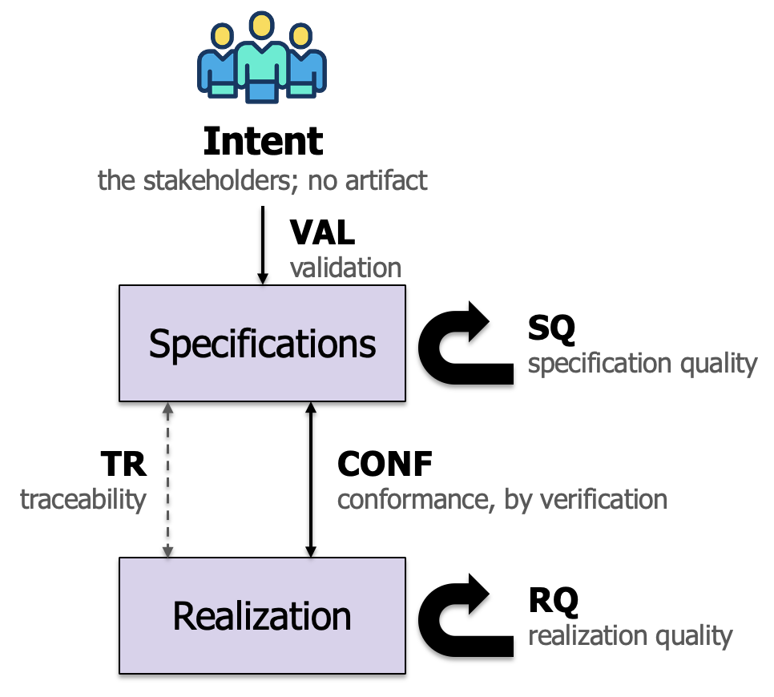

# Lecture 01 — Intent, Specifications, Realizations, and the Judgments That Connect Them

> Agentic software engineering principles module, meeting 1. Companion reading
> for the lecture; self-contained. The example is version A0 of the message
> guard, in `../demos/running-example-message-guard/v0/`; file paths below are
> relative to that directory unless they say otherwise. Vocabulary follows the
> course glossary, `../../glossary.md`. Launches **Exercise 1**.

## Purpose of this lecture

This lecture identifies basic entities of a managed software development process
and the relationships between them.  These concepts appear in some
form (not necessarily using the same terminology) in a number of
agent-oriented *spec-driven development* frameworks such as
[Spec Kit](https://speckit.org), [OpenSpec](https://openspec.dev), [AWS
Kiro](https://kiro.dev), and [BMAD](https://docs.bmad-method.org).
It's also possible to use these concepts independently of the frameworks above
just by configuring the agent-read markdown files for your harness
appropriately.  

*More generally, even though you may not apply a
rigorous spec-driven development approach in all situations (e.g.,
when doing rapid prototyping), it's worthwhile for every software
developer to understand these concepts.  Moreover, as a good engineer,
when you deliberately decide to reduce the rigor of your development in some way, you
should have clear justification for this in your mind and understand the
trade-offs.*

The lecture unfolds by considering three basic entities that a developer needs to
address in spec-driven development:

- the *intent* of the stakeholders, 
- the *specifications* that state what the system must do, and 
- the *realization*, the code and tests that are built to satisfy them.

Then the developer needs to consider the following properties and
relationships between the entities (we use the technical term
"judgments" for these):

 - the specifications are of good quality, 
 - the realization is of good quality, 
 - the realization conforms to the specifications, 
 - the specifications describe what the stakeholders intend, and 
 - every item in one artifact can be traced to the items in others 
   that it depends on. 

The entities and relationships, as we have described them, are very
abstract.  In the rest of this lecture series, we will make them more
concrete by considering various types of specifications, specific
quality rules that we want to enforce, etc.   

A process is *managed*, in the sense used here, when the entities above
are tracked in a source control system, and reviewed and updated in a
way that aims to maintain the judgments above and to understand when
a development step might cause a judgment to become false (triggering a need
for further actions to move the judgments back to a true state). 

All of these concepts reflect how we would like to be able to view a
"snapshot" of our development artifacts, e.g., at a particular commit
that closes out a set of tasks, is it the case that the relationships
above hold?  A companion set of key abstract concepts will be
introduced in later lectures to describe *evolution* of the 
development state in terms of work steps (also called work items or tasks),
grouping and parallelization of work steps, dependences between work
steps, allocation of work steps to different agents and humans, the
gating of work steps, etc.  

The term "assurance" is used in software and system development to
refer to the justified, evidence-based confidence that a product
functions as intended and remains resilient against failures, defects, or cyber
threats throughout its entire lifecycle.  While our focus is more
narrow here (we don't really address issues of cyber threats, resiliency,
etc.), we are interested in providing justified, evidence-based
confidence that our system functions as intended -- where the
intentions are expressed through specifications -- and that the 
development artifacts are of a quality that will reduce inadvertent
errors and help development carry forward successfully in the future.

Given this emphasis on understanding the truth status of the
judgments and being able to provide assurance, we will also aim for
our process to maintain what we call an "assurance ledger" (or just
"the ledger" below).
This is just a fancy way to describe a collection of 
carefully maintained data that help us understand 
the status of the five types of judgments above.  This will be 
augmented by a log of the work, and the reports each judgment produces.

Why bother with all of this?  With agentic development, producing code
and tests is no longer the bottleneck -- agents can do both very fast and
very well.  The challenge for developers now is *guiding* the agents
(e.g., through specifications and constraints on work steps), and
*understanding* the work the agents have accomplished (not necessarily
all the details of the work, but understanding if they achieved the
goals of development).

In short, there is a shift in where human effort goes as agents take over the
writing of code. Three stages of that shift are visible in the example and
in the rest of the course.

- *From engineering the code.* When an agent writes the code, the person no
  longer spends most of their effort on it, and for a system of any size they
  cannot read all of what the agent writes.  So what do they do? 
  We still need human effort for tasks that cannot be completely 
  replaced by agents. 
- *To engineering and managing the development and assurance context.* 
  Developers will increasingly spend their time designing the
  specifications that direct the agent work, the rules that say how it is checked,
  the verification methods and the evidence they produce, and the records of
  the current state. These are engineered artifacts in their own right. They
  have quality criteria, they can be wrong, and they are maintained over the
  life of the project.
- *To engineering layered, composable abstractions.* The development
  context is not a single specification or markdown file.
  Specifications can be long and detailed, and a developer who wants to
  understand the system should not have to start from the details.  We
  will see,
  especially for large-scale systems, that we need layered
  specifications, each a summary of the one below it: a
  concept of operations above the requirements, requirements above contracts
  and tests, contracts above the code; and above all of these, rules that say
  how each layer is checked against the next. The layering serves two readers
  at once. It gives an agent direction at the layer it works in, with the
  layers above as the standard its work is judged against. And it gives a
  person explainability: they can read the system at the layer they need,
  and trust the summary because conformance between layers is checked rather
  than assumed.

These concepts do not depend on the kind of system. A web service, an
embedded controller, a data pipeline, and a set of documents all have
stakeholders with intent, specifications that can be audited, realizations
that can be verified against them, and a state that can be recorded. What
varies between domains is which forms of specification are needed and which
verification methods are available, and the lectures that follow give the
details and the guidelines for choosing them. 

This lecture establishes the vocabulary and shows every concept on a
very small system that has all of them, so that each concept can be
illustrated with a concrete (though simple) development artifact.  We
will work through several versions (named A0, A1, A2, ...) that we build out over
time.  We start with A0 in this lecture.

### Learning objectives

By the end of this lecture, students should be able to:

- Name the three entities and the five judgments, define each in the sense
  the course glossary gives it, and point at the artifact in version A0 that
  holds or evidences each.
- Explain why human intent has no development artifact, but why we
  need to account for it explicitly in the development process. 
- Describe how specifications are often broken into small chunks called
  "clauses", and how clauses are best formatted to support the broader
  engineering effort.  This includes giving each clause a unique identifier
  and indicating its verification method and derivation. 
  Students should be able to distinguish clauses that can be evaluated
  mechanically from those that require human/agent judgment,
  and say why the distinction matters when an agent writes the code and the tests.
- State the five specification-quality properties and check a small
  specification against them by reading.
- Explain why a passing test suite is not by itself a verification, and name
  the four conditions of conformance in A0 together with the evidence for each.
- Say what validation asks, who can answer it, and construct a case in which
  every other judgment holds and validation fails.
- Read a ledger row as a claim supported by recorded evidence, and explain
  why a relevant change can make that evidence stale and require renewed checking.
- Explain what a gate is and why an algorithmic gate before each commit
  matters when an agent is the one committing.
- Read a development rule written in the template form and identify its
  decider, its evidence, and what happens on failure.
- Identify which elements of A0 can be set up directly in their own project
  and which need adaptation, as the section "Applying this to your own
  project" describes.

## The example: a message guard

Here is the story for our running example (found
[here](../demos/running-example-message-guard) in the course repo).

An organization keeps a protected enclave. The systems inside it produce
messages of differing sensitivity, and some of those messages need to reach a
less trusted network outside. The *message guard* (our running
example) sits on the boundary and decides, one message at a time, 
whether a message may leave. A message has two parts: a security
level, which is one of Public, Restricted, or Critical, and a payload,
which in this version is a single integer. In version A0 the guard has
one stage, called `filter`: a Critical message is dropped, and any other
message passes unchanged.

The example was chosen for three reasons. It is small: the file that does the
work in A0 is ten lines, and all the A0 artifacts can be read in
half an hour. Its shape is realistic:

- there is a system boundary, 
- a stakeholder who is responsible for setting the policy (expressing the
intent) for what messages get through the guard and inspecting that
the policy is enforced, 
- a stakeholder (a developer) who is responsible for implementing
the system, 
- a clear wrong outcome (a Critical message leaving) that matters. 

It is also easy to grow the system to illustrate additional concepts: 
later versions add a second stage that
changes payloads, a record of what was stopped, a change of policy, sessions
with an ordering protocol, and a standard message format.  Each
addition needs a kind of specification that is not needed in the
original version.  

Here is a summary of the artifacts that appear in A0.  

| Category | Files | Role |
|---|---|---|
| Intent | none | lives with the stakeholders; consulted through a person |
| Specifications | `specs/conops.md`, `specs/requirements.md` | what the system must do, as identified clauses |
| Realization | `guard/` (the code), `tests/` (the test suite) | what was built, and the executable claims about it |
| Development rules | `process/rules.md` | how each judgment is established and when it must hold |
| Reports | `reports/ledger.md`, `reports/dev-log.md`, `reports/walkthrough.md`, `reports/conformance.md` | the state of the development, readable without reading the code |
| Technology | `pyproject.toml`, `uv.lock` | Python 3.12 or later; `pytest`, `pytest-cov`, `ruff`; managed by `uv` |
| Support | `tools/gate.sh`, `tools/walk.py` | the gate command; a helper for walking through a scenario |

This lecture defines the entities in the first three rows and the five
judgments that relate them, points at the file in A0 that holds each, and
breaks two of the judgments to show which part of the repository notices.

## The A0 implementation, and why the code alone is not enough

Let's start by looking at the core of our system implementation -- the
code that actually decides whether messages should be passed or
dropped.  Here is the whole of `guard/filter.py`:

```python
"""The filter stage: pass or drop a message by its security level (REQ-1 to REQ-3)."""

from guard.message import Message, SecurityLevel


def filter_message(message: Message) -> Message | None:
    """Return the message unchanged if it may leave the enclave, or None if it is dropped."""
    if message.level is SecurityLevel.CRITICAL:
        return None  # REQ-1
    return message  # REQ-2, REQ-3
```

Is this code right? The question has no answer from the code alone, because
the code does not say three things. It does not say what was asked for: which
levels were meant to be stopped. It does not say what was promised: a statement
of the guard's behavior that someone responsible agreed to. And it does not
say whether the promise has been checked, by what, and when. 

This has always been true of code in critical systems, i.e., the
authority is the requirements document (the specification) not the
code.  This view now becomes relevant in even for non-critical systems 
when agents write code, for a practical reason: an agent produces code quickly and in volume,
and the person directing the work does not read all of it. For a system of
any size they cannot. What that person reads instead is the specification,
the evidence that the code conforms to it, and the record of whether that
evidence is current. When those three things exist and can be trusted, a
person can direct the work, review it, and take responsibility for a system
whose code they have not read line by line. When they do not exist, the
person is relying on the agent's own description of what it did, and an
agent's description is not trustworthy evidence about the
work. 

The purpose of this lecture is to illustrate an approach that lets
human developers keep confidence in the system, and keep guiding its
development, without writing or understanding all of the code.  The
extent to which developers want to embrace *all* of
what we are showing depends on the criticality of the system and the
amount of trust that developers are willing to put in the agents. 

## Three entities and five judgments



The figure above shows the arrangement. There are three entities.
*Intent* is what the stakeholders want; it has no file. The *specifications*
are the documents in `specs/`. The *realization* is the code in `guard/` and
the tests in `tests/`. Between and on these entities sit five judgments, each
a claim about the current artifacts whose truth is tracked from commit to
commit:

| Judgment | The question it answers | Established in A0 by | Evidence in A0 |
|---|---|---|---|
| **SQ**, specification quality | Are the specifications well-formed, unambiguous, consistent with themselves and with each other, and complete for their level? | a person reading the two specifications together (rule SQ-1) | the SQ row of `reports/ledger.md` |
| **RQ**, realization quality | Does the code lint, and does the test suite collect and follow the test discipline? | `ruff`; `pytest --collect-only` (RQ-1) | exit codes, recorded in `reports/dev-log.md` |
| **CONF**, conformance | Does the realization satisfy every clause of every specification? | the test suite, two coverage measures, and the walkthroughs (CONF-1, CONF-2) | `reports/conformance.md`; the coverage table; `reports/walkthrough.md` |
| **VAL**, validated | Do the specifications describe what the stakeholders intend? | a stakeholder of each user category signing the concept of operations (VAL-1) | the sign-off in `reports/walkthrough.md` |
| **TR**, traceable | Does every clause carry an identifier, and does every link between artifacts resolve? | the markers and the "derived from" fields, read by a program and a person (TR-1) | the "Unknown identifiers" section of `reports/conformance.md` |

Some additional terms are not directly reflected in the diagram. 
An **artifact** is anything under
version control that a judgment is about: a specification, the code, a rule
file, a report. The **development state** is the artifacts at a commit
together with the ledger. A **development-state judgment** is one of the five
claims above. The **ledger**, `reports/ledger.md`, is the table that states,
at a named commit, which judgments hold, on what evidence, and which have gone
stale.

Why five judgments rather than one judgment of "the system is good"? Because
they fail independently, and knowing which one failed tells you what to do.
The specifications can be sound and the code wrong (CONF fails, SQ holds).
The code can conform exactly to a specification that nobody wanted (CONF
holds, VAL fails). Every claim can be true and yet impossible to connect to
its evidence because an identifier was mistyped (TR fails). A single verdict
would hide the difference; five rows show it.

One remark for students who like formal models: the three entities, the four
judgments other than TR, and the rule that a change to an artifact invalidates
the judgments that depend on it are also the content of a small formal model
of development, written in Lean, that the course draws on. Nothing in this
lecture depends on it.

## Intent

Intent is what the stakeholders have in mind for the system. It lives in their
minds and is never fully written down, for the ordinary reason that a person
cannot enumerate everything they expect from a system of any size, and would not
recognize some of what they want until they saw a system that lacked it. The
only way to consult intent is to ask a person: "is what is written
down (e.g., in the specification) what you want?", or "when we run the
system, does this behavior match what you expected?".

A0 therefore has no file called intent.  However, it illustrates the
outcomes of steps that we take to try to summarize the shared
understanding that the stakeholders currently have about the system.
This shows up first in a specification document that is commonly
called a "Concept of Operations" (ConOps). "Concept" indicates that the
specification is high-level -- it focuses on the overall concept and
idea, not the details.  The "Operations" indicates that it describes
how the system operates as a "black box" within a larger context that
includes human users, other systems, and sometimes physical entities.
The description is given primarily in the form of what are called "user
stories" or "operational scenarios".  The following lecture will 
address the elements of a ConOps specification in greater detail.

A ConOps opens with a **purpose statement**. Here is the one in `specs/conops.md`:

> An organization keeps a protected enclave whose systems produce messages of
> differing sensitivity, and it needs some of those messages to reach a less
> trusted network outside the enclave. The message guard sits on that boundary
> and decides, one message at a time, whether a message may leave. Nothing
> leaves the enclave except through the guard.

The purpose statement, like the rest of the ConOps, is an engineering
artifact: text that the stakeholders revised until they agreed with it,
and that is audited like the rest of the document. It is not a transcript of what anyone said. The
distinction matters because the two are treated differently: the purpose
statement is a clause that other clauses derive from and that can be checked
for consistency; a transcript or other ad hoc information is reference
material that informs the writing but is not itself checked.

The practical consequence for agentic development is that an agent has no
access to human intent except through a person. An agent can read every file in the
repository and still not know that the security officer meant something (what
they had in their head) other than what the specification says. 
That is why one of the five
judgments, validation, is reserved to a person, and why the course keeps
intent out of the diagram's set of artifacts rather than pretending a file
could stand in for it.

How the purpose statement and the stories may be obtained from the stakeholders
is the subject of the next lecture, which introduces elicitation
(interviews and other ways of gathering the informal information that
shapes the high-level specifications) on version A1.   To keep the focus 
on the entities themselves (rather than how they were obtained), in A0 
they are provided as an artifact already agreed on by the stakeholders.

## Specification

A **specification** is a document that states, at a higher level than the
artifact it governs, what the system must do. It fixes some properties and
deliberately omits others; the omissions leave the realization
unconstrained where the stakeholders do not care to force a
choice.  There are many different forms of specifications.  Regardless
of the form, we try to identify discrete units with unique identifiers
so that other artifacts (e.g., other specs, requirements, tests,
reports) can cite them and establish cross-referencing and dependences.

A0 has two specifications. `specs/conops.md`, the **concept of
operations** (already discussed above), 
has five sections: the purpose statement; the scope and system boundary, with
a list of terms; the user categories; the user stories; and a pointer to the
sign-off. `specs/requirements.md` has four requirements. Together they are a
*family*: two documents of different kinds that govern one system and must
agree with each other.

The unit of a text-based specification is the **clause**. Here is one
from each file, as it appears:

> **US-1** · Method: walkthrough (human) · User category: message sender
>
> As a message sender, when I send a Public message, I expect it to arrive
> outside the enclave unchanged.
>
> Example: the guard is given a message with level Public and payload 42; it
> outputs a message with level Public and payload 42.

> **REQ-1** · Method: test · Derived from: US-3
>
> The filter drops every message whose security level is Critical: for such a
> message it produces no output.

Every clause carries an **identifier** and a **verification method**, and
every requirement carries the clause it **derives from**. Each of the three
has a job.

The identifier is what a report cites. A person, an agent, and a program can
each check REQ-1 and say so, and because they all name the same clause their
reports can be compared. Without identifiers a finding is "the thing about
Critical messages", which two readers may locate differently and an
audit tool program cannot locate at all.

The method says how the clause is verified and therefore who can verify it.
In A0 two methods are in use. A clause marked *test* is decided by a program:
a test in the suite cites it and either passes or fails. A clause marked
*walkthrough* is decided by a person, who exercises the system along the
scenario and judges what they observe. The course calls a clause
**mechanical** when a program can decide it and a **judgment clause** when it
needs a reader; in A0 the four requirements are mechanical and the three
stories are judgment clauses. The method is recorded on the clause, rather
than in the verifier's head, because the choice has consequences that others
need to see. A mechanical clause can be checked at every commit by a program
that nobody has to remember to run. A judgment clause costs a person's
attention every time it is checked. When an agent is writing the code and the
tests, one wants as many clauses as possible to be mechanically checkable, and the method
field is where that pressure is recorded and where a clause that cannot be
made mechanical is marked as such rather than silently left unchecked. Later
versions add two more methods, *analysis* for properties a program
(e.g., a static analysis tool)decides by examining the artifact
rather than running it, and *review* for properties a reader decides from the text.

The "derived from" field links a requirement to the story or term it refines.
It is what makes the two documents a family rather than two files that happen
to be in the same directory: every requirement can be followed back to
something a stakeholder said they wanted, and every story can be followed
forward to the requirements that make it precise.

Notice also what the specifications leave open. They say nothing about how a
message reaches the guard, how its level was assigned, or what happens to a
dropped message. Those are outside the system boundary stated in section 2 of
the concept of operations, and they are therefore not the responsibility
of *this system*. The realization is unconstrained outside the
boundary of the system.  A later version of the system will add a
record of dropped messages, and new clauses will be added to address
that feature.

Note that sometimes we do need to state where are called "context
assumptions" or "environmental assumptions".  These are properties of
the environment that we expect to be true when the system is deployed
in that context.  However, establishing that those assumptions hold
when the system is deployed is the responsibility of deploying
organization (the organization integrating the system into the
context).  It is not the responsibility of the organization developing
the system.  In fact, the developing organization typically doesn't
even know all the possible contexts into which the system will be
deployed.  We do not address the notion of context assumptions in this
overview. 

## Specification quality

A specification can be wrong in ways that have nothing to do with the code.
Two of its clauses can contradict each other, so that no realization could
satisfy both (for example, one clause could imply that a message is
dropped where another could imply that the same message is passed). 
A clause can admit two readings, so that two verifiers would
reach different verdicts on the same code. A clause can be missing, so that a
whole behavior is unconstrained. Checking code against a specification with
one of these defects gives a confident answer to the wrong question. The
situation is worse with an agent than with a human developer.  Human
developers often have some underlying intuition to help them "recover
the true meaning" from bad requirements, but an agent forms some very
literal interpretation of what the text says, at speed, 
and will produce a passing test suite for either reading of an ambiguous clause.

The course names five properties of a good specification. Each is stated
here with the place in A0 where it can be checked.

- **Well-formed.** Every clause has an identifier and a method, in a form a
  program can read. In A0 the form is the header line `**REQ-1** · Method:
  test`, and the program that writes the conformance report reads exactly that
  line to learn which clauses exist.
- **Unambiguous.** Each clause has one reading, so that a verifier reaches a
  yes-or-no verdict. REQ-1 says what "drops" means in the same sentence: "it
  produces no output". Consider REQ-2 in class: it says a Restricted message
  passes "unchanged", and the test decides that with `filter_message(message)
  == message`, equality of level and payload. Is that the only reading? A
  reader who thinks of identity rather than equality, or of a message with
  more fields than two, has a different one. A0's answer is that the term
  *pass* in the concept of operations defines "unchanged" and that the message
  has exactly two fields; whether that is enough is the kind of question the
  next lecture's audit is built to ask.
- **Internally consistent.** No two clauses contradict. REQ-1 to REQ-3 assign
  each of the three levels one outcome and do not overlap. A requirement that
  "every message is passed" would contradict REQ-1, and no realization could
  satisfy the document.
- **Externally consistent.** The documents of the family agree. Every
  requirement derives from a story or from the terms; the words Public,
  Restricted, Critical, pass, and drop are used in the same sense in both
  files; nothing in the requirements promises a behavior that a story
  contradicts.
- **Complete for its level.** Completeness is relative to the abstraction the
  specification has chosen. The concept of operations says nothing about
  transport, and that is not incompleteness; the boundary excludes it. But
  there are three levels and three requirements that say what happens to each,
  and if there were a fourth level with no requirement, the document would be
  incomplete at its own level.

Further properties may be appropriate for particular specifications.
The five above were chosen because they are general enough to apply to
almost any specification. 

In A0 the SQ judgment is established in the simplest way: rule SQ-1 requires
the properties, and a person read the seven clauses together and recorded the
reading in the ledger. The ledger row says who read them and which clauses,
which is the pattern every row follows. The next lecture replaces the reading
with an audit: a procedure, run by a person and then by an agent, over a
specification that has gaps placed in it on purpose, and it introduces the
form in which gaps are reported and ruled on. That is the deep treatment of
specification quality; this lecture establishes only what the judgment asks.

A sixth property, traceability, is sometimes listed with these five. The
course tracks it as its own judgment, TR, because a program can check it
directly, and it is treated below.

## Realization

A **realization** is an artifact built to satisfy a specification. When the
artifact is code the usual word is implementation; the general term is used
because a test suite, a document, or a configuration can each be built to
satisfy a specification.

There may be many possible realizations of the same specification. 
A different program in a different language that drops Critical messages and
passes the rest would be another realization of the same two specifications.

A0's realization can be found in `guard/` and `tests/`. The code in
`guard/` consists of two modules. `guard/message.py` defines the
security level as an enumeration with exactly three members and the 
message as a frozen dataclass, and it rejects a message
whose level is not a `SecurityLevel` or whose payload is not an integer;
that is REQ-0 made concrete. `guard/filter.py` is the function shown at the
start of the lecture.

Though it is often considered part of the realization because it is
code and it must be aligned with specification documents like ConOps
and Requirements, the test suite can also be viewed as a
specification: it is an **executable specification**, in which each
test is a claim the output(s) that may be produced when the system is
given specific input(s).  Moreover, to provide evidence of conformance
to the higher-level specification, one choses input output pairs that 
address behaviors described by specific specification clauses.  To
make the association of a test to one or more specification clauses
clear, the test documentation and or meta-data cites the associated
clause identifier(s). Here is `tests/test_filter.py`:

```python
import pytest

from guard import Message, SecurityLevel, filter_message


@pytest.mark.req("REQ-1")
@pytest.mark.parametrize("payload", [0, 100, -5])
def test_critical_is_dropped(payload):
    assert filter_message(Message(SecurityLevel.CRITICAL, payload)) is None


@pytest.mark.req("REQ-2")
def test_restricted_passes_unchanged():
    message = Message(SecurityLevel.RESTRICTED, 7)
    assert filter_message(message) == message


@pytest.mark.req("REQ-3")
def test_public_passes_unchanged():
    message = Message(SecurityLevel.PUBLIC, 42)
    assert filter_message(message) == message
```

The marker `@pytest.mark.req("REQ-1")` is an example of a citation
(and a part of the broader traceability framework -- it enables a test
to be traced back to a clause (and vice versa)).  The citation serves three
"readers". A program that implements an traceability tool can compute, 
from the markers, which clauses have tests and which do not. 
A person who sees this test fail knows which clause is in
question without reading the test body. And an agent that writes a test *should*
say which clause the test is evidence for, which rules out the common failure
of a test that exercises the code without claiming anything about it.
A0's rules do allow a test that has no cited clause.  
developer may find it useful to have a
test that doesn't directly match a written requirement.   Note that
this may mean that the system is constrained in some way that is not
explicitly acknowledged -- which could be OK or undesirable depending
on how rigorous you want to be.  In critical systems, this may be
undesirable -- it could indicate that there is an implicit requirement
that is not being acknowledged and utilized in other aspects of
development and auditing.  Or it could indicate the system's behavior
is specialized in ways that it shouldn't be -- making it less
re-usable in other contexts that didn't want and didn't know about
that restriction.  This is why many development regimes for critical
systems require each test to be associated with a specification
clause.

There is another subtlety regarding the actual semantic alignment of the
cited clause and test: just because the test cites a clause doesn't
guarantee that the actual test implementation itself (i.e., the assertion in the
test, the comparison to an expected result, or even the test input) 
has a meaning that is related the meaning of the clause.
It is possible that the test body itself is written incorrectly.
In short, a citation only declares *intended* support for a clause. 
Checking true **semantic alignment** between tests and
cited natural language requirements clauses is a challenging problem.
One can get approximate assessments of semantic alignment via human or
agentic review (sometimes supported by formal methods tools).  
For simplicity, the assurance framework in this lecture and in the A0
example will focus only on establishing appropriate
citations/traceability; however, we must keep in mind that this
semantic alignment gap exists in our assurance arguments.

To summary A0's testing rules, every clause assigned "verification by
test" must be cited by at least
one test, and every test citing that clause must pass for its test
evidence to be accepted. Tests may have no clause citations. Every
supplied citation must identify a clause defined in the
specifications. A valid citation declares an intended evidence
relationship; it does not establish that the test adequately checks
the clause.

**Realization quality** is the judgment that the realization is in a state
where it can be checked at all. In A0 it has two parts, both decided by
programs: `ruff check` finds a class of mistakes (unused names, undefined
names, syntax that will not run) more cheaply than any test would, and
`pytest --collect-only` confirms that every test file imports and every
marker is declared. Rule RQ-1 names both commands. The suite is also held to a
test discipline, stated in the course's development rules: a test must be
able to fail, must assert no more loosely than the clause it cites, and must
set up its inputs by construction rather than by reaching into the code's
internals. Those three are reviewed rather than computed in A0.

Realization quality is kept separate from conformance for a reason that
becomes visible on the ledger. A suite that does not compile produces no
conformance evidence at all; a module with an undefined name may pass every
test that does not reach the name. Checking the realization's own soundness
first means that a conformance result, when it comes, is a result about code
that is at least runnable and a suite that at least ran.

## Conformance and verification

**Conformance** is the relationship between a specification S and a
realization R that holds when R satisfies every property S states. It is a
yes-or-no question about the pair.  Properties S does not state are not
part of the conformance check. 
**Verification** is the activity of trying to confirm that the
relationship holds. The word *trying* is deliberate.  Verification
may initially fail.  Later, when the relationship is found to hold, 
the realization is said to be **verified** (more precisely, to be
**verified against S** or to **conform to S**).  It's also important
to note some *versioning/scoping* issues -- and we need to be precise 
about these.  We need to be able to say which version of the verifier
produced the result, against which version of the specification, over which clauses. Within
that scope it can be trusted; outside it, it says nothing; and, as a later
lecture will take up, even within it the verifier can be wrong.

In A0, conformance is not one thing but four, and the reason is the central
technical point of this lecture. A passing test suite, on its own,
establishes only that the suite's own tests hold -- it doesn't
indicate if the tests are relevant to specs, explore enough of the
code, etc.  Typically, when a human developer writes tests, the 
human forms an understanding of the constraints/properties they are
trying to enforce on the code.  Thus, even if the human does not understand
every last detail of the code, they at least understand
their tests.  When an agent has written both the code and the tests,
the human loses this avenue to understanding the system, and a green
suite can mislead in three ways. The
suite may contain no test for some clause, in which case the clause is
unverified and the green run says nothing about it. The tests may exercise
only part of the code, in which case the untested part may do anything. And
the clauses that no test can decide, the stories, may simply have been
skipped.  When any of these happens, the green suite gives confidence that
nothing has earned.  For these reasons,
an agent development process needs to include steps that might previously
have been considered "extra and unnecessary overhead" that was "only needed
for critical systems".  This is an example of where one can *benefit*
from the increased capacity of agents to produce code and tests but
where one must *pay* with effort redirected to rules, traceability, and
tooling that check what the agents are doing.  

To account for the fact that verification is not just "the tests
pass", abstractly, the CONF judgment for requirements-like
specifications checked via testing actually has four conditions that
all must hold, each with its own evidence:

1. **Every test passes.** The run itself.
2. **Requirements coverage.** Every clause whose method is *test* is cited by
   at least one passing test. The program that writes `reports/conformance.md`
   reads the clause identifiers from the specifications, collects the markers
   from the suite, and produces one row per clause:

   | Clause | Specification | Method | Tests citing it | Status |
   |---|---|---|---|---|
   | US-1 | `conops.md` | walkthrough | — | walkthrough: see `reports/walkthrough.md` |
   | US-2 | `conops.md` | walkthrough | — | walkthrough: see `reports/walkthrough.md` |
   | US-3 | `conops.md` | walkthrough | — | walkthrough: see `reports/walkthrough.md` |
   | REQ-0 | `requirements.md` | test | five tests in `test_message.py` | pass |
   | REQ-1 | `requirements.md` | test | `test_filter.py::test_critical_is_dropped[0]`, `[100]`, `[-5]` | pass |
   | REQ-2 | `requirements.md` | test | `test_filter.py::test_restricted_passes_unchanged` | pass |
   | REQ-3 | `requirements.md` | test | `test_filter.py::test_public_passes_unchanged` | pass |

   A clause with no citing test would show **no evidence**, and the run would
   fail. This is a coverage measure over the specification, in the same way
   that the next condition is a coverage measure over the code.
3. **Structural coverage.** The suite exercises every branch of `guard/`.
   `pytest-cov` measures it and fails the run below 100 percent:

   ```
   Name                Stmts   Miss Branch BrPart  Cover
   ---------------------------------------------------------------
   guard/__init__.py       3      0      0      0   100%
   guard/filter.py         5      0      2      0   100%
   guard/message.py       13      0      4      0   100%
   ---------------------------------------------------------------
   TOTAL                  21      0      6      0   100%
   ```

   Branch coverage is not a strong property. It says every branch was taken
   by some test, not that the test checked anything useful on that path. But
   a branch that no test took is a place where the code can do anything
   without the suite noticing, and the measure finds those places cheaply.
4. **Every judgment clause has been walked.** The three stories cannot be
   decided by a test in this version. Each was exercised by a person, in the
   role the story names, and the record is a table in `reports/walkthrough.md`:

   | Clause | Role | Command | Observed | Finding |
   |---|---|---|---|---|
   | US-1 | message sender | `tools/walk.py Public 42` | `pass: Public 42` | as the story expects |
   | US-2 | message sender | `tools/walk.py Restricted 7` | `pass: Restricted 7` | as the story expects |
   | US-3 | security officer | `tools/walk.py Critical 100`, then `Critical 0` | `drop`, both times | as the story expects |

The first three conditions are decided by one command, `tools/gate.sh`,
which runs `ruff` and then `pytest`. Its output at v0 ends:

```
conformance: every test clause has passing evidence; report in reports/conformance.md
...
Required test coverage of 100% reached. Total coverage: 100.00%
============================== 10 passed in 0.03s ==============================
```

Rules CONF-1 and CONF-2 state the four conditions; the CONF row of the ledger
cites all four pieces of evidence.

As noted earlier, the regime with its four conditions 
above still doesn't address the issue of
semantic alignment between a test and its cited clauses.  So even when
the above conditions hold, the semantic alignment gap may lead to 
situations where code mismatches with specifications are not detected.
However, the regime does gives us a method for obtaining greater confidence.

Asking who decided each condition above introduces a distinction the course will
use repeatedly. The first three were decided by programs: `pytest`, the
report-writing plugin, `pytest-cov`. The fourth was decided by a person. The
course names three kinds of **verifier**. A *human verifier* reads the
specification and the realization and works through the clauses; it can
decide any clause, including a judgment clause, and it is slow and only as
reliable as its attention. An *agent verifier* is asked to check and report;
it can also decide judgment clauses, costs tokens, and may give different
results on two runs. An *algorithmic verifier* is a program; it is
deterministic, immediate, and free to run, but it decides only mechanical clauses.
A0 uses the first and the third. The second enters in A1, when an agent is asked
to audit the specification, and the question of how a check moves from a
person to an agent to a program is a thread through the whole module.

Finally, what a green CONF does not establish. It does not establish that
the clauses are the right clauses; that is validation. And it does not
establish that the verifiers are correct: a test can assert the wrong
thing (the semantic alignment problem), a plugin can misread a marker, 
a coverage tool can be misconfigured, and even obtaining 100% branch
coverage doesn't mean that the test suite has explored all possible
execution behaviors of the system.  *Thus, each method discussed so
far has a failure mode*, and compentent engineer needs to understand
the possible failure modes to how to effectively construct an
assurance approach that gives appropriate effectiveness/cost
tradeoffs.  The ledger records which verifier produced each piece of evidence partly so that,
when a verifier is later found to be wrong (a failure mode is
exhibited), the claims it made can be found and re-examined.
In short, passing the prescribed verification checks establishes a 
**fallible, scoped conformance claim**, not proof of correctness.
That is as far as this lecture takes the point.  This issue 
of the "trustworthiness of a verifier" is generally considered as
part of the more technically challenging concept of an assurance case.

## Validation

**Validation** is the question whether the specifications describe what the
stakeholders intend. It differs from verification in what it compares.
Verification compares two artifacts, a specification and a realization, both
of which are in the repository. Validation compares an artifact (or
the behavior of a running system in some context) with what is
in a person's mind, which is not in the repository. 
So validation can only be decided by a
person, and the decision is recorded as a **sign-off**. A0's is in
`reports/walkthrough.md`:

> "The concept of operations, version A0, describes the guard I intend: a
> Critical message never leaves, and anything else leaves as it arrived."
>
> Security officer: role played by the instructor, 2026-10-20, on
> `specs/conops.md` version A0. Message sender: role played by the instructor,
> 2026-10-20, on `specs/conops.md` version A0.

The sign-off names who signed, in which role, when, and which version of
which document. Rule VAL-1 requires one from each user category.

The walkthrough table shown above does double duty, and the two duties should
be kept apart in thought even though one activity serves both. When the
security officer walks US-3 and sees `drop`, two questions are answered at
once: does the system behave as the story says (a conformance question about
a judgment clause), and is the story what the officer wants (a validation
question). A different officer, walking the same story and seeing the same
output, might answer the first question yes and the second no, and that is
exactly the case the next paragraph constructs.

Suppose the security officer had meant that Restricted messages must be
stopped as well, and that the person who wrote the concept of operations had
not understood this. Look at the repository. The two specifications are
consistent with each other: US-2 says a Restricted message arrives unchanged
and REQ-2 agrees. Every requirement has a passing test. Branch coverage is
complete. Every identifier resolves. Four of the five ledger rows are
established on sound evidence, and the fifth will be too if the officer signs
without reading. Nothing in the repository can detect that the system is
wrong, because every artifact in the repository was derived from the same
misunderstanding. The only thing that catches it is the officer walking US-2,
seeing `pass: Restricted 7`, and saying that this is not what they want, or
reading the concept of operations and declining to sign. This is why
validation is a separate judgment with a separate row, and why the row's
evidence is a person's recorded decision rather than a tool's output.

The point has particular force with agents. An agent given a specification
will realize that specification, and a well-run process will produce a green
ledger for it. If the specification describes the wrong system, the agent
has built the wrong system correctly, and the process has certified that.
The sign-off is the one place where the process asks a person whether the
system being certified is the one they wanted.

One more consequence, which later versions develop: the VAL row can go stale
when no file has changed. If the officer changes their mind, the
specification no longer describes what they intend, and the process learns of
it only when they say so. Version A3 records such a declaration as a change
request and shows the row turning stale while every other row stays green.

## Traceability

**Traceability** is the set of links between identified items in different
artifacts, and the TR judgment is that every link resolves. In A0 the links
run in a chain: a story in the concept of operations, to the requirements that
derive from it, to the tests that cite them by marker, to the rows of the
conformance report, to the CONF row of the ledger that cites the report. Rule
TR-1 requires that every marker name a clause the specifications define and
that every "derived from" name a clause that exists. The first part is
decided by the report-writing program, which lists any marker it cannot
resolve under "Unknown identifiers" and fails the run; `pytest` itself is
configured with `--strict-markers`, so a marker that was never declared is
rejected before any test runs. The second part is read by a person as part of
SQ-1.

Traceability is given its own row for two reasons. It can be decided by a
utility program, so it is cheap to keep established. And the other four rows depend on
it clause by clause: a conformance report is only readable if its identifiers
resolve, and an audit finding is only actionable if it names a clause. In
agentic development the identifiers are the vocabulary shared by the person,
the agent, and the programs. When all three say REQ-1 they mean the same
sentence, and a report from any of them can be checked against a report from
any other.

## The ledger

`reports/ledger.md` is the table of the five judgments at a named commit.
The CONF row at v0, condensed:

| Judgment | Status | Evidence | Provenance | Goes stale when |
|---|---|---|---|---|
| CONF | established | tests: 10 passed; requirements coverage 4 of 4 test clauses; branch coverage 100 percent of `guard/`; US-1 to US-3 walked | tests: pytest 9.1.1; coverage and citation analysis: pytest-cov 7.1.0 and the plugin in `tests/conftest.py`, specifications and realization at v0, clauses REQ-0 to REQ-3; walkthrough (human): the instructor as sender and as security officer, 2026-10-20, clauses US-1 to US-3 | relevant specifications, code, tests, or verification tools/configuration/environment change |

A row has four parts, and each is there for a reason.

The **status** tells us whether we currently have the evidence required to
support the claim. A judgment is *established* when the required checks and
reviews have succeeded and their evidence has been recorded. It becomes
*stale* when a relevant change means that the earlier evidence is no longer
sufficient for the current development state. Stale does not mean the system
is wrong; it means the claim needs renewed checking. A judgment may also be
*not established* because the checking has not yet been completed or has found
a problem; the record should explain which.

For this lecture, the important idea is simple: evidence has a scope and a
lifetime. Changes to specifications, code, tests, or the checking tools can
require renewed evidence. Later versions develop the rules for deciding what
must be checked again.

For an optional worked example, see [How a ledger evolves during
development](ledger-evolution-example.md), which follows evidence being
established, becoming stale, and being renewed.

The **evidence** is what was produced: a report, a run, a record. It is named
precisely enough to be found.

The **provenance** says who or what produced the evidence, against which
versions of which artifacts, over which clauses. These are the three scope
lines of a verification result from earlier in the lecture, moved onto the
row. They are there because a row is a claim made by a verifier, not a fact
about the system, and a claim can be wrong. If the plugin that writes the
conformance report is later found to misread a marker, the rows whose
provenance names the plugin are the rows to distrust. And the provenance is
what distinguishes evidence from a description of evidence: "pytest 9.1.1
exited 0 at v0" is a claim that can be rerun; "all tests pass" in an agent's
completion message is not. A0's rule RPT-1 requires the provenance on every
row for this reason.

A ledger with all five rows established is what the course means by a green
development state. It is not a proof. It is five claims, each with named
evidence and a named scope, which is what a person who has not read the code
can examine and, if they choose, rerun.

## The gate

Rule WF-1 says that before work is committed, the command `tools/gate.sh`
must exit 0. The command runs `ruff`, then `pytest` with the coverage
requirement and the report-writing plugin, so it decides RQ and the three
mechanical conditions of CONF in one step. A **gate** is a condition placed in
front of a step so that the step cannot complete unless the condition holds.
This one is an *algorithmic* gate: a program decides, and the decision is an
exit code. The course also names *approval* gates, where the condition is a
recorded human decision; A0's sign-off is a human decision but does not stand
in front of a commit, and the first approval gate in that position arrives
with the build plan in version A2.

The reason to have a gate at all, rather than a rule that says to run the
checks, is that an agent commits often and a rule that depends on someone
remembering is a rule that will be skipped. A gate makes the checks a
property of every commit, which is to say an invariant: at every commit in
the history, the gate passed.

## Breaking it: conformance

The A0 demos deliberately introduce problems to show what different checks
can—and cannot—detect. A change can affect more than one judgment; these
examples emphasize the particular problem each demonstration reveals. Two
are discussed in this lecture, and the README lists three more for the
lecture on testing.

The first is a wrong realization. In `guard/filter.py`, change
`SecurityLevel.CRITICAL` to `SecurityLevel.RESTRICTED`, so that Critical
messages pass and Restricted ones are dropped. Run the gate:

```
conformance: REQ-1: FAIL
conformance: REQ-2: FAIL
conformance: FAIL, see reports/conformance.md
...
4 failed, 6 passed in 0.05s
```

Four tests fail: the three parametrized cases for REQ-1 and the one for REQ-2.
The conformance report shows those two clauses as **FAIL** and the other two
as pass. Branch coverage is still 100 percent, which is worth pointing out:
coverage is a property of which code ran, not of whether it was right. The
tests expose a conformance failure: the changed implementation does not
satisfy REQ-1 and REQ-2. Changing the code requires renewed evidence for
claims that depend on it. Here, the rerun still passes lint and collection
and finds no broken clause citations, but the behavioral tests fail. The
specifications and stakeholder agreement have not changed.

In A0, these commands update the conformance report, not the handwritten
ledger. A ledger entry for the changed state would record that CONF is not
established and point to the failing results. Restoring the code and
rerunning the gate makes the automated checks pass again.

A failed check signals a discrepancy or an unmet evidence obligation. We
investigate the specification, implementation, and checking machinery to
determine the cause. In this demonstration, the deliberate code edit caused
the failure, so we restore the code. Other failures can require correcting
the specification, the tests, or the checking setup. The decision and its
rationale belong in the development record.

The second sabotage, validation, was described above and has no command to
run, which is its point.

## The development rules

Everything above is governed by `process/rules.md`, which holds eight rules:
one for each of the five judgments, with CONF having two, plus one for the
workflow (the gate) and one for reports (the dev log and the ledger). Each is
filed under the judgment it maintains and has the same fields. Here is CONF-1:

| Field | |
|---|---|
| Style | obligation |
| Maintains | CONF |
| When | at every commit; applies to every clause whose method is *test* |
| Statement | Every clause with method *test* MUST be cited, by marker, by at least one test; every citing test MUST pass; and the suite MUST reach 100 percent branch coverage of `guard/`. |
| Decided by | analysis: `uv run pytest`. The plugin in `tests/conftest.py` fails the run on a clause with no evidence or with a failing citation; `pytest-cov` fails it below 100 percent. |
| Evidence | `reports/conformance.md`; the coverage table in the run output, recorded in the dev log |
| On failure | a test is added or fixed, or the code is fixed; a clause is never weakened to make the run pass |
| Example | REQ-1 is cited by `test_filter.py::test_critical_is_dropped` |

Two of the fields deserve attention now. *Decided by* names the verifier, so
that a rule is something that can actually be checked rather than a statement
of good intentions; a rule with no decider cannot be followed by a program and
is easy for a person to believe they are following. *On failure* says what
happens, so that a red result has a next step. The rules in A0 come in two
styles: an **obligation**, "every X must have property P", and a **gate**,
"when step S would complete, condition C must hold". Later versions add
further styles as the process grows.

The rules are a file in the repository, rather than a convention, because the
agent reads the file. An agent started in this directory is told, through
the project's instructions, to read `process/rules.md`, and from that point
the person and the agent are following the same written process. When the
agent adds a test it cites a clause because CONF-1 says so; when it finishes
a task it records the gate result because RPT-1 says so. A process that lives
in a person's habits cannot be followed by an agent, and a process that lives
in the agent's prompt cannot be audited by a person; a process that is a file
can be both followed and audited.

The remaining report, `reports/dev-log.md`, is the append-only record of what
each task did: the files it touched, the judgments it affected, and the gate
result. A0's has three entries, for writing the specifications, realizing them
with tests, and walking the stories and writing the ledger. It is the record a
person reads to learn what happened, as the ledger is the record they read to
learn where things stand.

One observation about where effort goes. In A0 the code is under thirty lines.
The specifications, rules, and reports are more than three hundred. That ratio is not
just a property of this small example; it reflects a shift in what a person does
when an agent writes the code. The person's effort goes into saying what is
wanted, deciding how it will be checked, and reading the evidence, because
those are the parts an agent cannot do alone and the parts that make the
agent's output something a person can stand behind.  Of course, for
this tiny example, the effort hardly seems worth it.  The point is
that this approach will pay off (a) as systems scale, (b) as they use
technologies that developers may not be expert in, (c) as the size of
the human and agent team grows, and (d) as we need more confidence in the
development outcomes.

In class, the lecture may close with one demonstration: an agent started in
the A0 directory is asked what the system does and how it is known that the
code does it. The useful thing to watch is where the agent looks. An answer
drawn from `specs/`, `reports/conformance.md`, and `reports/ledger.md` is an
answer a person could check; an answer drawn from reading `guard/filter.py`
is the agent's opinion of the code.

## What is not here yet

Version A1 keeps the same system and improves the specifications. It shows
how the purpose statement and the stories are obtained from stakeholders
(elicitation) with the help of agents, 
adds a glossary of the domain's terms as a specification of
its own, rewrites the requirements in a structured natural-language form,
derives fixtures from the stories so that a story can be checked by a test as
well as by a walkthrough, and replaces the reading of the specifications with
an audit that finds gaps placed in the specification on purpose, first by a
person, then by an agent, then as a packaged skill. The next two lectures
cover that material.

Version A2 adds the second stage, `sanitize`, and with it the first
specifications of structure: an architecture with two stages in a fixed
order, a definition of the message's format, and contracts between the stages.
The work is large enough to need a plan with tasks and waves, and the ledger
is generated by a tool rather than written by hand. Later versions add a
change of policy, sessions with an ordering protocol, and a standard message
format, each bringing the kind of specification it needs.

## Applying this to your own project

The example is small and the lecture concepts are abstract, but most of what the example shows
can be set up in a project of any kind on the first day, and it is worth
being explicit about which parts carry over as they are and which parts you
will have to adapt.

**What carries over directly.**

- *The entities and the judgments.* Every project has stakeholders with
  intent, specifications of some kind, and a realization, and the five
  questions can be asked of any of them. Start a ledger (or some simpler
  form of reporting) on the first day, by hand, 
  with five rows; most will say "not established", and that is
  information.
- *A concept of operations.* You can always begin by working with the people
  on your team, and with an agent, to write a concept of operations that has
  the four elements shown here: a purpose statement that the stakeholders
  agree to, a scope with the system boundary and the terms, the user
  categories, and user stories with concrete examples. Agree on it before code
  is written. It is the document that the validation sign-off will be given
  on, and it is the first thing an agent should read.  Note that user
  stories have long been a foundational element of agile development
  and have proven useful in many development styles.
  They are not something that we made up, or something burdensome that
  is arbitrarily being imposed on you.
- *A requirements document.* You can always have one, and its clauses can
  always carry an identifier, a verification method, and the story or term
  each derives from. The method field is the one most often left out and the
  one that pays back soonest, because it decides which clauses a program can
  check at every commit.
- *A statement of the technology.* Agents and auditors both need what
  `pyproject.toml` provides here: the language and version, the tools and
  their versions, and the one command that is the gate. Write it down even
  when it seems obvious.
- *Tests that cite clauses, and the two coverages.* As you build a test
  suite, the question is not only whether the tests run and pass but whether
  the suite supports a verification: does every mechanical clause have a
  test, is every part of the code exercised, and is there a record for the
  clauses a test cannot decide. Those three questions can be asked of any
  suite in any language, and the first two can be answered by a program once
  the tests cite clauses.
- *A rules file.* The template fields, in particular the decider, the
  evidence, and what happens on failure, apply to any rule about any process.
  Start with one gate and the ledger, and add a rule the second time you find
  yourself doing a check by hand.
- *A sign-off, and provenance on every claim.* Find the person who can say
  whether the system is the one they wanted, and get their decision on
  record, named and dated. Record who or what produced every piece of
  evidence and against which version.

**What you will need to adapt.**

- *The forms of specification.* A0 needs two. A system with several
  components needs an architecture; one that stores or exchanges data needs a
  data format; one with modes or a protocol needs a state machine; one with
  an API needs interface contracts. The course's catalog of specification
  kinds, `../../specification-kinds.md`, is the list to think through for your
  system, and later lectures introduce each form with the version of the
  example that first needs it.
- *The verification methods.* A0 uses two, test and walkthrough. Your system
  will likely need *analysis*, where a type checker, a schema validator, or a
  static analysis decides a clause without running the code, and *review*,
  where a reader decides a clause from the text. Each method brings its own
  tools and its own form of evidence.
- *The tooling.* The program that writes A0's conformance report reads one
  particular clause format and one particular marker. The idea, that a
  program derives requirements coverage from citations in the tests, carries
  over to any language; the code does not. A project in another language will
  need its own way to cite a clause from a test, its own coverage tool, and
  its own gate command.
- *The thresholds.* Complete branch coverage is the right requirement for
  thirty lines of code. A larger system will set a level and justify it, and
  the lecture that introduces the verification plan shows where such a
  decision is recorded.
- *The people.* In A0 one person plays both stakeholder roles. In a project
  the roles are held by different people, some of whom are hard to reach, and
  finding them early is part of writing the concept of operations.
- *The records.* A ledger written by hand serves a small project; a larger
  one generates it from the gate's outputs, as version A2 shows. Begin by
  hand regardless, because the generated form is the hand-written form
  automated.

One skill underlies the adapted parts, and the next several lectures are
designed to build it: phrasing your own criteria for specification quality,
for realization quality, and for verification in a form that an agent can
process. That form is the one the rules file uses, a statement with a named
decider, named evidence, and a stated consequence of failure. A guideline
that lacks those is something a person may follow; a guideline that has them
is something an agent will follow and a person can check.

## Exercise 1

Take a copy of A0 and add a requirement: a message whose payload is negative
is dropped, whatever its level. Before writing any code, read the new
requirement together with REQ-0 to REQ-3 and decide whether the five
specification-quality properties still hold; at least one does not, and the
resolution is an amendment to existing clauses, not just an addition. Record
which ledger rows the amendment makes stale and why. Then carry the
requirement through: the clause with its identifier, method, and derivation; a
test that cites it; the gate; the ledger; and a dev-log entry. If a story is
affected, say what the sign-off would have to say now.

Deliverable: the diff of the specifications and the realization, the ledger
after the change, and half a page on which rows went stale, which verifier
re-established each, and which could not be re-established without a person.

## Questions to think about

1. REQ-2 says a Restricted message passes "unchanged", and the test decides it
   by equality. Write down a reading of "unchanged" under which the test is
   too weak, and say which artifact you would change to rule the reading out.
2. Write a change to `guard/filter.py` under which every test passes and every
   requirement has evidence, yet the gate is red. Say what the change does to
   a message that no test sends, and what that tells you about which of the
   four conformance conditions found it.
3. For each of the five rows at v0, say whether the evidence was produced by a
   program or a person. For each row a person produced, say what would have
   to be written down before a program could produce it instead, and whether
   anything is lost if it is.

## Before next meeting

- Run A0 yourself: `uv sync`, then `tools/gate.sh`, then the two sabotages
  from the README, restoring the file after the first. Read `reports/ledger.md`
  and check one row's evidence against the file it names.
- Read the glossary entries for the terms introduced here: intent, purpose
  statement, specification, realization, conformance, verification,
  validation, development-state judgment, ledger, establish and stale,
  provenance, traceability, gate, mechanical clause and judgment clause,
  verification method, verifier, executable specification, requirements
  coverage and structural coverage.
- Read `specs/conops.md` once more and ask how its author could have found
  out what the security officer wanted. The next lecture is about that.
