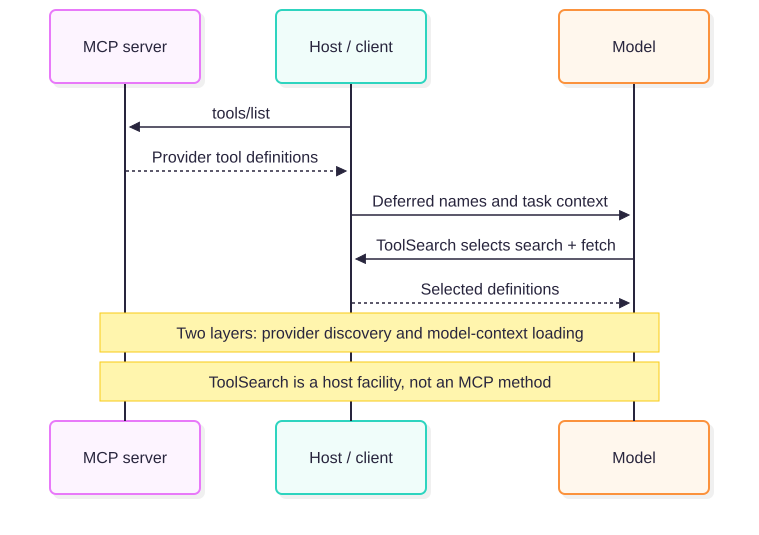
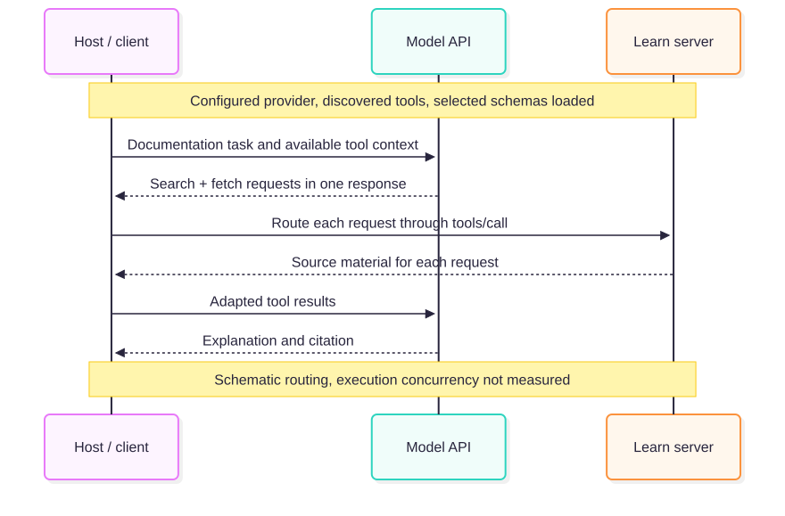

# Connecting an agent to existing MCP servers

An agent is useful when it can do more than answer from its training. It may
need to read a current reference, query a database, or operate a program. In the
toy-agent exercise you built some of that machinery yourself: describe a tool
to the model, inspect the model's request, dispatch a function, and append the
result before asking the model what to do next. This lecture shows how the same
pattern works when the tool provider is an existing MCP server.

The main extension point changes: the toy harness contains tool-specific schemas
and dispatch mappings, while an MCP-capable host reads server declarations and
discovers the operations those providers expose. This lets us add compatible
providers through configuration and reuse them across compatible hosts.

Our first task uses a public documentation server. You will declare its existence
in your repository, inspect its available tools, ask for information, and verify
the result. You do not need to implement a server, install PowerShell, or start
a database. Later, the music homework applies the same process to Neo4j. The
following dice lecture explains the provider's side of the interface.

Read the main walkthrough in order the first time. The troubleshooting, glossary,
and worked checks are also reference material for when setup goes wrong. The
written explanation is more detailed than the classroom presentation; you are
not expected to memorize every field during the live demonstration.

## 1 A concrete reason to retrieve information

Imagine this directory tree, a constructed example:

```text
project/
  README.md
  src/
    app.py
    tests/
      test_app.py
  notes/
    design.md
```

You want to know how a directory-listing command can restrict how deeply it
traverses subdirectories. A model may recall an answer based on its
training. But you want a documented
answer tied to a particular tool and version, not a guess about what a similarly
named option probably does. Retrieving a reference makes the basis of the answer
inspectable (note, however, that even this does not automatically make
the model's interpretation correct -- but it does enable the human to
inspect the original documentation to determine if the model's
interpretation is correct).

Here is the basic documentation task that we use in the lecture:

> Use the Microsoft Learn MCP tools to find the official documentation for
> PowerShell Get-ChildItem. Explain how to limit recursive directory listing
> depth. Cite the relevant page. Do not execute shell commands.

Note that the task above only reads information from the Microsoft
server.  It should not run the command locally or modify the directory.
A strong answer identifies the relevant parameter, explains its meaning, and
points to the source. 

Then, our verification checks whether the actual tool result
and article support that explanation. A fluent answer with a source URL could
still have been produced without using the configured MCP integration
using the models on built in web browsing capabilities, so we inspect
the invocation as well to confirm that it went through the MCP
capability (not the general purpose model web browsing capability).

In our test runs used to prepare for this lecture, the client successfully searched and retrieved the
[Get-ChildItem article](https://learn.microsoft.com/en-us/powershell/module/microsoft.powershell.management/get-childitem?view=powershell-7.5).
The article distinguishes recursive directory levels from the number of files
returned. Check its Depth parameter and examples when evaluating a response.
The saved capture is LLM-free: it demonstrates provider access, not a model's
selection or explanation. Your own host interaction supplies that next layer.

## 2 Revisiting how we made tool calls in the Toy Agent

In the toy-agent exercise, `TOOLS_SCHEMA` contained metadata sent to the model.
A simplified teaching example is:

```python
TOOLS_SCHEMA = [{
    "type": "function",
    "function": {
        "name": "read_file",
        "description": "Read the contents of a file",
        "parameters": {
            "type": "object",
            "properties": {"file_name": {"type": "string"}},
            "required": ["file_name"]
        }
    }
}]
TOOLS_DICTIONARY = {"read_file": read_file}
```

`TOOLS_SCHEMA` and `TOOLS_DICTIONARY` have different jobs. The schema
explains an available operation in the model API's format. The
dictionary maps a name to executable code in the
harness. Sending the schema does not send the Python function to the model.
Instead, it tells the model what tools are available for it to
*request*.  The model can request that the harness call a tool with a
particular name and arguments; the harness then interprets 
that request and decide whether and how to execute it.

The loop then appends the result of the tool call to the conversation. 
This illustrative fragment omits error handling and budget checks to 
make the data flow visible:

```python
message = call_model(messages, tools=TOOLS_SCHEMA)
messages.append(message)
for call in message.get("tool_calls", []):
    name = call["function"]["name"]
    arguments = json.loads(call["function"]["arguments"])
    result = TOOLS_DICTIONARY[name](**arguments)
    messages.append({"role": "tool", "tool_call_id": call["id"],
                     "content": str(result)})
```

### From hard-wired tools to configured providers

In our toy agent, the harness's code names the specific tools it supports. To
add a new operation, we add its schema to `TOOLS_SCHEMA`, put its implementation
or adapter in the program, and update `TOOLS_DICTIONARY` so the harness can
route the model's request. The model itself does not need retraining, but the
harness needs tool-specific integration work. That approach is understandable
for two functions; However, it becomes tedious and repetitive when many tools and providers are involved.

MCP moves the provider-specific tool catalogue out of the harness.
With MCP, the developer configures **which servers the host may
connect to**, rather than writing a schema and dispatch entry 
into the harness for every tool. Each server describes
the operations (tools) it provides through a standard discovery interface. The host's
MCP client obtains those definitions, adapts them to the model API, and keeps
the routing information needed to invoke the correct provider.

For example, suppose our toy agent already has `read_file`, and we now want dice
operations. With its current design, we would edit the harness to describe and
dispatch `roll` and `flip_coins`. With an MCP-capable host, we can configure the
dice server and let the host discover those two definitions. The host still
needs its general MCP integration, but we do not add custom dice dispatch code
to that host. Adding the Neo4J-based music server follows the same
pattern: another provider declaration, discovery of its tools, then calls through the common interface.

The distinction is therefore:

| Toy agent as written | MCP-capable host |
|---|---|
| Harness code contains a specific tool catalogue and function mappings | Configuration identifies approved providers; providers publish their tool catalogues |
| Adding an integration means editing tool-specific schemas/dispatch code | Adding a compatible existing provider usually means configuration and discovery |
| Another harness needs its own integration for that provider | Compatible hosts can reuse the provider's MCP interface |

The server declaration normally stays in the host's (e.g., Claude
Code's) configuration; it is not
simply forwarded to the model as instructions to open a connection. **The host's
MCP client (the Claude Code harness has an MCP client living inside
it) queries the server; the model requests actions through the host.**
A model can participate in finding relevant tools when a host exposes a tool-search
operation, but even then the host/client performs the underlying MCP exchanges.
This separates protocol discovery from the model's decision about which available
capability is useful. See the [MCP architecture explanation](https://modelcontextprotocol.io/docs/learn/architecture).

This gives us three practical benefits. First, an existing MCP-capable host can
acquire new integrations without adding provider-specific dispatch
code in the harness for each one. 
Second, one server implementation can serve multiple compatible hosts.
Third, a host that supports several tool-capable models can adapt the same discovered
contracts for those models instead of requiring the provider to implement every
model API separately. Host support, schema compatibility, credentials, dependencies,
and permission policy still determine whether a particular combination works.

“Without changing the model” is useful, but it is not unique to MCP: our toy
agent already added tools without changing model weights. **MCP's additional
benefit is standardized discovery and invocation across the host/provider
boundary.** It also does not make the toy agent's design the only possible
non-MCP design; we could build our own plugin/discovery mechanism. The benefit
of adopting a shared protocol is that many providers and hosts already implement
that interface rather than each pair inventing its own.

Tool availability can change as a provider evolves. The host can obtain the
current definitions when it connects or refreshes discovery, subject to its
loading and permission policy. This is runtime discovery of an external contract,
not the model learning a new implementation or gaining permission to contact
arbitrary servers on its own. The developer still chooses the configured providers.


The full exercise needed invalid-argument handling, unknown-tool handling, proper
pairing, and execution limits. Those needs remain with MCP. MCP does not replace
the model API or provide a universally safe autonomous loop. It gives hosts and
providers a common interface for discovering and invoking capabilities.

| Handwritten integration | MCP-enabled host |
|---|---|
| Maintain `TOOLS_SCHEMA` | Discover provider definitions and adapt to the model API |
| Maintain name-to-function dictionary | Associate each exposed name with its server/client |
| Call the function directly | Route an authorized request through the MCP client |
| Append a tool result message | Convert the server result into model API context |

The word “adapt” matters. The model's tool-call format is not necessarily the
same object as an MCP request. The host connects those representations.

## 3 Name the participants before connecting them

The **host** is the agent application you use, here Claude Code. It manages the
conversation, model requests, tools available to the model, execution policy,
and results. An **MCP client** is the part of the host that communicates with
a provider through MCP. An **MCP server** exposes capabilities, such as a
search operation or a database query operation.

A **process** is a running program. A **server** need not mean a separate physical
machine: your host can launch a local server as a child process. A **remote
endpoint** is an address at which a service accepts protocol requests. A
**transport** specifies how those requests and responses move between client
and server, such as pipes or HTTP.



The host-to-model API and host-to-MCP-server connections have different purposes.
The model API carries messages and tool requests. MCP carries discovery and
provider invocations. The model selects/request tools, the host routes them,
and provider code executes the operation. A provider can itself access another
service. In the music example, the MCP process talks to a separate database.

A local stdio server does not make a remote model run offline. A remote MCP
service does not mean its provider is the model vendor. Each component can
have a different deployment, failure mode, credential requirement, and cost.

MCP also has **resources**, which expose addressable context, and **prompts**,
which expose reusable message templates. Tools are the operations we need in
this walkthrough. Do not infer that every server must implement every primitive.

## 4 What a server declaration actually does

Putting a server in `.mcp.json` tells Claude Code where it can obtain
capabilities (discover tools).
It does not itself request execution, and it is not the complete tool schema.
The host must load the configuration, connect, obtain metadata, and decide how
to make tools available to the model. The model can then request an invocation
and the host can route it.

A **repository** is the project directory whose files can be shared with version
control. For this walkthrough use a scratch repository. An initially minimal
file tree might be:

```text
mcp-adoption-practice/
  README.md
  .mcp.json
```

The `.mcp.json` file contains meta-data about the MCP servers that you
want Claude Code to be aware of.  For example, to tell Claude about
the Microsoft Learn MCP server, we make the following entry in the
list of MCP Servers:

```json
{
  "mcpServers": {
    "microsoft-learn": {
      "type": "http",
      "url": "https://learn.microsoft.com/api/mcp"
    }
  }
}
```

Notice that we are telling tell Claude directly what tools are
available.  Instead, we tell Calude where it can interact with (the
MCP server at `https://learn.microsoft.com/api/mcp`) to discover
tools.

As a reminder, 
JSON is a text representation of values. Objects use braces and contain named
fields. Quoted strings are text; commas separate fields. In this file there
are no comments and no trailing commas. If you remove a comma or leave a quote
open, the host may reject the file before it ever tries the network.

The outer `mcpServers` field contains a map of server connections. We chose
`microsoft-learn` as the map key. It names this connection in our configuration;
it is not necessarily the provider's internal name or the name of a tool.
`type: "http"` chooses the host's remote HTTP connection mode. The URL identifies
the provider endpoint. There is no local command to install or run here.

The filename and object layout are Claude Code configuration conventions, not
a universal file format that every MCP-compatible product must consume.
Another host can connect to the same provider through its own configuration UI
or file format. That is consistent with sharing a protocol interface.

## 5 Reproduce the connection step by step

You need Claude Code installed and authenticated with your normal model access.
Microsoft documents its Learn endpoint as accessible without
authentication.  This makes it nice for our classroom demo -- it 
removes a provider login requirement for the MCP server. Of course, we
still need a valid Anthropic model user account and we need a network
connection.  The optional independent client also needs Python 3.12+
and uv. [Microsoft server overview](https://learn.microsoft.com/en-us/training/support/mcp).

Let's now try the demo.  From the provided `demos/lecture-mcp-adoption/` directory
in the course material repo, use a new terminal:

```sh
ADOPTION_REHEARSAL_DIR="$(mktemp -d)"
cp .mcp.json.example "$ADOPTION_REHEARSAL_DIR/.mcp.json"
cd "$ADOPTION_REHEARSAL_DIR"
git init
claude
```

The first command creates a separate temporary directory. The second copies
the supplied example into the active filename. `cd` changes the current working
directory. `git init` makes it a practice repository; it does not publish it.
Starting the host there lets us examine project-scoped configuration without
changing a real project's integrations. On Windows, create an empty folder and
copy the same file using your normal tools; the JSON remains the same.

Read any workspace trust/server approval prompt and approve this intended
project integration through the host's ordinary interface. 

Now, we can list the MCP servers that Claude currently sees using the
`/mcp` slash command.  Look at the output of `/mcp` and find 
find `microsoft-learn`. If the file was added to an already running session,
exit and start a fresh session for this exercise. That gives a predictable
loading point without depending on automatic reload behavior.

Connection status is one check. Next inspect the tools offered by the server.
The preparation capture contains `microsoft_docs_search`, `microsoft_docs_fetch`,
and `microsoft_code_sample_search`. Remote tools can change, so inspect your
actual session. If the server is absent, first check the project root, active
filename, JSON, loading/approval, and policy rather than changing a prompt.

The [demo script](../demos/lecture-mcp-adoption/DEMO.md) includes a session-isolation option
for instructors whose other integrations could answer the same task. Students
normally use the straightforward project file. Isolation does not authorize
bypassing permissions or changing user-wide configuration.

## 6 Understand configuration scope and sharing

An MCP configuration for Claude can apply to one project or to 
many projects for one user. In Claude Code, 
project scope uses the repository's `.mcp.json`. User scope can
make a server available across projects. Its “local scope” applies privately
to the current project but is stored in the user's home configuration. The
names are easy to confuse, so identify both the effect and the storage location.
See [Claude's scope documentation](https://code.claude.com/docs/en/mcp).

Sharing `.mcp.json` lets classmates inspect the intended server declaration.
It does not install Claude Code, grant an account, supply a private password,
or guarantee that a remote service is available. For local processes it also
does not guarantee that the configured executable (e.g., the Neo4J
server) is installed on every machine. Good project instructions explain these dependencies.

A documentation server without credentials makes the first example small.
For the music homework we supply environment references instead of literal
passwords. An **environment variable** is a named value available to a process
and its children. Setting it in one terminal does not imply that a GUI-launched
host or another terminal has it. A `.env` file is merely a file until some
program explicitly loads it.

Review repository configuration before activating it: a local launch entry
instructs the host to run a program, while a remote entry directs communication
to a provider. Version control makes changes visible but does not make every
configuration trustworthy automatically. Keep that review practical: identify
what will run, where data will go, and what access it receives.

## 7 Inspect the discovered contract

The host's MCP client discovers tool definitions from the server. These
definitions include schemas describing argument shapes. A **schema** describes
the shape of data. An MCP tool definition normally tells you
its name, description, and input schema. It may also advertise an output schema.
The input schema does not contain the implementation; it helps clients and
models form arguments and helps validation check them.

The real preparation listing includes the following input for article retrieval,
shortened here by omitting descriptive prose:
```json
{
  "name": "microsoft_docs_fetch",
  "inputSchema": {
    "type": "object",
    "properties": {"url": {"type": "string"}},
    "required": ["url"]
  }
}
```

The input must be an object. Its `url` field is a string and required. This
schema is not a promise that every string is a meaningful article address.
A missing property, an inaccessible page, and a misleading answer are different
problems. The tool description helps the host/model understand the operation's
purpose; it is part of the interface alongside schemas and actual behavior.

Search takes a query string. A documentation query is an argument to the tool,
not a command the host should execute in a shell. Code-sample search is another
operation. The host can expose or defer definitions according to its model and
context policy; do not assume that listing three tools proves all three full
definitions entered every prompt. Inspect the session when investigating that.

Names can be presented with a host-specific prefix. Record the actual displayed
name and the connection/provider identity. Two servers may offer operations
with similar names; provenance cannot be inferred from a name fragment alone.

### Two different kinds of discovery in the instructor session

The instructor ran the documentation task with Claude Code on 2026-11-17, then
asked Claude to write a [session record](../demos/lecture-mcp-adoption/claude-session/mcp-microsoft-learn-transcript.md)
from its context. That record makes an important distinction visible: the host
can know a tool's definition before the model has its full schema available.
It is a model-generated account of live use, not an independently exported API
or network trace. The [companion walkthrough](../demos/lecture-mcp-adoption/claude-session/mcp-microsoft-learn-tutorial.md)
labels reconstructed envelopes separately.



First, the host's MCP client obtains the provider's tool definitions. Then the
host chooses how to expose that catalogue to the model. In this recorded session,
three names were presented as deferred tools. The model requested two definitions
through the host's `ToolSearch` facility before requesting their execution:

| Layer | What the record shows |
|---|---|
| Provider catalogue | Search, fetch, and code-sample-search tools were available |
| Model-context loading | ToolSearch selected the search and fetch definitions |
| Requested execution | The model requested search and fetch; code-sample search was unused |

ToolSearch is a host operation, not an MCP `tools/list` request emitted directly
by the model. Loading definitions may use host caches or trigger refreshes; the
record does not show that implementation. Hosts can use other loading policies.
See [Claude Code's tool-search documentation](https://code.claude.com/docs/en/mcp#scale-with-mcp-tool-search).

This illustrates the motivation for MCP without blurring responsibility. The
developer selects providers through configuration; the client discovers their
contracts; the host exposes suitable definitions; the model can request relevant
capabilities. Discovery, model-context availability, and invocation are different
states. A tool's name appearing in context does not mean its full schema was
loaded or that it was executed.

The same session also gives a concrete name-adaptation example:

```text
Provider tool name:       microsoft_docs_fetch
Model-visible host name: mcp__microsoft-learn__microsoft_docs_fetch
```

The connection namespace distinguishes this provider from others. The model-visible
record renders parameters under `parameters`; the Messages API convention uses
`input_schema`. A rendered definition is not proof of the exact serialized API
body. The host must preserve the operation's meaning and route it correctly;
we do not need to guess its private routing data structure to explain that job.


## 8 Follow one task through the boundaries



The diagram follows the instructor record's request pattern: search and fetch
were requested in the same model response, after selected definitions had been
loaded. The host routes each operation and returns the source material in an
adapted form. Two requests in one response permit concurrent execution; this
record does not measure whether the host ran them concurrently. They are not
shown as a JSON-RPC batch.

The diagram is a schematic explanation of routing, not a packet trace. A model
can instead wait for search results before choosing a page to fetch. Another
task may need only a search or several retrievals. The follow-up verification
turn in this session requested an additional fetch. Teach the observed path
without requiring every task to follow the same call sequence.

The actual LLM-free preparation calls used these arguments:

```json
{"query": "Get-ChildItem Recurse Depth parameter"}
```

```json
{"url": "https://learn.microsoft.com/en-us/powershell/module/microsoft.powershell.management/get-childitem?view=powershell-7.5"}
```

These are tool argument objects. They are not `.mcp.json` entries and are not
complete JSON-RPC request envelopes. MCP requests also have method names and
association information; the SDK handles their framing and version negotiation.
That independent client connection negotiated **2025-06-18** with this remote
server; this does not establish Claude Code's negotiated version in the instructor run. The local dice
capture uses a different revision. Do not paste the dice initialization behavior
into a diagram of this remote peer merely because both clients use the same SDK.

The independent script deliberately calls both operations. There was no
model-generated selection in that run. Its [capture](../demos/lecture-mcp-adoption/evidence/remote.json)
records the observed definitions, arguments, response types, lengths/hashes,
and one short source excerpt. Full third-party articles are not bundled.
The instructor record supplies a separate account of model-selected calls and
answers. For your own live pass, inspect your host's actual invocation and final
answer rather than substituting that record or the independent client capture.

## 9 Search results, retrieved articles, and grounded answers

Search usually returns candidate material, perhaps with useful snippets. Retrieval
opens a particular article. A snippet may establish a simple fact, but it may
omit restrictions, version differences, or an example's surrounding explanation.
Open the source when those details affect your answer. More retrieved text is
not automatically better; irrelevant material also consumes context.

A **grounded answer** connects its claims to evidence. For this question, check
whether the relevant passage discusses recursion depth, whether an example's
specified levels match the answer, and whether the citation identifies the
article/version being discussed. A result containing the word Depth is not
enough to support every possible statement about traversal.

Consider this constructed bad answer: “Depth 2 returns at most two files.”
The parameter is about directory depth, so a file-count claim needs different
evidence. Even if the search call succeeded, the interpretation can fail.
Write the disputed claim beside the source meaning and identify the mismatch.
This is more informative than asking whether the model sounded confident.

### A real follow-up check separated facts from inferences

The instructor's first answer included explanations drawn from several parts
of the article and some extrapolations. The second prompt asked Claude to fetch
the article and check the Depth section against its explanation. The resulting
[claim review](../demos/lecture-mcp-adoption/claude-session/mcp-microsoft-learn-transcript.md#23-the-models-answer)
separated parameter text, an example elsewhere on the page, and statements
that were not explicitly established by that text.

Before reading that follow-up answer, classify these claims yourself. Use the
recorded article excerpts or open the cited 7.6 page; keep its version distinct
from the independent client's 7.5 retrieval.

| Claim from the first answer | Evidence question |
|---|---|
| Depth controls included subdirectory levels | Does the parameter definition explicitly say this? |
| Depth can cause recursion without adding Recurse | Does the definition say it, or does Example 8 illustrate it? |
| Negative values are rejected | Is that rejection explicitly documented, or inferred from UInt32? |
| Depth 0 lists only immediate contents | Does the retrieved passage establish this case? |
| LiteralPath advice applies when using Depth | Does the Notes section discuss Depth, or is the answer extending Recurse advice? |

Suggested classification: the first claim is explicit parameter text; the second
is supported by the example rather than a direct sentence in that parameter
entry. The negative-value claim is inferred from the type. The zero-depth case
and extension of the path advice require evidence beyond the cited parameter
text. These distinctions do not establish that every inference is false. They
establish what the supplied documentation does and does not support directly.

The exercise is about traceable support, not asking the model to certify itself.
Re-fetching and self-review are useful, but the student's own comparison is still
necessary. A citation at the end of an answer does not make every preceding
sentence an explicit statement from that source. The original record even says
“three” statements before listing four qualifications; count and inspect the
individual claims rather than accepting the summary label.


When recording evidence, use a small excerpt or a readable tool screenshot,
the source URL, the final claim, and your explanation. Avoid dumping an entire
account conversation. If no call is visible, label the result unverified for
this integration even if you recognize the answer as correct.

## 10 Practice and systematic diagnosis

Try the alternate task:

> Use Microsoft Learn MCP tools to find how Get-ChildItem can include hidden
> items. Cite the relevant documentation. Do not execute commands.

Record configuration, actual tool identity, invocation, relevant result, citation,
answer, and why you accept it. Use the [evidence template](../demos/lecture-mcp-adoption/EVIDENCE.md).
If paired with a classmate, each person should explain what the evidence proves.

A server can be configured without connecting. It can connect without exposing
a relevant operation. A relevant operation can be available without being selected.
A selected call can fail, and a successful result can be explained incorrectly.
The following cases show why diagnosis should begin at the failing boundary.

**Invalid JSON.** Suppose you remove the comma before `url`. The host cannot
interpret its configuration. A model prompt cannot repair a file the host never
loaded. Inspect the JSON file and parser error first. Restore the supplied
example in the scratch repository and restart the host.

**Bad endpoint.** The file parses, but the URL is wrong. Check the declared
provider address and actual connection error. An ordinary browser GET is not
an MCP client negotiation; some MCP endpoints reject it by design. In a disposable
copy use the demo's invalid URL exercise, observe rather than predict the HTTP
status, and restore the value afterward.

**Missing local command.** This applies to stdio later. A config can ask the
host to run `uv`, but the host's PATH may not contain it. Test the command from
the shell used to start the host. Fix the environment or provide a documented
absolute executable path; do not change the tool's argument schema.

**Missing environment variable.** A database password reference is not an actual
password. Confirm the variable's name and presence without printing its value.
Launch the host from the prepared terminal. Do not solve the problem by committing
a credential into project configuration.

**Stopped database.** The local MCP executable may start correctly while its
Neo4j connection fails. Test the database's own readiness and URI. Database
startup and MCP startup are separate conditions.

**Missing or sandboxed extension.** During preparation the music database
answered direct queries, yet the official provider first required APOC meta.
After installation it connected, but its schema call still failed until the
meta procedure family was configured for execution. This real example separates
backend reads, provider requirements, discovery, and tool execution.

**No selected call.** Inspect available definitions and actual host behavior.
Clarify that the task should use the configured provider and identify the missing
evidence. A success status in `/mcp` cannot establish that a model chose it.

**Wrong final answer.** Compare returned rows or passages with the final claim.
The provider may be correct while model interpretation is wrong. Preserve the
first answer and correction so the evidence tells an honest story.

Do not repeatedly change multiple layers at once. Make one diagnosis, inspect
an observation that can confirm it, then rerun the smallest relevant check.

## 11 Local stdio, remote HTTP, and database integration

For a remote server, the host uses a URL. For stdio, it launches a program and
exchanges protocol messages over the child's standard input/output pipes. The
launch command and argument array are host configuration. They are different
from the arguments to a later tool call.

For example, a local process entry might have `command: "uv"` with arguments
that select a pinned project and run a launcher. That command starts the provider;
it does not itself ask for schema inspection. The homework supplies a complete
version rather than a partly runnable placeholder. A package runner can also
need network access on first installation; install dependencies before class.


The music integration has the host/client, official MCP provider process, and
Neo4j database. Stopping the host usually stops its child, but the database can
remain running under Desktop. Local stdio describes only the first link. The
provider uses a database connection, and the host may still call a remote model.

This is also why CLI integration remains useful. A host could invoke a database
client or JSON CLI directly. Such a CLI can validate inputs and return structured
results. MCP provides a reusable discovery/invocation boundary; it does not make
CLI execution obsolete. An adapter can wrap a library, command, or remote service
without rewriting the underlying operation.

## 12 Permissions, output, costs, and context

Three permission questions are separate: will the host allow this action, will
the provider expose this operation, and will the downstream service authorize
it? A host approval prompt is not a substitute for database authorization.
The homework launcher restricts the provider to schema/read operations and enables
its read-only setting, but does not claim a Community administrator credential
has become an independently restricted database user. Use the supplied disposable
data and the documented scope.

Treat retrieved documentation as evidence, not an instruction source allowed
to change host policy. A tool result can contain text that resembles commands
or instructions. The task is to interpret it within the user's request. An
accurate source title does not authorize executing unrelated commands.

Separate server execution cost, downstream service cost, and model interaction.
The public documentation endpoint may require no provider login, while the host's
model turns still use account resources. Repeated retries and excessive tool
output can increase both latency and context. Definitions, arguments, and results
may consume context depending on host loading policy; avoid universal claims
that every definition enters every request. Use `/context` and actual host
observations for that session. This package supplies no invented prices or
measured token savings.

## 13 Transfer the method to music

A Playlist points to Tracks; a Track points to its Artists. Artist A can have
many tracks in one playlist, so counting paths differs from counting distinct
playlists. In a tiny constructed example, P1 contains T1 and T2; both credit A;
P2 contains T1. There are three paths to A but two distinct playlists. An exact
duplicate input row should not inflate either answer.

The homework gives you a complete fictional fixture, loader, and
[Cypher primer](../../neo4j/02-neo4j-music-mcp/PRIMER.md). You inspect its schema, review
agent-proposed reads, and compare the result with direct reference queries.
This adds domain meaning to the same integration pattern. “Most popular artist”
is ambiguous; “greatest number of distinct playlists in this fixture” is a
specific count the graph can support.

Do not let database setup swallow the lecture. The instructor preview uses a
prepared instance. Your homework checkpoint provides time to establish that
the instance, plugin, provider, and host are each ready.

## 14 A reusable adoption recipe

Start with a task and a way to judge its answer. Identify a provider and inspect
its source, transport, configuration, authentication, and capabilities. Declare
it in the intended scope, connect, and inspect actual discovered definitions.
Run one bounded operation and examine both the result and the final explanation.
When something fails, isolate the boundary before modifying unrelated settings.

For a remote provider, record the capture date and observed schema because its
deployment can change. For a local executable, pin the tested release and its
launch environment. Keep secrets external. Disable or remove an unused scratch
configuration through the host's supported mechanism or remove the scratch
repository entry and restart; do not accidentally remove an unrelated global
server with the same display name.

The next lecture follows the same boundary from the other side: build ordinary
dice code, expose it with official Python SDK MCPServer, inspect discovery,
and test validation and results. You now know what a consumer will try to observe.

## 15 Explained self-checks and vocabulary

**Does committing `.mcp.json` commit the tools' implementation?** No. It records
connection/launch information. A remote provider stays remote; a local program
still has to be installed or available through the documented environment.

**Can the documentation task run without PowerShell?** Yes. The MCP tool retrieves
reference material. Our task does not execute a PowerShell command.

**Does a URL citation prove the MCP tool ran?** No. You need invocation evidence.
Then check whether the cited material supports the answer as a separate step.

**Which component executes the music query?** The MCP provider sends it to Neo4j,
and Neo4j executes it. The model proposes arguments and the host routes calls.

**What still works if model access fails?** An independent MCP client can inspect
and invoke tools; direct database queries can also work. A model conversation
and provider connectivity are different checks.

**Why not hard-code every tool definition in the repository config?** That would
confuse connection information with provider contracts. The discovery interface
lets the host obtain the definitions the connected provider currently offers.

| Term | Meaning in this tutorial |
|---|---|
| Host | Agent application managing model conversation and tool use |
| Client | Host component communicating with a provider via MCP |
| Server/provider | Program exposing capabilities through MCP |
| Endpoint | Address for remote protocol requests |
| Process | Running program, possibly a child launched by a host |
| Transport | Mechanism moving protocol messages, such as pipes or HTTP |
| Discovery | Obtaining the provider's capability definitions |
| Schema | Description of input/output data shape and constraints |
| Arguments | Values supplied to a particular operation |
| Result | Data or failure information returned by that operation |
| Scope | Where a host configuration applies and who shares it |
| Grounding | Connecting final claims to actual retrieved evidence |

For optional deeper reading consult [MCP architecture](https://modelcontextprotocol.io/docs/learn/architecture),
[Microsoft's developer reference](https://learn.microsoft.com/en-us/training/support/mcp-developer-reference),
[Claude Code MCP documentation](https://code.claude.com/docs/en/mcp), and
[the official Neo4j provider](https://github.com/neo4j/mcp).
The prepared scripts and verification report distinguish live protocol evidence,
recorded fallbacks, the instructor-supplied model-generated session account,
and any remaining checks that need raw host/network observations or a fresh rehearsal.
