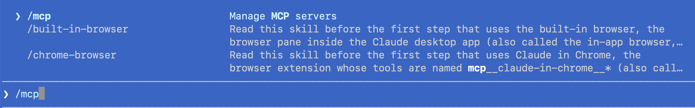
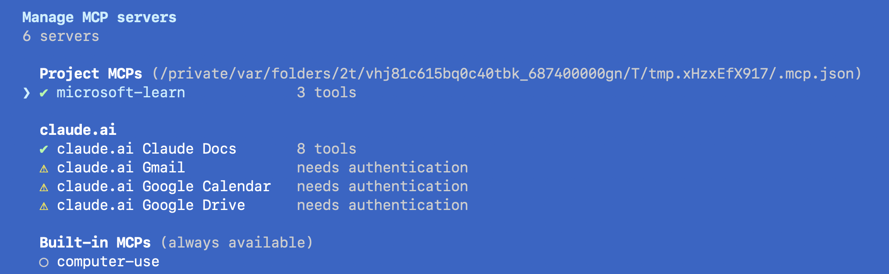
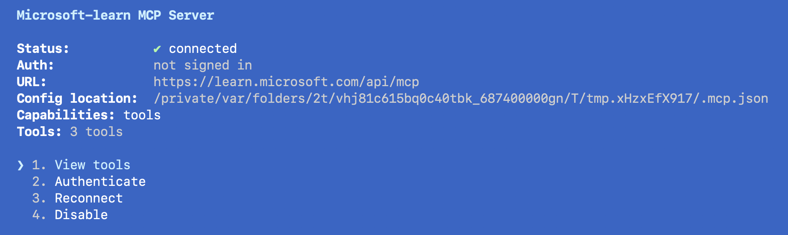
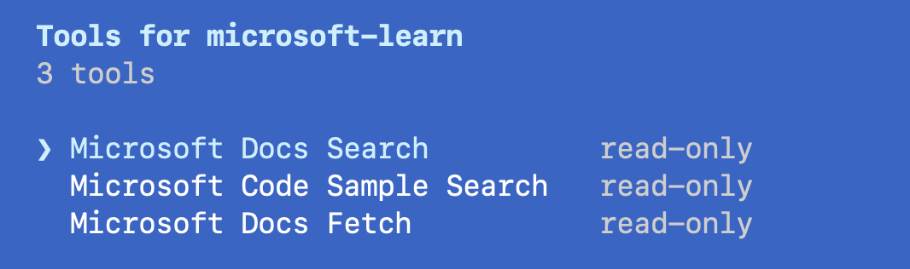
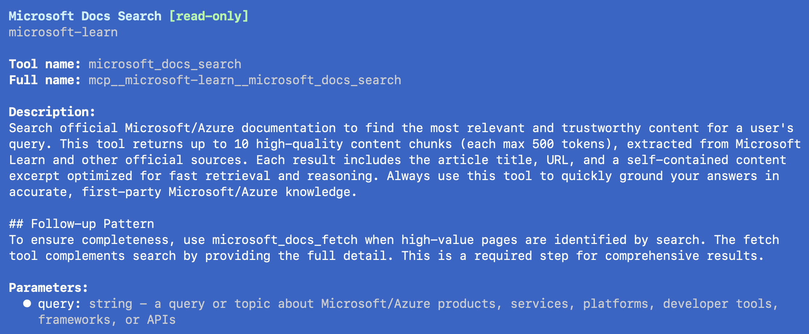

# Connecting an agent to existing MCP servers

## Motivation for MCP

In our first week of this course, we learned that large language 
models are impressive at reasoning and generating text.
But going back to our Toy Agent exercise where we started with a chat
bot, we learned that models are isolated: they only know what was in their
training data (plus whatever the user pastes into the prompt).  In
moving to from a chat bot to our Toy Agent, we added the notion of
tool calls, which let the model request the harness to perform simple
file system operations.   Beyond this, real usefulness for LLMS 
comes from connecting them to a varieity of *live* data and
systems — databases, GitHub, calendars, internal APIs, SaaS
tools, etc.  

However, without a standard, every AI application (chatbot, coding
assistant, agent) must write its own custom integration for every
external system -- just like we had to explicitly develop tool call
wrappers for the Toy Agent list files and read file operations.

With \(M\) applications and \(N\) data sources you face an \(M \times
N\) integration problem: duplicated effort, inconsistent security, and
brittle point-to-point glue code. MCP, introduced by Anthropic in late
2024 and now governed under the Linux Foundation’s Agentic AI
Foundation, turns this into an \(M + N\) problem. You write an MCP
*server* once for a data source or tool; any MCP-compatible *host*
(harness) can then use it. 

In short, MCP is a thin, standardized “plug” that lets AI applications
discover and use external capabilities (tools) without custom integrations for
every pair of app and data source. It is somewhat analogous to a 
USB-C as a universal connector — i.e., MCP is like “USB-C for LLM and
tool connections.”

The vocabulary used in standard MCP documentation is slightly
different than what we have used elsewhere in the course: what we have
referred to as "harness" before, the MCP documentation refers to as
"host".  So when you see the word "host" being used, that refers to a
harness like Claude Code or Codex.

In this lecture, we introduce basic concepts of MCP:
 - we discuss the relationship of MCP to the notions of tools and tool
   calls that we encountered in the Toy Agent, 
 - we introduce the notion of an MCP *server* that offers tools that a host
   can call for a model, 
 - we see how to declare MCP servers to make Claude Code aware of them
   in `.mcp.json` files,
 - we go through a demo in which we make retrieval tools for Microsoft's Learn
   documentation facility available via MCP to a project managed by Claude
   Code,
 - we give some example prompts that use the Microsoft Learn MCP and
   look behind the scenes at the session transcript to see how the
   model becomes aware of the associated MCP tools and interacts with
   the harness to request tool calls.
 - from the above, we learn the basic architectural elements of MCP:
   *hosts*, *models*, *MCP clients* (embedded in hosts), and *MCP
   servers* associated with enterprise data.

This lecture uses an existing MCP documentation server, and we only
read data from it.  In a subsequent lectures, we
will
 - see how we can use MCP to connect to Neo4j and illustrate how
   models can then achieve reads and writes to the Neo4j database via
   cypher queries
 - we will learn how to develop our own MCP servers for local
   applications that we build ourselves.

To recap, in the toy-agent exercise you built the machinery for tool calls
yourself: your code described a tool to the model, inspected the
model's request, dispatched a function, and appended the result before
asking the model what to do next. This lecture shows what changes
when the tool provider is an existing MCP server: the developer declares a
server, the host discovers the server's tools, and the model selects among them.

Our first task uses a public documentation server. You will declare its existence
in your repository, inspect its available tools, ask for information, and verify
the result. You do not need to implement a server, install PowerShell, or start
a database. Later, the music database homework applies the same
process to Neo4j. Then, after that, a lecture that uses a simple game
dice example explains the provider's side of the interface
as you set up your own MCP server.


## 1 Why MCP: from hard-wired tools to discovered tools

### 1.1 How the toy agent got its tools

In Step 5 of the toy-agent exercise, a tool had two halves stored in two places.
The schema which described the tool capability and use was the half
the model saw; the python function that implemented the tool was the half the harness
executed:

```python
READ_FILE_SCHEMA = {
    "type": "function",
    "function": {
        "name": "read_file",
        "description": "Get the full contents of a file",
        "parameters": {
            "type": "object",
            "properties": {"file_name": {"type": "string"}},
            "required": ["file_name"],
        },
    },
}

TOOLS_DICTIONARY = {"read_file": read_file}   # name -> function, for the loop to dispatch
TOOLS_SCHEMA = [READ_FILE_SCHEMA]             # what actually gets sent to the model
```

Sending the schema does not send the Python `read_file` function to the model. It tells the
model that a `read_file` operation exists, what it is for, and how to request it. The model
can then ask the harness to call a tool by name with arguments; the harness
decides whether and how to execute that request.

Step 6 wrote the loop that services those requests. Reduced to its data flow,
with the error handling and the Step 7 execution bound removed, it is:

```python
message = call_model(messages, tools=TOOLS_SCHEMA)
messages.append(message)
for tc in message.get("tool_calls", []):
    name = tc["function"]["name"]
    arguments = json.loads(tc["function"]["arguments"])
    result = TOOLS_DICTIONARY[name](**arguments)
    messages.append({"role": "tool", "tool_call_id": tc["id"], "content": str(result)})
```

The exercise names its model call `call_zen`, after the gateway used in class;
the name here is generic.

Step 8 then asked for two more tools, `list_files` and `write_file`, and its
instruction was to register each one in **both** `TOOLS_DICTIONARY` and
`TOOLS_SCHEMA`. That instruction is the point to notice. Every tool the agent
can use is wired into the harness by hand: its schema is written in the harness,
its implementation lives in the harness, and its dispatch entry is edited into
the harness. The tool catalogue is a constant in the program. Adding a tool is a
code change, forgetting one of the two registrations is a silent failure, and a
second harness that wants the same tool repeats all of the work.

### 1.2 What MCP changes

The Model Context Protocol (MCP) moves the tool catalogue out of the harness.
Three things change.

**Instead of writing code for a tools and accompanying schema's in a
harness, the developer provides JSON meta-data (a "configuration") to declare the
existence of an MCP server.** The configuration names an MCP
provider and says how to reach it. For the documentation server used in this
lecture, the whole declaration is:

```json
{
  "mcpServers": {
    "microsoft-learn": {
      "type": "http",
      "url": "https://learn.microsoft.com/api/mcp"
    }
  }
}
```

There is no tool name, description, or parameter schema in this file. Section 3
explains each field; for now notice only what is absent.

**The host (harness) discovers the server's tools.** When the host
starts, it reads the `.mcp.json` to see what MCP servers it is to use,
the host's MCP client connects to each declared server and asks for that server's tool definitions
(the protocol request is `tools/list`). The server answers with names,
descriptions, and input schemas in MCP's format. The host adapts those
definitions to its model API, the job `TOOLS_SCHEMA` did, and remembers which
server each name came from, the job `TOOLS_DICTIONARY` did. Neither
the schema or the dictionary structure is written by hand any more; 
both are filled from what the server declared.

**The model selects; the host routes.** The model is shown the discovered
definitions and requests a call exactly as it did in the toy agent. The host
routes the request to the right server (`tools/call`), receives the result,
converts it into a tool-result message, and asks the model again. The loop is
the one you wrote. What moved is where its tool table comes from.


The diagram names the participants. The **host** is the agent application, here
Claude Code. It manages the conversation, the model requests, the tools
available to the model, execution policy, and results. The **MCP client** is the
part of the host that speaks MCP to one provider. An **MCP server** is a program
that exposes capabilities such as a search or a database query. A **transport**
is how client and server exchange messages: here HTTP to a **remote endpoint**;
later, for the music homework, standard-input and standard-output pipes to a
local child **process**. 

A server need not be a separate machine or on the internet.  In fact,
configure Neo4j desktop (a local app) to run an MCP server process locally
that that hosts like Claude can connect to.  In a subsequent lecture,
we will build our own MCP server that wraps some simple Python game
dice simulations.  In the diagram, the dashed box stands for any
further server like the Neo4j MCP or game dice MCP the developer
declares:  adding more tools s another server entry in the
configuration, not another edit to the host (as we would have had to
do in the toy agent).

The two connections carry different things. The model API carries messages,
tool definitions, and tool requests and results. MCP carries discovery and
invocation. The model never connects to a MCP server and never reads `.mcp.json`;
the host's client performs every MCP exchange on the model's behalf. Claude Code
adds one refinement (an optimization) to this picture: it can present discovered tools to the
model as *deferred names* and let the model load full definitions on request
through a host facility called ToolSearch (this helps reduce context
usage for MCP-based tools). This optimization is a host policy for managing
context, not a standardized MCP capability; Section 6 shows it in the instructor's recorded
session.  There are other things that MCP can do that we don't discuss
in this lecture.  For example, an MCP server can also define
**resources** (addressable context) and **prompts** (reusable message
templates); this lecture needs only tools.

### 1.3 Why a shared standard, and what it does not buy

Two benefits follow from moving the catalogue out of the harness.

First, **adding a tool provider is configuration, not harness code.** A host that
already speaks MCP acquires the documentation server, the music database
server, or the dice server of the next lecture through declarations. No
provider-specific schema or dispatch branch is added to the host code, and a provider
whose tools change is rediscovered at the next connection rather than re-edited.

Second, **one interface is implemented on both sides by many parties.** Many
hosts contain an MCP client, and many providers publish an MCP server. A
provider written once works in every compatible host, and each host adapts the
same discovered contracts to whichever tool-capable model it drives. Without a
shared protocol, every host-and-provider pair would invent its own integration;
the toy agent is one such pair.

The caveats are as real as the benefits. "Adding tools without retraining the
model" is not an MCP benefit; the toy agent already did that. A host must
support MCP, the configuration must be loadable, the provider must be reachable,
credentials and permissions must be in place, and every discovered definition
and every result occupies context when loaded. MCP does not make the loop safe
or the answers correct: the toy agent's exception handling, request-result
pairing, and execution limit all remain the host's responsibility. What MCP
provides is a standard way to discover and invoke capabilities across the
host-provider boundary.

Here some correspondences between concepts in the Toy Agent and
MCP-capable Agent (host).

| Toy agent (exercise 04) | MCP-capable host |
|---|---|
| `TOOLS_SCHEMA` written by hand | Tool definitions discovered from each declared server and adapted to the model API |
| `TOOLS_DICTIONARY` written by hand | Each discovered name associated with its server connection |
| `TOOLS_DICTIONARY[name](**arguments)` | An authorized request routed through the MCP client as `tools/call` |
| `messages.append({"role": "tool", ...})` | The server's result converted into the model API's tool-result message |

The word "adapt" matters in this table. The model's tool-call format is not the
same object as an MCP request; the host connects the two representations, and
Section 6 shows a name changing shape as it crosses that boundary.  In
other words, once the MCP tool information gets inside of Claude Code,
it converts it into its own tool information format that it uses when
interacting with Anthropic models.

## 2 A concrete reason to retrieve information

Our Microsoft Learn example interactions will deal with documentation
for Microsoft PowerShell capabilities.  In particular, it will deal
with commands for reading directory structures.

Imagine this directory tree, a constructed example:

```text
project/
  README.md
  src/
    app.py
    tests/
      test_app.py
  notes/
    design.md
```

You want to know how a PowerShell directory-listing command can restrict how deeply it
traverses subdirectories. A model may recall an answer based on its
training. But you want a documented
answer tied to a particular tool and version, not a guess about what a similarly
named option probably does. Retrieving a reference makes the basis of the answer
inspectable (note, however, that even this does not automatically make
the model's interpretation correct -- but it does enable the human to
inspect the original documentation to determine if the model's
interpretation is correct).

Here is the basic documentation task that we use in the lecture:

> Use the Microsoft Learn MCP tools to find the official documentation for
> PowerShell Get-ChildItem. Explain how to limit recursive directory listing
> depth. Cite the relevant page. Do not execute shell commands.

Note that the task above only reads information from the Microsoft
server.  It should not run the command locally or modify the directory.
A strong answer identifies the relevant parameter, explains its meaning, and
points to the source. 

Then, in our demo activities, we perform do some inspections on the
transcript and actual Microsoft documentation (referred to as
"verification checks") to determine whether the actual tool result
and article support that explanation.  A fluent answer by the agent with a source URL could
still have been produced without using the configured MCP integration
using the model's own built-in web browsing capabilities, so we inspect
the invocation (in the transcript) as well to confirm that it went through the MCP
capability (not the general purpose model web browsing capability).

In our test runs used to prepare for this lecture, the client successfully searched and retrieved the
[Get-ChildItem article](https://learn.microsoft.com/en-us/powershell/module/microsoft.powershell.management/get-childitem?view=powershell-7.5).
The article distinguishes recursive directory levels from the number of files
returned. Check its Depth parameter and examples when evaluating a response.
The saved capture is LLM-free: it demonstrates provider access, not a model's
selection or explanation. Your own host interaction supplies that next layer.

## 3 What a server declaration actually does

Putting a server in `.mcp.json` tells Claude Code where it can obtain
capabilities (discover tools).
It does not itself request execution, and it is not the complete tool schema.
The host must load the configuration, connect, obtain metadata, and decide how
to make tools available to the model. The model can then request an invocation
and the host can route it.

Imagine a very simple project **repository**.  We put an `.mcp.json`
at the root of the repository for Claude to read and load information
about the MCP servers that we want to use.  

To try this out for yourself, use a scratch repository named something
like `mcp-adoption-practice`. An initially minimal file tree might be:

```text
mcp-adoption-practice/
  README.md
  .mcp.json
```

The `.mcp.json` file contains meta-data about the MCP servers that you
want Claude Code to be aware of.  For example, to tell Claude about
the Microsoft Learn MCP server, we make the following entry in the
list of MCP Servers:

```json
{
  "mcpServers": {
    "microsoft-learn": {
      "type": "http",
      "url": "https://learn.microsoft.com/api/mcp"
    }
  }
}
```

Notice that we are not telling Claude directly what tools are
available. Instead, we tell Claude where it can interact with (the
MCP server at `https://learn.microsoft.com/api/mcp`) to discover
tools, as Section 1 previewed.

As a reminder, 
JSON is a text representation of values. Objects use braces and contain named
fields. Quoted strings are text; commas separate fields. In this file there
are no comments and no trailing commas. If you remove a comma or leave a quote
open, the host may reject the file before it ever tries the network.

The outer `mcpServers` field contains a map of server connections. We chose
`microsoft-learn` as the map key. It names this connection in our configuration;
it is not necessarily the provider's internal name or the name of a tool.
`type: "http"` chooses the host's remote HTTP connection mode. The URL identifies
the provider endpoint. There is no local command to install or run here.

The filename and object layout are Claude Code configuration conventions, not
a universal file format that every MCP-compatible product must consume.
Another host can connect to the same provider through its own configuration UI
or file format. That is consistent with sharing a protocol interface.

## 4 Reproduce the connection step by step

You need Claude Code installed and authenticated with your normal model access.
Microsoft documents its Learn endpoint as accessible without
authentication.  This makes it nice for our classroom demo -- it 
removes a provider login requirement for the MCP server. Of course, we
still need a valid Anthropic model user account and we need a network
connection.  The optional independent client also needs Python 3.12+
and uv. [Microsoft server overview](https://learn.microsoft.com/en-us/training/support/mcp).

Let's now try the demo.  From the provided `demos/lecture-mcp-adoption/` directory
in the course material repo, use a new terminal:

```sh
ADOPTION_REHEARSAL_DIR="$(mktemp -d)"
cp .mcp.json.example "$ADOPTION_REHEARSAL_DIR/.mcp.json"
cd "$ADOPTION_REHEARSAL_DIR"
git init
claude
```

The first command creates a separate temporary directory. The second copies
the supplied example into the active filename. `cd` changes the current working
directory. `git init` makes it a practice repository; it does not publish it.
Starting the host there lets us examine project-scoped configuration without
changing a real project's integrations. On Windows, create an empty folder and
copy the same file using your normal tools; the JSON remains the same.

Read any workspace trust/server approval prompt and approve this intended
project integration through the host's ordinary interface. 

Now, we can list the MCP servers that Claude currently sees using the
`/mcp` slash command.  Look at the output of `/mcp` and find 
find `microsoft-learn`. 


Note that Claude only looks at the `.mcp.json` file when it starts up.
If the file was added to an already running session,
exit and start a fresh session for this exercise. That gives a predictable
loading point without depending on automatic reload behavior.

Connection status is one check. Next inspect the tools offered by the server.
The preparation capture contains `microsoft_docs_search`, `microsoft_docs_fetch`,
and `microsoft_code_sample_search`. Remote tools can change, so inspect your
actual session. If the server is absent, first check the project root, active
filename, JSON, loading/approval, and policy rather than changing a prompt.

### 4.1 Drilling down into the server from inside Claude Code

The five screenshots below come from the instructor's session on 2026-11-17,
started in a temporary directory exactly as described above. Each screen is one
level deeper in the host's view of the server: the command, the list of servers,
one server, its tools, and one tool. Your screens will differ in detail, because
Claude Code's interface changes between versions and your machine has different
servers declared, but the levels are the same.



Typing `/mcp` at the prompt opens the command palette on "Manage MCP servers".
Slash commands are handled by the host itself. The model never sees `/mcp`, and
nothing we do in these screens sends a message to the model service. We are
inspecting what the host's MCP client learned when it started, not asking the
model about it. The other palette entries merely matched the typed letters and
are unrelated.



The server list is grouped by where each declaration came from. The "Project
MCPs" group shows the full path of the `.mcp.json` the host read, here the
temporary directory that `mktemp -d` created. That path is the first thing to
check when a server you expected is missing: if it is not the file you edited,
the host is running in a different project directory. The `microsoft-learn`
entry carries the key we chose in the configuration, a check mark meaning the
connection succeeded, and "3 tools", the number of tool definitions the host
received from `tools/list`. The other groups are the instructor's own user-level
and built-in integrations and have nothing to do with the project file; a
machine with no other integrations shows only the project group. They still
teach something. The three entries marked "needs authentication" are declared
servers whose tools are not yet usable. Declaring a server and having a working
connection to it are separate facts, and the host displays them separately.



Selecting the server shows the connection as the host sees it. Status
"connected" together with Auth "not signed in" confirms what Microsoft's
documentation says: this endpoint answers without a login. URL and Config
location are exactly the values from our file, so this screen is where a typo in
the declaration first becomes visible. "Capabilities: tools" is a fact about the
server, reported during the protocol's initialization handshake. An MCP server
can offer tools, resources (data the host can read), and prompts (reusable
prompt templates); this one offers only tools. The menu below gives the
host-side controls. "Reconnect" repeats the connection and discovery steps
without restarting the session, which is useful while diagnosing. "Disable"
takes the server's tools out of the model's view without editing the file.



"View tools" lists the three definitions the host received. The names shown here
are display titles that the provider supplied for human readers; the
programmatic names appear on the next screen. The "read-only" label is also from
the provider. Each tool definition carries annotations, and all three of these
set `readOnlyHint` to true; the independent
[capture](../demos/lecture-mcp-adoption/evidence/remote.json) made without
Claude Code shows the same annotations. A host may consult such hints in its
permission policy, but a hint is a claim by the provider, not something the host
has verified.



Selecting one tool shows the parts of a tool definition that Section 6 examines
as JSON. Two names appear. "Tool name" is what the provider declared,
`microsoft_docs_search`. "Full name" is what the model sees,
`mcp__microsoft-learn__microsoft_docs_search`. The host built the second from
the first by prefixing the key we chose in `.mcp.json`, so that tools from
different servers cannot collide and so that a call in a transcript can be
traced to its server. Rename the key and every full name changes; the provider
is not involved. The description is text the provider wrote for the model, not
for us. Read it as instructions: "Always use this tool to quickly ground your
answers" and the "Follow-up Pattern" that tells the model to call
`microsoft_docs_fetch` afterwards are the provider steering the model's choices
through the same channel that delivers the schema. When the definition is loaded
into the model's context (Section 6 explains when that happens in Claude Code),
this prose arrives with it. Finally, "Parameters" lists one string, `query`.
This plays the role of the input schema in the toy agent's `READ_FILE_SCHEMA`:
it tells the model what arguments to supply. The difference is that nobody on
our side wrote it; it arrived over the network when the host connected.

Everything in these five screens is the host's rendering of information that
arrived in protocol messages, the initialization handshake and the `tools/list`
response. Section 6 looks at the same tool definitions as raw JSON captured by an
independent client, with nothing that depends on Claude Code.

The [demo script](../demos/lecture-mcp-adoption/DEMO.md) includes a session-isolation option
that only loads the specific MCP server in the demo -- it excludes
others that might be configured globally for the user.  This is an
optional capability that you probably don't need to use. 


## 5 Understand configuration scope and sharing

An MCP configuration for Claude can apply to one project or to 
many projects for one user. In Claude Code, 
project scope uses the repository's `.mcp.json`. User scope can
make a server available across projects. Its “local scope” applies privately
to the current project but is stored in the user's home configuration. The
names are easy to confuse, so identify both the effect and the storage location.
See [Claude's scope documentation](https://code.claude.com/docs/en/mcp).

Sharing `.mcp.json` lets classmates inspect the intended server declaration.
It does not install Claude Code, grant an account, supply a private password,
or guarantee that a remote service is available. For local processes it also
does not guarantee that the configured executable (e.g., the Neo4J
server) is installed on every machine. Good project instructions explain these dependencies.

A documentation server without credentials makes the first example small.
For the Neo4j music homework we supply environment references instead of literal
passwords. An **environment variable** is a named value available to a process
and its children. Setting it in one terminal does not imply that a GUI-launched
host or another terminal has it. A `.env` file is merely a file until some
program explicitly loads it.

Review repository configuration before activating it: a local launch entry
instructs the host to run a program, while a remote entry directs communication
to a provider. Version control makes changes visible but does not make every
configuration trustworthy automatically. Keep that review practical: identify
what will run, where data will go, and what access it receives.

## 6 Inspect the discovered contract

The host's MCP client discovers tool definitions from the server. These
definitions include schemas describing argument shapes. A **schema** describes
the shape of data. An MCP tool definition normally tells you
its name, description, and input schema. It may also advertise an output schema.
The input schema does not contain the implementation; it helps clients and
models form arguments and helps validation check them.

The real preparation listing includes the following input for article retrieval,
shortened here by omitting descriptive prose:
```json
{
  "name": "microsoft_docs_fetch",
  "inputSchema": {
    "type": "object",
    "properties": {"url": {"type": "string"}},
    "required": ["url"]
  }
}
```

The input must be an object. Its `url` field is a string and required. This
schema is not a promise that every string is a meaningful article address.
A missing property, an inaccessible page, and a misleading answer are different
problems. The tool description helps the host/model understand the operation's
purpose; it is part of the interface alongside schemas and actual behavior.

Search takes a query string. A documentation query is an argument to the tool,
not a command the host should execute in a shell. Code-sample search is another
operation. The host can expose or defer definitions according to its model and
context policy; do not assume that listing three tools proves all three full
definitions entered every prompt. Inspect the session when investigating that.

Names can be presented with a host-specific prefix. Record the actual displayed
name and the connection/provider identity. Two servers may offer operations
with similar names; provenance cannot be inferred from a name fragment alone.

### Two different kinds of discovery in the instructor session

The instructor ran the documentation task with Claude Code on 2026-11-17, then
asked Claude to write a [session record](../demos/lecture-mcp-adoption/claude-session/mcp-microsoft-learn-transcript.md)
from its context. That record makes an important distinction visible: the host
can know a tool's definition before the model has its full schema available.
It is a model-generated account of live use, not an independently exported API
or network trace. The [companion walkthrough](../demos/lecture-mcp-adoption/claude-session/mcp-microsoft-learn-tutorial.md)
labels reconstructed envelopes separately.


First, the host's MCP client obtains the provider's tool definitions. Then the
host chooses how to expose that catalogue to the model. In this recorded session,
three names were presented as deferred tools. The model requested two definitions
through the host's `ToolSearch` facility before requesting their execution:

| Layer | What the record shows |
|---|---|
| Provider catalogue | Search, fetch, and code-sample-search tools were available |
| Model-context loading | ToolSearch selected the search and fetch definitions |
| Requested execution | The model requested search and fetch; code-sample search was unused |

ToolSearch is a host operation, not an MCP `tools/list` request emitted directly
by the model. Loading definitions may use host caches or trigger refreshes; the
record does not show that implementation. Hosts can use other loading policies.
See [Claude Code's tool-search documentation](https://code.claude.com/docs/en/mcp#scale-with-mcp-tool-search).

This illustrates the motivation for MCP without blurring responsibility. The
developer selects providers through configuration; the client discovers their
contracts; the host exposes suitable definitions; the model can request relevant
capabilities. Discovery, model-context availability, and invocation are different
states. A tool's name appearing in context does not mean its full schema was
loaded or that it was executed.

The same session also gives a concrete name-adaptation example:

```text
Provider tool name:       microsoft_docs_fetch
Model-visible host name: mcp__microsoft-learn__microsoft_docs_fetch
```

The connection namespace distinguishes this provider from others. The model-visible
record renders parameters under `parameters`; the Messages API convention uses
`input_schema`. A rendered definition is not proof of the exact serialized API
body. The host must preserve the operation's meaning and route it correctly;
we do not need to guess its private routing data structure to explain that job.


## 7 Follow one task through the boundaries


The diagram follows the instructor record's request pattern: search and fetch
were requested in the same model response, after selected definitions had been
loaded. The host routes each operation and returns the source material in an
adapted form. Two requests in one response permit concurrent execution; this
record does not measure whether the host ran them concurrently. They are not
shown as a JSON-RPC batch.

The diagram is a schematic explanation of routing, not a packet trace. A model
can instead wait for search results before choosing a page to fetch. Another
task may need only a search or several retrievals. The follow-up verification
turn in this session requested an additional fetch. Teach the observed path
without requiring every task to follow the same call sequence.

The actual LLM-free preparation calls used these arguments:

```json
{"query": "Get-ChildItem Recurse Depth parameter"}
```

```json
{"url": "https://learn.microsoft.com/en-us/powershell/module/microsoft.powershell.management/get-childitem?view=powershell-7.5"}
```

These are tool argument objects. They are not `.mcp.json` entries and are not
complete JSON-RPC request envelopes. MCP requests also have method names and
association information; the SDK handles their framing and version negotiation.
That independent client connection negotiated **2025-06-18** with this remote
server; this does not establish Claude Code's negotiated version in the instructor run. The local dice
capture uses a different revision. Do not paste the dice initialization behavior
into a diagram of this remote peer merely because both clients use the same SDK.

The independent script deliberately calls both operations. There was no
model-generated selection in that run. Its [capture](../demos/lecture-mcp-adoption/evidence/remote.json)
records the observed definitions, arguments, response types, lengths/hashes,
and one short source excerpt. Full third-party articles are not bundled.
The instructor record supplies a separate account of model-selected calls and
answers. For your own live pass, inspect your host's actual invocation and final
answer rather than substituting that record or the independent client capture.

## 8 Search results, retrieved articles, and grounded answers

Search usually returns candidate material, perhaps with useful snippets. Retrieval
opens a particular article. A snippet may establish a simple fact, but it may
omit restrictions, version differences, or an example's surrounding explanation.
Open the source when those details affect your answer. More retrieved text is
not automatically better; irrelevant material also consumes context.

A **grounded answer** connects its claims to evidence. For this question, check
whether the relevant passage discusses recursion depth, whether an example's
specified levels match the answer, and whether the citation identifies the
article/version being discussed. A result containing the word Depth is not
enough to support every possible statement about traversal.

Consider this constructed bad answer: “Depth 2 returns at most two files.”
The parameter is about directory depth, so a file-count claim needs different
evidence. Even if the search call succeeded, the interpretation can fail.
Write the disputed claim beside the source meaning and identify the mismatch.
This is more informative than asking whether the model sounded confident.

### A real follow-up check separated facts from inferences

The instructor's first answer included explanations drawn from several parts
of the article and some extrapolations. The second prompt asked Claude to fetch
the article and check the Depth section against its explanation. The resulting
[claim review](../demos/lecture-mcp-adoption/claude-session/mcp-microsoft-learn-transcript.md#23-the-models-answer)
separated parameter text, an example elsewhere on the page, and statements
that were not explicitly established by that text.

Before reading that follow-up answer, classify these claims yourself. Use the
recorded article excerpts or open the cited 7.6 page; keep its version distinct
from the independent client's 7.5 retrieval.

| Claim from the first answer | Evidence question |
|---|---|
| Depth controls included subdirectory levels | Does the parameter definition explicitly say this? |
| Depth can cause recursion without adding Recurse | Does the definition say it, or does Example 8 illustrate it? |
| Negative values are rejected | Is that rejection explicitly documented, or inferred from UInt32? |
| Depth 0 lists only immediate contents | Does the retrieved passage establish this case? |
| LiteralPath advice applies when using Depth | Does the Notes section discuss Depth, or is the answer extending Recurse advice? |

Suggested classification: the first claim is explicit parameter text; the second
is supported by the example rather than a direct sentence in that parameter
entry. The negative-value claim is inferred from the type. The zero-depth case
and extension of the path advice require evidence beyond the cited parameter
text. These distinctions do not establish that every inference is false. They
establish what the supplied documentation does and does not support directly.

The exercise is about traceable support, not asking the model to certify itself.
Re-fetching and self-review are useful, but the student's own comparison is still
necessary. A citation at the end of an answer does not make every preceding
sentence an explicit statement from that source. The original record even says
“three” statements before listing four qualifications; count and inspect the
individual claims rather than accepting the summary label.


When recording evidence, use a small excerpt or a readable tool screenshot,
the source URL, the final claim, and your explanation. Avoid dumping an entire
account conversation. If no call is visible, label the result unverified for
this integration even if you recognize the answer as correct.

## 9 Practice and systematic diagnosis

Try the alternate task:

> Use Microsoft Learn MCP tools to find how Get-ChildItem can include hidden
> items. Cite the relevant documentation. Do not execute commands.

Record configuration, actual tool identity, invocation, relevant result, citation,
answer, and why you accept it. Use the [evidence template](../demos/lecture-mcp-adoption/EVIDENCE.md).
If paired with a classmate, each person should explain what the evidence proves.
You can also ask Claude to produce a tutorial walk-through of the
transcript - explain these steps.

A server can be configured without connecting. It can connect without exposing
a relevant operation. A relevant operation can be available without being selected.
A selected call can fail, and a successful result can be explained incorrectly.
The following cases show why diagnosis should begin at the failing boundary.

**Invalid JSON.** Suppose you remove the comma before `url`. The host cannot
interpret its configuration. A model prompt cannot repair a file the host never
loaded. Inspect the JSON file and parser error first. Restore the supplied
example in the scratch repository and restart the host.

**Bad endpoint.** The file parses, but the URL is wrong. Check the declared
provider address and actual connection error. An ordinary browser GET is not
an MCP client negotiation; some MCP endpoints reject it by design. In a disposable
copy use the demo's invalid URL exercise, observe rather than predict the HTTP
status, and restore the value afterward.

**Missing local command.** This applies to stdio later. A config can ask the
host to run `uv`, but the host's PATH may not contain it. Test the command from
the shell used to start the host. Fix the environment or provide a documented
absolute executable path; do not change the tool's argument schema.

**Missing environment variable.** A database password reference is not an actual
password. Confirm the variable's name and presence without printing its value.
Launch the host from the prepared terminal. Do not solve the problem by committing
a credential into project configuration.

**Stopped database.** The local MCP executable may start correctly while its
Neo4j connection fails. Test the database's own readiness and URI. Database
startup and MCP startup are separate conditions.

**Missing or sandboxed extension.** During preparation the music database
answered direct queries, yet the official provider first required APOC meta.
After installation it connected, but its schema call still failed until the
meta procedure family was configured for execution. This real example separates
backend reads, provider requirements, discovery, and tool execution.

**No selected call.** Inspect available definitions and actual host behavior.
Clarify that the task should use the configured provider and identify the missing
evidence. A success status in `/mcp` cannot establish that a model chose it.

**Wrong final answer.** Compare returned rows or passages with the final claim.
The provider may be correct while model interpretation is wrong. Preserve the
first answer and correction so the evidence tells an honest story.

Do not repeatedly change multiple layers at once. Make one diagnosis, inspect
an observation that can confirm it, then rerun the smallest relevant check.

## 10 Local stdio, remote HTTP, and database integration

For a remote server, the host uses a URL. For stdio, it launches a program and
exchanges protocol messages over the child's standard input/output pipes. The
launch command and argument array are host configuration. They are different
from the arguments to a later tool call.

For example, a local process entry might have `command: "uv"` with arguments
that select a pinned project and run a launcher. That command starts the provider;
it does not itself ask for schema inspection. The homework supplies a complete
version rather than a partly runnable placeholder. A package runner can also
need network access on first installation; install dependencies before class.


This is the Section 1 picture with the music provider added: the same host and
client, a second declared server reached over stdio instead of HTTP, and behind
it a database that the provider, not the host, talks to.


The music integration has the host/client, official MCP provider process, and
Neo4j database. Stopping the host usually stops its child, but the database can
remain running under Desktop. Local stdio describes only the first link. The
provider uses a database connection, and the host may still call a remote model.

This is also why CLI integration remains useful. A host could invoke a database
client or JSON CLI directly. Such a CLI can validate inputs and return structured
results. MCP provides a reusable discovery/invocation boundary; it does not make
CLI execution obsolete. An adapter can wrap a library, command, or remote service
without rewriting the underlying operation.

## 11 Permissions, output, costs, and context

Three permission questions are separate: will the host allow this action, will
the provider expose this operation, and will the downstream service authorize
it? A host approval prompt is not a substitute for database authorization.
The homework launcher restricts the provider to schema/read operations and enables
its read-only setting, but does not claim a Community administrator credential
has become an independently restricted database user. Use the supplied disposable
data and the documented scope.

Treat retrieved documentation as evidence, not an instruction source allowed
to change host policy. A tool result can contain text that resembles commands
or instructions. The task is to interpret it within the user's request. An
accurate source title does not authorize executing unrelated commands.

Separate server execution cost, downstream service cost, and model interaction.
The public documentation endpoint may require no provider login, while the host's
model turns still use account resources. Repeated retries and excessive tool
output can increase both latency and context. Definitions, arguments, and results
may consume context depending on host loading policy; avoid universal claims
that every definition enters every request. Use `/context` and actual host
observations for that session. This package supplies no invented prices or
measured token savings.

## 12 Transfer the method to music

A Playlist points to Tracks; a Track points to its Artists. Artist A can have
many tracks in one playlist, so counting paths differs from counting distinct
playlists. In a tiny constructed example, P1 contains T1 and T2; both credit A;
P2 contains T1. There are three paths to A but two distinct playlists. An exact
duplicate input row should not inflate either answer.

The homework gives you a complete fictional fixture, loader, and
[Cypher primer](../../neo4j/02-neo4j-music-mcp/PRIMER.md). You inspect its schema, review
agent-proposed reads, and compare the result with direct reference queries.
This adds domain meaning to the same integration pattern. “Most popular artist”
is ambiguous; “greatest number of distinct playlists in this fixture” is a
specific count the graph can support.

Do not let database setup swallow the lecture. The instructor preview uses a
prepared instance. Your homework checkpoint provides time to establish that
the instance, plugin, provider, and host are each ready.

## 13 A reusable adoption recipe

Start with a task and a way to judge its answer. Identify a provider and inspect
its source, transport, configuration, authentication, and capabilities. Declare
it in the intended scope, connect, and inspect actual discovered definitions.
Run one bounded operation and examine both the result and the final explanation.
When something fails, isolate the boundary before modifying unrelated settings.

For a remote provider, record the capture date and observed schema because its
deployment can change. For a local executable, pin the tested release and its
launch environment. Keep secrets external. Disable or remove an unused scratch
configuration through the host's supported mechanism or remove the scratch
repository entry and restart; do not accidentally remove an unrelated global
server with the same display name.

The next lecture follows the same boundary from the other side: build ordinary
dice code, expose it with official Python SDK MCPServer, inspect discovery,
and test validation and results. You now know what a consumer will try to observe.

## 14 Explained self-checks and vocabulary

**Does committing `.mcp.json` commit the tools' implementation?** No. It records
connection/launch information. A remote provider stays remote; a local program
still has to be installed or available through the documented environment.

**Can the documentation task run without PowerShell?** Yes. The MCP tool retrieves
reference material. Our task does not execute a PowerShell command.

**Does a URL citation prove the MCP tool ran?** No. You need invocation evidence.
Then check whether the cited material supports the answer as a separate step.

**Which component executes the music query?** The MCP provider sends it to Neo4j,
and Neo4j executes it. The model proposes arguments and the host routes calls.

**What still works if model access fails?** An independent MCP client can inspect
and invoke tools; direct database queries can also work. A model conversation
and provider connectivity are different checks.

**Why not hard-code every tool definition in the repository config?** That would
confuse connection information with provider contracts. The discovery interface
lets the host obtain the definitions the connected provider currently offers.

| Term | Meaning in this tutorial |
|---|---|
| Host | Agent application managing model conversation and tool use |
| Client | Host component communicating with a provider via MCP |
| Server/provider | Program exposing capabilities through MCP |
| Endpoint | Address for remote protocol requests |
| Process | Running program, possibly a child launched by a host |
| Transport | Mechanism moving protocol messages, such as pipes or HTTP |
| Discovery | Obtaining the provider's capability definitions |
| Schema | Description of input/output data shape and constraints |
| Arguments | Values supplied to a particular operation |
| Result | Data or failure information returned by that operation |
| Scope | Where a host configuration applies and who shares it |
| Grounding | Connecting final claims to actual retrieved evidence |

For optional deeper reading consult [MCP architecture](https://modelcontextprotocol.io/docs/learn/architecture),
[Microsoft's developer reference](https://learn.microsoft.com/en-us/training/support/mcp-developer-reference),
[Claude Code MCP documentation](https://code.claude.com/docs/en/mcp), and
[the official Neo4j provider](https://github.com/neo4j/mcp).
The prepared scripts and verification report distinguish live protocol evidence,
recorded fallbacks, the instructor-supplied model-generated session account,
and any remaining checks that need raw host/network observations or a fresh rehearsal.
