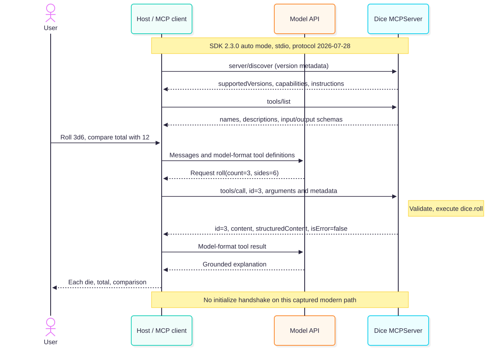

# MCP: from an ordinary function to an agent tool

This lecture follows the [adoption tutorial](lecture-mcp-adoption.md) and takes a bounded dice tool from a Python function through the
Model Context Protocol (MCP) to an agent host. You should already recognize an
agent loop: send messages to a model, inspect its tool requests, execute selected
tools, append results, and ask the model again. You do not need a database.

After the lecture, you should be able to trace a tool call across the model API
and MCP boundaries, explain the provider's and host's responsibilities, inspect
a discovered contract, distinguish four kinds of failure, and justify using a
CLI or MCP for a concrete integration. The [example](../demos/lecture-mcp-dice/README.md)
contains reproducible setup, tests, and a [rehearsal script](../demos/lecture-mcp-dice/DEMO.md).

## Start with observable behavior

Ask the finished host to roll three six-sided dice once, show the individual
outcomes and total, and compare the total with 12. The useful evidence is the
actual tool name, arguments, result, and final answer. Plausible prose alone does
not establish that a tool ran. In the recorded LLM-free call, the outcomes were
2, 4, 5 and the total was 11. Therefore the total is below 12. That comparison is
our arithmetic; an authenticated model demonstration still needs rehearsal.
Random outcomes will change between runs.

The tool's contract is small: 1–20 dice, each with 4, 6, 8, 10, 12, or 20 sides;
1–100 coins for the second tool. A dice result contains ordered `rolls`, `total`,
and `sides`. A coin result contains an H/T `flips` string, `heads`, and `tails`.
The local pseudorandom generator is adequate for this demonstration. A few
samples cannot prove fairness, and this is not a cryptographic randomness tool.

## Why MCP when the harness can run a CLI?

A harness could execute `python dice.py roll --count 3 --sides 6` and parse its
JSON. That is already a valid integration. A CLI can have structured output,
validation, bounded operations, and good documentation. MCP adds a common way
for hosts to discover tool definitions and invoke named operations, so the
provider need not supply a different custom integration for every host.
There is still work on both sides of the boundary.

Compared with the toy agent, the central change is the integration boundary.
Its code contained each tool's schema and function mapping. An MCP-capable host
instead reads developer-supplied server declarations and asks those providers
for their tools. Adding a compatible dice server generally needs configuration,
not a dice-specific dispatch branch in the host. The provider can also be reused
by other compatible hosts, whose model adapters can expose its definitions to
different tool-capable models.

The host's MCP client performs discovery and invocation; the model requests tool
use through the host. Model-guided tool search is a host feature layered on this
mechanism. Neither design requires retraining the model to add tools: MCP adds
a shared provider interface, discovery, and routing convention. The toy-agent
code and the host, model, and server picture are presented in full in Section 1
of the [adoption lecture](lecture-mcp-adoption.md); what follows is a recap from
the provider side.

In Steps 5–6 of the toy-agent exercise, `TOOLS_SCHEMA` told the model what was
available, `TOOLS_DICTIONARY` associated names with functions, the harness
parsed arguments and dispatched, and a message with `role="tool"` returned the
result to the model. The MCP-enabled host preserves this loop:

| Toy-agent artifact | MCP-enabled host behavior |
|---|---|
| Handwritten `TOOLS_SCHEMA` | Discover definitions and adapt them to the model API |
| `TOOLS_DICTIONARY` | Associate a tool with its server/client connection |
| Direct function dispatch | Route an authorized request through the MCP client |
| Append tool result to messages | Convert the MCP result into the model API's representation |

The toy agent already needed exception handling, pairing calls with results,
and an execution limit. MCP does not remove those responsibilities. A server
can wrap the existing CLI rather than replace its implementation.

## Architecture and responsibility



The **host** is the agent application, here Claude Code. It owns the interaction
with the user and model, chooses which tools are available to the model,
applies execution policy, and integrates results into the next model request.
Its **MCP client** handles communication with a server. The **server** offers
operations and executes provider code. The **model** produces a tool request;
it does not execute the Python function itself.

The model API and MCP are separate connections. Our MCP link uses stdio pipes
to a local child process, while the host's model inference can use a remote
service. Local stdio therefore does not make the entire system offline.
Remote servers may instead use HTTP. Transport choice does not settle tool
permissions, credential scope, or trust in returned content.

The provider must define accurate descriptions and schemas, enforce bounds,
execute the underlying operation, return useful results, handle failures, and
protect any service credentials. The host must route names correctly, manage
processes/connections, adapt schemas/results to its model API, enforce policy,
manage context and budgets, and ground its answer in results. The SDK supplies
protocol framing, dispatch, and schema machinery; it cannot prove that a total
is correct or decide whether an application should grant database write access.

MCP also supports **resources** (addressable context) and **prompts** (reusable
message templates). They orient us within the protocol, but the dice example
only needs tools. We do not add features solely to exercise every primitive.

## Walkthrough A–E

**A: ordinary code.** `dice.roll` validates count and sides, generates outcomes,
and calculates their sum. `dice.flip_coins` checks count and calculates tallies.
Both can be called directly. Their CLI serializes the dictionaries as JSON.
Function callers receive `ValueError` for invalid arguments.

**B: a minimal adapter.** The pinned official SDK is `mcp==2.3.0`:

```python
from mcp.server import MCPServer
mcp = MCPServer("dice")

@mcp.tool()
def roll(count: int = 1, sides: int = 6) -> str:
    """Roll bounded dice and report each outcome and total."""
    # Delegate to ordinary code; format text or return Error: text.
```

The complete runnable version is in `dice_server.py --stage B`. The decorator
registers the operation. Type hints/defaults become an input schema; the
function's docstring supplies its description. A description helps the model
choose and use the tool, but the interface also includes name, schemas, result
representation, and failure behavior. An integer hint alone does not enforce
1–20. B's domain check catches invalid values and returns `Error:` text as a
successful tool result, preserving the earlier example's behavior.

**C: inspect actual messages.** `protocol_demo.py --stage B` launches a real
subprocess through a teaching tee and the official client. No LLM is involved.
The recorded modern path uses protocol revision `2026-07-28`:



The client sends `server/discover`, receives supported versions, capabilities,
and instructions, then asks `tools/list`. The listing provides tool names,
descriptions, and schemas. A `tools/call` request specifies the name and
arguments; the response carries the matching JSON-RPC ID. Requests also carry
protocol/client metadata. This capture has no initialization handshake. The
SDK's automatic negotiation can use a legacy path with older peers, so do not
generalize this trace into a claim that every deployed client has migrated.
The model-related arrows in the diagram explain the host integration; they
were not part of this LLM-free capture.

**D: strengthen the contract.** Count becomes an annotated strict integer with
minimum 1 and maximum 20. The sides parameter is strict integer; its whitelist
remains a function check, accurately stated in the description. This split
makes validation layers visible. It would also be reasonable to encode the
allowed sides as an enum in a later refinement. The adapter raises the SDK's
`ToolError` for a domain failure. Pydantic result models generate output schemas.
Successful results contain both text with serialized JSON and `structuredContent`.
The tests check that these representations agree.

**E: discover a second operation.** The same server adds `flip_coins`; discovery
now returns two tools. Ask the host for two d20 and five coins, then inspect both
calls and check the final answer against both results. MCP standardizes the
interface but does not guarantee correct model selection or reasoning.

## A guided implementation tutorial

The adoption lecture began with a provider that already existed. Now you are
that provider's implementer. A consumer needs to find the operation, understand
its arguments, execute it through the host, and interpret the result. Work
through these steps slowly rather than treating a decorator as unexplained
magic. Keep the ordinary computation, protocol adapter, and agent integration
as separate things you can inspect.

### Establish the environment and the ordinary computation

From a fresh checkout, start in `module-software-engineering/demos/lecture-mcp-dice/`, the directory containing
`pyproject.toml`, `uv.lock`, `dice.py`, and `dice_server.py`. Install the locked
environment before starting a host:

```sh
uv sync --locked
uv run --frozen python dice.py roll --count 3 --sides 6
uv run --frozen python dice.py flip_coins --count 5
```

`uv sync --locked` creates the project environment from the recorded dependency
resolution. The `--frozen` run commands use that environment without changing
the lock. We pin official `mcp==2.3.0`; another similarly named package or an
older import example is not equivalent. If you use an editor's Run button,
check that its interpreter is this environment rather than an unrelated Python.

`dice.py` is both a module containing ordinary functions and a small command-line
interface. `roll` returns a dictionary such as the following **constructed example**:

```json
{"rolls": [1, 6, 3], "total": 10, "sides": 6}
```

Three independent values are useful. `rolls` lets the caller inspect individual
outcomes. `total` is a derived value calculated by the server. `sides` records
the requested die type. Keeping the individual values makes a wrong total
detectable; returning only “success” would hide important evidence.

The CLI prints JSON. Its ability to produce structured output does not depend
on MCP. If a harness already has a reliable CLI integration, that can be a good
choice. We add MCP to expose a discoverable operation across compatible hosts,
not because command-line programs cannot return JSON or enforce limits.

The core computation checks count and sides before generating values:

```python
bounded_count(count, 20)
if type(sides) is not int or sides not in ALLOWED_SIDES:
    raise ValueError("unsupported sides")
rolls = [random.randint(1, sides) for _ in range(count)]
return {"rolls": rolls, "total": sum(rolls), "sides": sides}
```

This excerpt shortens the actual diagnostic text. `randint(1, sides)` includes
both endpoints. The list comprehension performs one draw per die. `sum(rolls)`
adds those outcomes; it does not make another draw. The final type checks reject
booleans as counts or side values even though Python otherwise treats booleans
as integer-like values. Read `bounded_count` to see this explicit choice.

A direct call such as `dice.roll(0)` raises a Python exception. That is a function
interface, not yet an MCP result. The adapter decides how to represent that
failure to a protocol consumer. This is a good reason to keep the ordinary
function independent of transport.

### Read a complete minimal server

The following complete, self-contained teaching server demonstrates the first
adapter stage. It intentionally returns domain failures as successful text so
we can later compare that behavior with explicit tool errors:

```python
import random
from mcp.server import MCPServer

mcp = MCPServer("dice")

@mcp.tool()
def roll(count: int = 1, sides: int = 6) -> str:
    """Roll 1–20 dice with 4, 6, 8, 10, 12, or 20 sides.

    Return each outcome and their total. Invalid values return Error: text.
    """
    if not 1 <= count <= 20:
        return "Error: count must be between 1 and 20"
    if sides not in (4, 6, 8, 10, 12, 20):
        return "Error: unsupported sides"
    rolls = [random.randint(1, sides) for _ in range(count)]
    return f"rolls: {rolls} total: {sum(rolls)}"

if __name__ == "__main__":
    mcp.run()
```

You can save this in the locked demo environment as `tutorial_server.py` and
launch it with that environment's Python. It waits for a client; it does not
print a chat prompt. To inspect the repository's maintained version instead,
use `dice_server.py --stage B`. The maintained example delegates the computation
to `dice.py` and selects stages through a factory. That structure lets the
walkthrough compare behavior without maintaining many nearly identical files.

`MCPServer("dice")` constructs the provider object and gives it a name. The
`@mcp.tool()` line is a Python **decorator**: it registers the following function
as an exposed operation. Registration happens when Python executes the module,
before any model chooses a tool. `def roll` supplies the operation's name and
function. The model does not receive this implementation as executable code.

The annotations `count: int` and `sides: int` describe parameter types for the
SDK's schema/validation machinery. `= 1` and `= 6` are defaults. A caller omitting
both arguments requests one d6. `-> str` describes the return representation.
The docstring becomes a tool description. It explains purpose and semantic
limits, but it is not the entire interface and does not enforce those limits.
The function body is responsible for checks absent from the schema.

Finally, `mcp.run()` starts the stdio server in this example. Standard input and
standard output become protocol channels. A debugging `print("ready")` on
stdout would put non-protocol text in the client's stream. Use stderr logging.
The SDK's own validation diagnostics observed during preparation went to stderr.

### Connect the new provider using what you learned earlier

A remote server entry supplied a URL. A local dice entry supplies a launch
command instead. After `uv sync --locked`, an illustrative host entry is:

```json
{
  "mcpServers": {
    "dice": {
      "type": "stdio",
      "command": "/absolute/path/to/dice/.venv/bin/python",
      "args": ["/absolute/path/to/dice/dice_server.py"]
    }
  }
}
```

Replace the illustrative paths with your actual absolute paths. They are not
portable values to copy unchanged between machines. The demo script generates
this configuration in a scratch session to avoid hand-editing paths or changing
global configuration. Windows virtual environments normally place the interpreter
under `Scripts`; the transcript above shows the rehearsed macOS/Linux form.

The `args` array here launches the server process. It is not the later
`{"count":3,"sides":6}` tool argument object. That distinction is easy to miss
when both are called arguments. Launch failure means the provider cannot start;
a bad dice argument is a later operation-level failure.

### Inspect what consumers actually discover

Run:

```sh
uv run --frozen python protocol_demo.py --stage B
```

The official client starts a real child process and discovers `roll`. Its input
schema includes an object with `count` and `sides` integer properties and their
defaults. At this stage the schema does not advertise the numeric count bound
or allowed-side whitelist. An integer type is not the same constraint as an
integer between 1 and 20. The function still checks those semantic limits.

Now inspect D:

```sh
uv run --frozen python protocol_demo.py --stage D
```

In the actual D listing, count includes these fields:

```json
{"default": 1, "minimum": 1, "maximum": 20, "type": "integer"}
```

The complete listing also includes SDK-generated titles and the surrounding
object. Those titles help identify schema components; they do not add domain
constraints. `sides` remains a strict integer with a default. The whitelist is
still in function code and description, so `sides=7` gets through integer shape
validation and then fails the domain check. An enum schema could improve
advertising in a future refinement; the present split deliberately exposes
the layers students must distinguish.

A schema helps form calls and detect certain errors, but does not tell the
consumer every important invariant. The output schema can require a list and
a total integer without proving that the total equals the sum. Tests of the
ordinary code establish that relationship.

### Follow one successful call and both result representations

The actual captured E call requested:

```json
{"count": 3, "sides": 6}
```

The provider produced `[2,4,5]`, total 11, sides 6. In the captured response,
`isError` is false and the result contains `structuredContent`:

```json
{"rolls": [2, 4, 5], "total": 11, "sides": 6}
```

It also contains a `content` array with a text block holding formatted JSON for
the same values. Text is a useful representation for clients expecting readable
content; structured content gives clients a machine-readable object. They are
two representations of one tool result, not two rolls. The tests parse the text
JSON and compare it with structured content to guard against inconsistency.

The return annotation is a Pydantic model in D/E:

```python
class RollResult(BaseModel):
    rolls: list[int]
    total: int
    sides: int
```

The adapter constructs an instance from the ordinary result dictionary. The
SDK uses that model to produce an output schema and serialize the result.
Pydantic is a Python validation/representation library; it is not a second
agent or another network service. Its field types describe shape. They do not
independently verify every domain invariant.

Where does the comparison with 12 happen? The dice tool calculates the total;
it does not return a comparison field. The host sends the result back to the
model, which can explain that 11 is below 12. We can independently check the
arithmetic. In the saved LLM-free evidence, that comparison is the instructor's
reasoning, not a captured model answer. A host rehearsal must verify the
model's actual final explanation separately.

### Work through four failures instead of treating them as one

**Count zero in B.** The ordinary function raises ValueError. B catches it and
returns text beginning `Error:`. The protocol call completed successfully, with
`isError=false`. A consumer cannot use the prefix alone as a protocol failure
indicator. This preserves the inherited example's behavior for comparison.

**Count zero in D.** The annotated strict count field includes `ge=1`, so the
SDK's argument validation rejects the request before the dice function runs.
The observed tool result has `isError=true` and diagnostic text describing the
lower bound. This does not mean the transport crashed.

**Count as a string.** The final adapter uses strict fields so it rejects
`"3"` and `true` as well as a word such as `"many"`. B's plain integer annotation
can coerce some values according to its validation rules; do not assume that
Python type hints always imply strict JSON typing. The tests state the final
contract explicitly. It is a design decision worth making visible to consumers.

**Sides seven in D.** Seven has the required integer shape, but the ordinary
function rejects it as unsupported. The adapter catches ValueError and raises
the official SDK's ToolError. The observed result has `isError=true` and the
allowed values. Here execution reached the function's domain check rather
than failing SDK count validation.

There is also a distinct **protocol request failure**. The malformed capture
contains a `tools/call` request without a tool name, while including the required
modern envelope metadata. The response has JSON-RPC `error.code=-32602`, not
a successful response containing a tool result. A stopped subprocess or timeout
would be a transport/lifecycle failure. Do not label every one of these outcomes
“the function returned an error.”

When diagnosing, first identify whether there is a protocol response, whether
it contains a result or error, whether the tool result indicates failure, and
what the relevant domain check says. This ordered inspection avoids guessing
from a single word in a log.

### Test at boundaries that can actually fail

A controlled-randomness test makes an exact assertion meaningful:

```python
with patch("dice.random.randint", side_effect=[1, 6, 3]):
    assert dice.roll(3) == {"rolls": [1, 6, 3], "total": 10, "sides": 6}
```

The patch replaces the source of random outcomes for this test. It does not
claim that a real roll will be 1,6,3. The test checks that the function consumes
three draws, preserves their order, and calculates their sum. If the implementation
accidentally returns the last die as the total, this deterministic test catches
it reliably. Sampling a few uncontrolled rolls would be a poor way to diagnose
that defect and cannot prove fairness.

Boundary tests separately check counts 1 and 20, every permitted side count,
invalid counts/types, and coin counts 1 and 100. For coins, compare the H/T
sequence with both tallies and require heads+tails=count. An outcome-domain
check catches an impossible face even when length and total look plausible.

An in-process protocol test uses `Client(build_server("E"))`, lists tools, and
calls them. It can inspect generated input/output schemas and result fields
without network or a model. This is useful for a wrong return annotation or
an unexpected error representation. It does not establish that a fresh child
process can import dependencies or locate files.

That is why the subprocess check uses `StdioServerParameters` with a real
interpreter and server file. It verifies launch, discovery, and calls across
actual stdin/stdout. A wrong interpreter or accidental stdout print can break
this layer even when ordinary functions pass. The teaching wire proxy tees
JSON-RPC lines to a file and forwards the original stream; it is observation
tooling, not part of the server's domain logic.

Finally, inspect a real host interaction. The two tools can be healthy while
a model chooses the wrong one, uses wrong arguments, rerolls unnecessarily, or
misstates a result. Protocol tests cannot prove those behaviors absent a model.
Use the exact prompts, expanded calls, returned values, and final answers in
the demo script. Record a failed rehearsal as a failed rehearsal.

### Repair common setup failures

If import fails, run the program with the project environment. Installing a
package into another Python interpreter will not repair the child process's
imports. Use absolute server/interpreter paths for the scratch host and check
which environment the host actually launches.

If direct execution works only from the dice directory, inspect relative paths
in the launch configuration. A host can run from another working directory.
The provided protocol demo locates files relative to its own source and starts
the same interpreter that runs the client. This makes the launch assumption
explicit instead of depending on your terminal's current directory.

If the client reports invalid protocol text, inspect stdout. A friendly startup
banner is still non-protocol text. Move diagnostics to stderr and rerun the real
subprocess test. Do not modify model prompts to compensate for broken framing.

If `/mcp` shows a connected server but a response invents a roll, inspect the
actual invocation. Clarify the request to use the tool, identify the provider,
and check selection/loading behavior. A recorded random result is a fallback;
it is not a fresh roll unless the operation actually ran again.

If an output seems surprising, compare the layers independently. A sum mismatch
is a domain result problem. A correct result misquoted by the model is a grounding
problem. A wrong schema limit is a contract problem. Different evidence supports
each diagnosis.

### Choose the interface for a real engineering task

A one-off script that already produces bounded JSON may fit an existing CLI
workflow. A provider reused across multiple compatible hosts may benefit from
MCP discovery. A large service with sensitive operations needs narrow contracts,
service authorization, and maintenance regardless of interface. MCP can expose
an existing CLI; adopting it need not mean replacing the underlying program.

Think through result size as well as tool count. Returning a million simulated
dice faces would burden execution and context; the 20-dice bound keeps the
operation understandable. Returning only the total would reduce output but
remove evidence needed by our opening task. Interface design balances what
the consumer needs against work and context costs.

Resources and prompts are useful in other integrations: a resource can expose
addressable reference material and a prompt can provide a reusable message
template. Neither is required to make these dice tools complete. Add capabilities
because a consumer needs them, then test their behavior.

### Vocabulary and explained checks

A **decorator** registers a Python function; an **annotation** describes a field
type; a **schema** advertises data shape and constraints; **validation** checks
some of those constraints; a **domain invariant** expresses the operation's
meaning, such as total=sum(rolls). A **tool error** is an operation failure
represented in the protocol; a **protocol error** concerns the request itself.
A **transport** moves messages between processes, and a **host** manages the
model loop and tool routing.

**Why can B return Error text without `isError=true`?** Because the adapter
returned a normal string. The SDK has no reason to infer a failure flag from
an English prefix. D makes the intended signaling explicit.

**Does the count schema prove the total is correct?** No. It validates an input
bound. Output shape validation also does not prove the arithmetic invariant.
Controlled tests check that meaning.

**Would passing in-process tests catch a missing interpreter dependency in the
host's child process?** Not necessarily. The running test interpreter may have
the package while the configured child does not. Reproduce the actual launch.

**Why keep both outcomes and total?** The task asks for individual dice and a
comparison based on the total; the outcomes also let us verify the sum. The
result contract serves both use and checking.

**What carries the MCP request to the server?** The host's MCP client. The model
API's request is a separate representation adapted by the host. The server
executes ordinary code rather than delegating a random draw to model prose.

## Testing at three layers

1. **Function:** controlled randomness makes exact sums and tallies testable.
   Test every allowed side count, minimum/maximum counts, disallowed sides,
   invalid types, and bounds. Check length, outcome domain, sum, and tallies.
2. **Protocol:** discover schemas and call tools without a model. Check text vs.
   structured results and failures. In-process tests are fast, while a real
   stdio subprocess also checks launch paths, import environment, framing, and
   the requirement that stdout contain only protocol messages.
3. **Agent integration:** inspect actual model-selected calls and the final answer.
   Include the user's task, exact arguments, raw results, and answer. A working
   server does not prove that the host exposes it or that a model uses it well.

Keep these failures distinct:

| Layer | Example | Observable behavior in this package |
|---|---|---|
| Ordinary function | `dice.roll(0)` | Python `ValueError` |
| SDK argument validation | D `count=0` or string count | `result.isError=true`, validation text |
| Tool execution | D `sides=7` | Function check mapped to `ToolError`, `result.isError=true` |
| Protocol request | `tools/call` missing name | JSON-RPC `error`, code -32602; no result |

B `count=0` is a useful counterexample: the text says Error but `isError=false`.
A transport crash or timeout is another failure that the host must handle; it
is not interchangeable with a tool returning an error result. The SDK's strict
validation also prevents booleans and numeric strings in the final adapter.

## Connect this provider to the music homework

The [adoption notes](lecture-mcp-adoption.md) already introduced existing
providers, project configuration, and result verification. The
[music homework](../../neo4j/02-neo4j-music-mcp/README.md) uses the official Neo4j provider
with a complete fictional fixture, not the older airport transcript. Its actual
schema/read capture and direct query results are available for instructor fallback.
The server exposes `get-schema` and `read-cypher` in the tested restricted launch.

Think about the consumer's checks when designing dice. Music needs an accurate
schema path, correct distinct counts, and rows supporting the answer. Dice needs
accurate argument limits, outcomes, a matching sum, and a grounded comparison.
In both cases a healthy protocol can coexist with wrong domain semantics or
wrong model interpretation. Provider tests and host evidence address different
parts of that chain. See the [current preview](../demos/lecture-mcp-adoption/neo4j-preview.md).

## Pitfalls, context, and costs

A wrong description can steer tool choice even when code is correct. Test such
changes as experiments; do not predict a guaranteed model failure. A truthful
schema can still omit a semantic constraint, as the sides whitelist shows.
Descriptions and results are model context, so concise, informative contracts
help both selection and cost. Tool output is data from a provider, not a new
source of authority to change host policy.

Separate three costs: server execution (local CPU or downstream service calls),
model turns (including retries and recovery), and context (definitions, arguments,
results, and accumulated history). Local dice execution makes no model call;
the host does. More tools can increase selection difficulty and context use,
but do not assume every definition enters every prompt. Current Claude Code
supports deferred tool search with model/provider/configuration exceptions.
Inspect `/context` and the actual session. This package reports no token counts
or price measurements.

Common practical failures include the wrong Python environment, relative paths
that work only in one directory, debug prints corrupting stdio, coercion hidden
by permissive types, a server listed but unavailable to the model, and large
results obscuring relevant evidence. Pin dependencies, use explicit launch paths,
log to stderr, bound work/results, and reproduce the failing layer independently.

## Two recipes and a decision

To **adopt** a server: identify a task, inspect the provider and exact version,
read its tools/permissions and transport requirements, configure it in a scratch
host session, inspect discovery, perform one bounded call, and verify the answer.
To **expose your tool**: define an ordinary function and contract, wrap it with
MCPServer, inspect generated schemas, test function/protocol/stdio behavior,
then rehearse the host. Use the supplied [agent-development prompt](../demos/lecture-mcp-dice/agent-prompt.md)
to request concrete evidence rather than just “build MCP.”

Choose a CLI when an existing command fits the task and the harness already has
a reliable execution/parsing path. Choose MCP when reusable discovery and named
operations across compatible hosts justify another adapter and its lifecycle.
A mature CLI can be wrapped by MCP. Evaluate the actual task, result shape,
permissions, portability, deployment, and maintenance burden; neither interface
makes an unbounded operation safe or a model answer correct by itself.

Self-check: Who executes the dice function? Which connection carries the tool
request to the server? Why does B's Error text still count as success? Which test
would detect an import failure only in the server subprocess? What evidence
would establish that the model's comparison with 12 used the returned total?

## Primary references

Checked 2026-11-15; runtime evidence uses the exact SDK pin, not a moving main branch.

- [Official Python SDK v2.3.0](https://github.com/modelcontextprotocol/python-sdk/tree/v2.3.0),
  [migration](https://py.sdk.modelcontextprotocol.io/migration/), and
  [v2 changes](https://py.sdk.modelcontextprotocol.io/whats-new/).
- [MCP architecture, revision 2026-07-28](https://modelcontextprotocol.io/docs/2026-07-28/learn/architecture).
- [Inspector](https://modelcontextprotocol.io/docs/tools/inspector).
- [Claude Code MCP setup and tool search](https://code.claude.com/docs/en/mcp).
- [Neo4j installation](https://neo4j.com/docs/mcp/current/installation/) and
  [official server source](https://github.com/neo4j/mcp).
