<!-- _class: lead -->

# Beads: Managing Agent Work Across Sessions and Subsystems

**Agentic Software Engineering**

A growing work graph · the recorded Spec Kit tic-tac-toe example

<!--
75-minute plan, with three minutes of slack:
0–7 what Beads is; 7–15 motivation; 15–25 usefulness and alternatives;
25–43 using Beads; 43–64 recorded tic-tac-toe workflow and fresh-session handoff;
64–67 parallel/distributed workflow summary; 67–72 exercise and reflection; 72–75 slack.
Students have already seen the Spec Kit five-in-a-row game. SDD is the general setting; Spec Kit supplies the familiar example.
The lecture follows a sole developer. The captured implementation uses one agent at a time; one developer can also coordinate several agents. The documented parallel/distributed extension stays on one summary slide.
Slides 3–4 retain a small seeded issue to introduce fields. Slides 24–41 use the recorded Sonnet run, real issue IDs, archived states, and actual verification. Abbreviations, diagrams, reproduction commands, and proposed improvements are labeled accordingly.
Student notes accompany the lecture. The exercise-beads starter folder includes the render-and-resume handout, setup, and recorder; the deck summarizes its activity and evidence requirements.
Reference runtime: Beads 1.3.2; Claude Code 2.1.310; claude-sonnet-5-5. Recorded evidence and documentation checked October 26, 2026.
If long, compress alternatives and CLI details; retain the interrupted task, observed recovery, and evidence limitations.
-->


---


## What is Beads?

**Beads is an issue tracker designed for coding agents.** Its command is `bd`.

- A **bead (issue)** records work, context, acceptance criteria, status, and ownership.
- **Dependencies** connect the work into a graph: what is independent, and what must wait?
- Agents query the relevant work and maintain it across sessions and subsystems.

GitHub Issues communicates project concerns to users and developers. **Beads organizes detailed agent execution:** “What is ready, who owns it, and what remains?”

<p class="source">Sources: <a href="https://github.com/gastownhall/beads/tree/v1.3.2">Beads 1.3.2</a> · <a href="https://beads.gascity.com/multi-agent/coordination">Coordination</a> · <a href="https://docs.github.com/en/issues/tracking-your-work-with-issues/using-issues/creating-issue-dependencies">GitHub Issues</a></p>

<!--
Define a persistent, queryable work graph, rather than limiting Beads to a local queue or a session-memory file. An issue can be a task, feature, bug, or investigation.
The developer and agent can inspect the same records; the agent normally maintains them. No extra model is required for basic CLI operations.
The GitHub comparison is about audience and execution granularity. GitHub supports dependencies, APIs, CLI access, and agents too; all three artifact roles on slide 9 can coexist.
Retrieval is deliberate: storing a bead does not automatically place its information into an agent's context. Parallel/distributed use also needs appropriate workspace and issue-sharing setup, summarized later.
-->


---

<!-- _class: compact -->

## One bead, concretely

**A bead is one tracked work item.** Prepared illustration; the progress below is example data.

| Beads field | Meaning and example |
|---|---|
| **Title** | Parse player input for tic-tac-toe |
| **Description** | **Work:** implement move/menu parsing and update the existing menu caller. **Context:** references to the game's input rules. |
| **Acceptance criteria** | **Done when:** specified inputs parse, menu behavior is preserved, and the required tests pass. |
| **Notes** | **Progress:** move parser implemented; next: menu tests and refactor. |
| **ID / status** | `ttt-8fy` / `in_progress` — identify the task and track its state |

“Context,” “done when,” and “progress” describe contents, not extra fields. The later recorded run uses different IDs.

<!--
Use the actual work item and Beads fields before introducing the original Spec Kit task IDs.
The title names the work; the description explains its scope and links to the governing rules. Acceptance criteria explain the evidence needed for completion. Notes preserve progress and the next action.
There is no standalone context field in this example: context is supplied by references in the description. The CLI uses --acceptance for acceptance criteria and --append-notes for progress updates.
This is a seeded example issue. Its progress is example data, not a claim that the parser was implemented. The next slide captures the real CLI serialization of the same issue.
Hash IDs are assigned by Beads. Do not type the illustrative ID expecting it to exist.
The later Spec Kit slide describes the original work by name. Task labels remain source references, not prerequisites for following the lecture.
Grouping move/menu parsing and the menu-caller refactor is a granularity choice inherited from the original implementation task and useful for the planned interruption; Beads does not require those parsers to share an issue.
Source for fields: https://beads.gascity.com/core-concepts/issues
-->

---

<!-- _class: compact code-dense -->

## The same bead, as JSON

`bd show ttt-8fy --json`

```json
[
  {
    "id": "ttt-8fy",
    "title": "Parse player input for tic-tac-toe",
    "description": "Implement move/menu parsing. Update menu caller. Follow input rules.",
    "acceptance_criteria": "Required formats parse; menu behavior is preserved; tests pass.",
    "notes": "Move parser done; next: menu tests and refactor. (Example progress.)",
    "status": "in_progress"
  }
]
```

<p class="source">Actual Beads 1.3.2 output from the prepared illustration; selected fields shown. Separate from the recorded run. <a href="https://github.com/santoslab/agentic-software-engineering-public/blob/main/module-software-engineering/slides/examples/bead-show.json">Full JSON output</a>.</p>

<!--
Read this beside the preceding slide: title and description specify the actual work item; acceptance_criteria states the completion conditions; notes records progress; status tracks the lifecycle.
The output is an array even when showing one issue. Other metadata such as priority, assignee, timestamps, and claim information is omitted here; the linked file preserves the complete command output.
Captured with the repo-local Beads 1.3.2 CLI in a disposable repository. The issue and its progress text were seeded for teaching; this is not evidence that game implementation or an agent handoff has run.
The displayed bd command names the CLI. With this repo's local install, invoke it as "$BD" after setting the executable path as shown in the setup section.
Full output: slides/examples/bead-show.json. No schema or values were invented to fill out the display.
-->

---


<!-- _class: compact -->

## Motivation: resuming work from a previous session (in a clear context)

A previous session implemented part of the parser. Recover the task, governing rules, changes, evidence, remaining work, and next action.

**Recall `STATE.md` in “Other LLMs and Harnesses”:** preserve project state at checkpoints so it survives the session.

As the project grows, we also need to:

- retrieve work for one subsystem;
- maintain ownership and prerequisites across many tasks;
- divide independent work among agents and carry discoveries forward.

**Beads makes these work items and relationships queryable.**

<p class="source">Callback: <a href="https://github.com/santoslab/agentic-software-engineering-public/blob/main/weeks-01-03/slides/lecture-04-other-llms-and-harnesses.md#poor-mans-context-management-on-a-budget">Other LLMs and Harnesses — “Poor man's context management on a budget”</a></p>

<!--
Keep the requested previous-session wording. The callback is slide 15 of Other LLMs and Harnesses: a project-root STATE.md, maintained at checkpoints or before compaction, with version control.
STATE.md preserves a useful summary. A growing, interconnected backlog needs individually addressable records, dependency queries, ownership, and selective retrieval. A single hand-maintained narrative/list does not supply that machinery.
The limitation concerns a monolithic summary/checklist as the operational tracker, not Markdown as a storage format. Ticket later illustrates separate structured ticket files plus tooling.
The handoff is one benefit of the work graph. The broader motivation is organizing work across sessions, subsystems, and workers. Code and Git remain evidence about the realization.
-->


---


## SDD: from specifications to a growing work graph

**Specification-driven development (SDD)** connects required behavior to an implementation plan and actionable tasks.

**Our familiar planning input:** Spec Kit's tic-tac-toe [tasks.md](https://github.com/santoslab/agentic-software-engineering-public/blob/4d6a2cdc70cfd3fc4ffc5d117ad1078d69b206f8/module-software-engineering/demos/lecture-speckit-intro-tic-tac-toe/specs/001-five-in-a-row/tasks.md).

**Two examples from that plan:**

- Write tests for reading player moves.
- Implement move/menu parsing and update the existing menu caller.

During execution, tasks gain status, owners, discoveries, evidence, and dependencies across parts of the system.

**The ongoing question:** what work is ready in this part of the project, and how does it connect to the rest?

<p class="source">Example: <a href="https://github.com/santoslab/agentic-software-engineering-public/blob/4d6a2cd/module-software-engineering/demos/lecture-speckit-intro-tic-tac-toe/specs/001-five-in-a-row/tasks.md">the course's Spec Kit task list</a></p>

<!--
Begin with SDD in general; Spec Kit is the familiar example, not a Beads prerequisite. Other planning tools and task formats can supply the same kind of input.
The source calls these tasks T019 (move-parser tests) and T022 (parser implementation and menu-caller refactor). Those labels are retained for traceability; explain the work by name. They are separate from Beads issue IDs.
Retain the original task list as planning input in this adapted working copy. Beads is the live operational graph. A task document can describe dependencies, but selective queries, ownership, and ongoing updates across a growing collection need tracking machinery.
The specification still governs required behavior. Decomposing or regrouping work does not authorize changing it.
-->


---


<!-- _class: compact -->

## What we want the work graph to answer

| Question | Record or query needed |
|---|---|
| What work belongs to this subsystem or goal? | Grouping, labels, and task references |
| What can proceed independently; what must wait? | Ready work and explicit dependencies |
| Who owns it; what is already active? | Assignee, status, and progress |
| Where did this new work come from? | A discovery link and explanation |
| Why is it considered complete? | Acceptance criteria and evidence |
| What should the next session do? | A concrete handoff |

The agent maintains the records and retrieves the part relevant to its work.

<!--
Scale includes the number of tasks, their relationships, subsystem boundaries, and the number of sessions/workers. It is not only the length of a saved conversation.
These are structural capabilities to inspect, not a measured speedup claim. The tiny recorded graph demonstrates the mechanism, not throughput with a large backlog.
Grouping work and declaring prerequisites are separate operations. A stored completion status still needs supporting evidence.
-->


---


<!-- _class: compact -->

## When is Beads useful?

- **A growing backlog:** query selected work instead of maintaining one expanding checklist.
- **Several subsystems:** retrieve local context and keep dependencies across boundaries visible.
- **Independent work:** assign separate tasks to agents; integration waits for prerequisites.
- **Sessions and compaction:** preserve decisions, partial progress, and evidence.
- **New work appears:** record discoveries and handoffs while implementation proceeds.

**In “Other LLMs and Harnesses,”** we saw compaction omit details needed to continue work—even within the same session.

<p class="source">Sources: <a href="https://github.com/santoslab/agentic-software-engineering-public/blob/main/weeks-01-03/slides/lecture-04-other-llms-and-harnesses.md#compaction-what-happens-when-context-runs-out">Earlier compaction comparison</a> · <a href="https://beads.gascity.com/cli-reference/list">Selective queries</a> · <a href="https://beads.gascity.com/multi-agent/coordination">Coordination</a></p>

<!--
Keep the within-session compaction callback self-contained. Lecture 4, Other LLMs and Harnesses, slide 14 inspected actual compaction output; Lecture 6 also discusses lossy summaries. These are historical observations, not permanent rankings of tools.
Beads needs the agent to save the information and retrieve it again. It cannot reconstruct facts never recorded.
The growing work graph is the main motivation; session recovery is one consequence. A short, immediate change may need little tracking, but a monolithic task/state file is not the operational model for a growing graph.
One developer can manage multiple agents. This lecture demonstrates sequential use and summarizes parallel/distributed setup later.
-->


---


<!-- _class: compact -->

## Project issues and agent work items

**All three can be used together.** Each record has a role.

| Work record | Typical role |
|---|---|
| **SDD task document + Git** | Original work breakdown, rationale, and specification references |
| **GitHub Issues / Projects** | Broader bugs, features, and coordination read by users and developers |
| **Agent work graph, such as Beads** | Detailed execution, ownership, prerequisites, evidence, and handoffs across parts of the project |

**Example:** GitHub: “Add two-player mode” → SDD plan → related parser, renderer, loop, and verification beads.

Detailed agent work in GitHub can **clutter the user/developer issue list**. Link the records; keep each work item's status authoritative in one place.

<p class="source">Sources: <a href="https://github.com/github/spec-kit/blob/main/templates/tasks-template.md">SDD task-list example</a> · <a href="https://docs.github.com/en/issues/tracking-your-work-with-issues/learning-about-issues/about-issues">GitHub Issues</a> · <a href="https://beads.gascity.com/core-concepts">Beads</a></p>

<!--
Audience and granularity distinguish these roles; GitHub can represent detailed tasks and dependencies too. Do not claim an exclusive technical capability or automatic synchronization between these artifacts.
The original task document is planning input. GitHub communicates the broader project concern. Beads maintains the evolving detailed graph, which may span subsystems and agents.
Retain original IDs and links. Different work items at different levels may have distinct statuses; avoid independently editing two statuses for the same item.
Spec Kit's GitHub extension can export tasks, but the team still decides which granularity belongs in its public/developer-facing issue list.
-->


---

<!-- _class: compact -->

## Alternatives: choosing an agent work tracker

| Tool | Prefer when you want… | Main tradeoff |
|---|---|---|
| **[Task Master](https://github.com/eyaltoledano/claude-task-master)** | AI commands to generate tasks and subtasks | Whole-file JSON; lost concurrent updates (0.43.1); *(no established evidence for the effectiveness of AI commands)* |
| **[Ticket](https://github.com/wedow/ticket) (`tk`)** | Readable Markdown tickets, dependency queries, and normal Git review | Bash tooling; collaboration through task-file merges |
| **[Beads](https://github.com/gastownhall/beads/tree/v1.3.2) (`bd`)** | Agents managing a growing work graph across sessions and subsystems | Dolt (Beads’ database): branching/merging; one writer embedded; server for concurrency; issue sync |

**Beads is designed for agents:** they can create and refine beads, link prerequisites, record discoveries, and close verified work.

The agent plans and maintains the graph; independent work can be assigned separately.

<p class="source">Sources: <a href="https://github.com/eyaltoledano/claude-task-master">Task Master</a> · <a href="https://github.com/wedow/ticket">Ticket</a> · <a href="https://github.com/gastownhall/beads/tree/v1.3.2">Beads</a></p>

<!--
These are conditional preferences inferred from the documented approaches, not a benchmark or a universal ranking.
Task Master provides AI commands that turn requirements into task records and split selected tasks into subtasks. There is no established evidence for the effectiveness of these AI planning commands. The examined unit tests mock model output, and the manual generation benchmarks measure timing/progress rather than plan quality or resulting software. See the evidence links in the course notes. Its AI features require model/provider or supported CLI configuration; do not say it always requires a separate API key. An existing SDD plan can also feed either tracker.
Ticket keeps Markdown/YAML records in .tickets/ and supports dependencies and ready-work queries. Its appeal is file inspection, ordinary Git review, and a Bash/coreutils toolchain; the query command additionally needs jq. Collaboration uses the task files and Git merges.
Beads is designed for coding agents to plan and maintain work, not just to store tasks entered by a human. The agent can create and refine the breakdown, wire dependencies, query ready work, and update records while coding. Task Master provides built-in AI task-generation and task-expansion commands; a coding agent using Beads can also do the planning through its own reasoning and bd calls. Our existing SDD plan is a teaching choice, not a prerequisite for agent use. Beads also supports workflow context through bd prime and persistent issue records. Cross-machine issue sync is separate from ordinary code Git push/pull. Ticket can also support session recovery; this is a workflow/storage choice, not an exclusive Beads capability.
Task Master local storage reads/parses a whole JSON file even for one task and rewrites it for status updates; tags are groups in that file, not storage shards. The measured latency through 10,000 synthetic tasks does not establish scalability as the backlog or writer count grows.
The Beads workflow was exercised locally. Task Master 0.43.1 local CLI storage was separately evaluated: command latency stayed around 1.4 seconds through 10,000 synthetic tasks (17.58 MB); this does not establish scalability. Concurrent status updates to the same tag lost successful changes. See research/task-master-assessment.md and its reproducer. Task Master AI planning and hosted team mode were not evaluated; Ticket remains documentation-based. Primary documentation checked 2026-10-26.
No Beads Rust comparison, per agreed scope.
-->

---


## Keep the roles of the documents clear

| Artifact | What it governs or records |
|---|---|
| [Specification](https://github.com/santoslab/agentic-software-engineering-public/blob/4d6a2cdc70cfd3fc4ffc5d117ad1078d69b206f8/module-software-engineering/demos/lecture-speckit-intro-tic-tac-toe/specs/001-five-in-a-row/spec.md) and [contracts](https://github.com/santoslab/agentic-software-engineering-public/blob/4d6a2cdc70cfd3fc4ffc5d117ad1078d69b206f8/module-software-engineering/demos/lecture-speckit-intro-tic-tac-toe/specs/001-five-in-a-row/contracts/cli.md) | Required behavior and subsystem interfaces |
| [Plan](https://github.com/santoslab/agentic-software-engineering-public/blob/4d6a2cdc70cfd3fc4ffc5d117ad1078d69b206f8/module-software-engineering/demos/lecture-speckit-intro-tic-tac-toe/specs/001-five-in-a-row/plan.md) | Implementation approach and structure |
| [tasks.md](https://github.com/santoslab/agentic-software-engineering-public/blob/4d6a2cdc70cfd3fc4ffc5d117ad1078d69b206f8/module-software-engineering/demos/lecture-speckit-intro-tic-tac-toe/specs/001-five-in-a-row/tasks.md) | The original work breakdown for this example |
| **Beads** | The evolving work graph: status, ownership, dependencies, discoveries, **evidence summaries**, and handoffs |
| Code, tests, and reports | The realization and evidence about it |

A specification gap still needs a **developer ruling**.

<!--
The graph supports dividing execution; specifications and contracts keep subsystem work aligned. Moving tasks into Beads does not move authority over intended behavior.
Store actual verification summaries, commands, outcomes, revision references, failures, and remaining acceptance criteria in the bead. Detailed reports and commits remain linked evidence.
An agent normally maintains the graph within the plan. Human rulings concern genuine intent/behavior changes, not every routine issue update.
The later recorded example includes a question carried through closure. Present that as a limitation of the run, not an endorsement of unresolved requirements.
-->


---

<!-- _class: standout -->

## Using Beads

Capture the work · choose a ready task · verify it · leave a useful record

<!-- 25–43 min. The CLI is deterministic; the quality of the information entered is a developer/agent responsibility. -->

---

<!-- _class: code-dense -->

## Install Beads; initialize the game project

[Beads project folder](https://downgit.github.io/#/home?url=https://github.com/santoslab/agentic-software-engineering-public/tree/main/module-software-engineering/demos/lecture-beads): `npm ci` installs the pinned **Beads 1.3.2 CLI** locally.

```sh
# From the extracted lecture-beads project folder:
npm ci  # install the bd executable pinned in package-lock.json
export PATH="$PWD/node_modules/.bin:$PATH"
export BD="$PWD/node_modules/.bin/bd"
"$BD" version

# Then enter the separate game working copy.
cd /path/to/tictactoe-work
"$BD" init --prefix ttt
```

**Manual demo setup.** The exercise’s `setup.sh` already installs and initializes Beads.

`BD` names the executable; `.beads/` belongs to the project being tracked.

<p class="source">Sources: <a href="https://beads.gascity.com/getting-started/installation">Installation</a> · <a href="https://beads.gascity.com/cli-reference/init">Initialization</a> · <a href="https://docs.npmjs.com/cli/v11/commands/npm-ci/">npm ci</a></p>

<!--
Use a disposable game working copy. Never initialize the public course repository for a classroom demo. These manual commands are for a separate uninitialized copy. The exercise and demo bundle setup scripts already initialize work/; a restored checkpoint also retains its tracking state.
The repo-local npm package downloads the native CLI. This does not install a global bd command.
Set BD in each terminal used for the demo; export it if an agent started from the terminal needs the variable.
Use the default init path: Beads 1.3.2 creates or updates AGENTS.md and CLAUDE.md and installs project integrations. Inspect its output, generated files/hooks, and resulting setup commit. The PATH export is needed because generated hooks invoke bd by name. --skip-agents is an optional way to suppress instruction/integration setup. The planned DownGit URL targets only module-software-engineering/demos/lecture-beads/; it becomes usable after that project folder is published. Slides and notes are published separately in their existing module folders.
CI means continuous integration. npm ci performs a clean install from package-lock.json; it also works locally. It requires a matching package.json and lockfile, removes an existing node_modules directory, and leaves the manifests unchanged. Here it installs the pinned Beads CLI. Installation and initialization are different steps.
The CLI calls below use "$BD" consistently so students can copy them without a global installation.
-->

---

## Inspect the generated agent guidance

- **[bd init](https://beads.gascity.com/cli-reference/init) — project setup:** creates tracking files and agent instructions.
- **[bd prime](https://beads.gascity.com/cli-reference/prime) — session guidance:** prints the Beads workflow for the agent to read at session start or after compaction.

In **[CLAUDE.md](https://github.com/santoslab/agentic-software-engineering-public/blob/main/module-software-engineering/demos/lecture-beads/recorded-run/policy/CLAUDE.md) / [AGENTS.md](https://github.com/santoslab/agentic-software-engineering-public/blob/main/module-software-engineering/demos/lecture-beads/recorded-run/policy/AGENTS.md)**, keep the generated guidance and add:

```markdown
Keep Spec Kit task IDs; tasks.md is the original plan.
Use Beads for live status, evidence summaries, and handoffs.
Read specifications/contracts before editing.
Ask the developer about changes to specified behavior.
```

The agent reads the **project policy** and the **output of `bd prime`**.

<p class="source">Sources: <a href="https://beads.gascity.com/cli-reference/prime">bd prime</a> · <a href="https://github.com/gastownhall/beads/tree/v1.3.2">agent onboarding</a></p>

<!--
The default initialization was checked locally with Beads 1.3.2 in empty repositories and repositories with existing AGENTS.md/CLAUDE.md: both instruction files were created or updated, existing policy text was preserved, and project integrations were installed. Their hooks use the plain bd command, so the repo-local bin directory must be on PATH. The block shown is additional course policy, not an upstream template. Add it to the instruction file the harness reads, alongside the generated guidance, and retain the existing instruction map and constitution.
init is project initialization; prime is repeated session guidance. prime prints Beads commands/workflow and saved project memories, when present. The generated instruction files tell the agent to run prime. The additional course policy stays in the instruction file the harness reads. The agent reads both that policy and the prime output, then queries its work items and governing files. prime does not simply print CLAUDE.md or AGENTS.md, and it does not reinitialize the project.
Optional editor integrations can run prime through hooks. The minimal lecture path shows the mechanism explicitly and does not require a new plugin.
Use the configured PATH for generated hooks; the lecture shell examples can also invoke the executable via "$BD".
-->

---

<!-- _class: compact code-dense -->

## What `bd prime` prints

`"$BD" prime` — selected output from the recorded run:

```text
# Beads Workflow Context
> **Context Recovery**: Run `bd prime` after compaction, clear, or new session
...
# 🚨 SESSION CLOSE PROTOCOL 🚨
[ ] 1. bd close <id1> <id2> ...   (close completed issues)
[ ] 2. run quality gates        (tests, linters, builds when relevant)
[ ] 3. git status               (check what changed)
[ ] 4. report handoff           (local-only/no remote sync; wait for authority)
...
## Core Rules
- **Workflow**: Create beads issue BEFORE writing code, mark in_progress when starting
...
### Finding Work
- `bd ready` - Show issues ready to work (no blockers)
- `bd list --status=in_progress` - Your active work
- `bd show <id>` - Detailed issue view with dependencies
```

<p class="source">Beads 1.3.2; omissions marked <code>...</code>. <a href="https://github.com/santoslab/agentic-software-engineering-public/blob/main/module-software-engineering/slides/examples/sonnet-run/prime-workflow.txt">Full recorded output</a>. Closing rules reflect this local-only demo.</p>

<!--
This is actual decoded workflow context from the SessionStart hook in recorded call 03-review-beads, not an invented template. The hook used bd prime; the linked text preserves its full additionalContext unchanged. The display selects lines in their original order and uses ellipses for omissions.
The output reminds the agent how to use Beads: reload workflow context, track work before coding, inspect available/active work, and close the session with verification and a useful handoff. It also contains issue creation/update, dependency, quality, lifecycle, and memory command guidance omitted here.
The local-only/no-remote checklist is specific to this demo's configuration. Do not present its prohibition on remote sync as a universal Beads rule. Project authority and configuration affect the wording.
Prime supplies workflow guidance and can include saved memories. To recover the actual task, the agent still queries the relevant issue and reads its linked specifications, code, and evidence. It does not regain the whole previous conversation by running prime.
Source: research/sonnet-tictactoe/transcripts/03-review-beads.md, first SessionStart hook stdout. Full decoded output: slides/examples/sonnet-run/prime-workflow.txt.
-->

---

## How the record reaches a fresh session



The tracker holds saved state. The agent must **query it and read the relevant files**.

<p class="source">Sources: <a href="https://beads.gascity.com/core-concepts">Beads concepts</a> · <a href="https://beads.gascity.com/cli-reference/show">bd show</a></p>

<!--
The issue database is Dolt-backed in this reference release. It lives separately from the model's active context.
The Beads executable stays in the downloaded project folder; the game working copy holds the work record and code.
Arrows into the fresh session are reads, not automatic recollection of the previous chat.
Only relevant issues and linked files need to enter the new context. Do not dump the whole backlog by default.
-->

---

<!-- _class: code-dense -->

## The agent's daily loop

**The agent runs these commands, implements the work, and records verification.**

```sh
"$BD" prime                            # workflow guidance
"$BD" list --status in_progress        # work already started
"$BD" ready                           # available new work
"$BD" show "$task_id"                  # context and criteria
"$BD" update "$task_id" --claim        # begin selected work
# Implement, inspect the diff, and run the required verification.
"$BD" close "$task_id" --reason "..."  # evidence for completion
```

**The agent resumes unfinished work first; the developer can redirect priorities.**

<p class="source">References: <a href="https://beads.gascity.com/cli-reference/ready">ready</a> · <a href="https://beads.gascity.com/cli-reference/update">update</a> · <a href="https://beads.gascity.com/cli-reference/close">close</a></p>

<!--
These are normally agent actions: the agent calls the CLI through its shell tool, performs implementation and verification, and maintains the record within the agreed scope. The commands are shown so students can understand and inspect that workflow. The agent sets task_id to the returned ID of the selected task.
Ready work normally excludes work in progress; that is why session start checks both views. This is the workflow, not a troubleshooting segment.
Claim records ownership and in_progress status. One developer still needs an explicit active task.
The close reason should name the relevant evidence, not merely say 'done'.
-->

---

## The agent writes actionable beads

The agent drafts and refines bounded work items from the specifications and plan.

**Too broad:** “Finish the CLI.”

**Bounded:** “Parse player moves and preserve menu behavior.”

- **Context:** the original plan and move/menu rules in [contracts/cli.md](https://github.com/santoslab/agentic-software-engineering-public/blob/4d6a2cdc70cfd3fc4ffc5d117ad1078d69b206f8/module-software-engineering/demos/lecture-speckit-intro-tic-tac-toe/specs/001-five-in-a-row/contracts/cli.md).
- **Outcome:** readable coordinates become a `Square`, even out of range; unreadable text is rejected.
- **Evidence:** parser tests; existing menu tests after the refactor.
- **Boundary:** the engine checks range and occupation; the two-player loop has another bead.

A useful task has a result you can inspect and verify independently.

<!--
The agent normally drafts, reviews, and updates the beads against the scope established during planning. Avoid decomposing each line of code into an issue. The agent groups a test task with its implementation task while retaining both original IDs.
T022 also requires a menu refactor, so dropping that caller change would make this task incomplete.
Signed and out-of-range numbers are syntactically readable; the engine handles range validation. Preserve this contract in the bead.
The source tasks and contract settle the behavior. The bead points to them instead of copying every clause.
-->

---


<!-- _class: compact -->

## Issues, epics, and their relationships

An **issue (bead)** is a tracked work item. An **epic** groups child work toward a larger goal.

| Relationship | What it says |
|---|---|
| **Blocking dependency** | The game loop needs the parser and renderer |
| **Parent / child** | The two-player milestone groups parser, renderer, loop, and verification work |
| **Discovered from** | A new question arose during parser implementation |

Group work by goal or subsystem; keep dependencies across groups explicit. **Priority** records importance; **dependencies** record prerequisites.

<p class="source">Source: <a href="https://beads.gascity.com/core-concepts/issues">Issues and relationships</a></p>

<!--
Issue and bead name the same record; an epic is an issue for a larger goal. The recorded run uses epic ttt-cik with four child issues.
Epics can organize milestones or subsystem work. Labels and references can also select work for a subsystem. Do not imply every subsystem must be an epic or that parent membership specifies all execution order.
The small demo's parser and renderer are independently executable parts of the CLI milestone; they are not two distinct architectural subsystems. Larger projects can apply the same dependency structure across subsystem boundaries.
The agent maintains these links. Explicit blocking edges express the taught prerequisites. Advanced workflow edges and blocked parents have other readiness semantics, so do not claim only blocks can ever affect readiness.
-->


---

## Dependency direction: read it as a sentence

**The agent adds and inspects dependencies through the CLI.**

```sh
"$BD" dep add "$loop_id" "$parse_id"
```

**“The loop depends on the parser.”**

```sh
"$BD" dep add "$loop_id" "$render_id"
"$BD" dep tree "$loop_id"
```

**Argument order:** dependent first, prerequisite second. Diagram arrows point prerequisite → dependent.

When the parser and renderer are complete, those prerequisites are satisfied.

<p class="source">Source: <a href="https://beads.gascity.com/cli-reference/dep">Dependency command reference</a></p>

<!--
These commands are normally run by the agent while maintaining the work graph. Students should be able to read them to review its choices. The first positional ID is the dependent; the second is its prerequisite. Default type is blocks.
Our diagrams draw arrows from prerequisite to dependent, so the visual arrow runs in the opposite reading order from these positional arguments. Say this explicitly.
Ask a student to read the second command aloud. That is enough practice; no troubleshooting segment.
-->

---

## Steve Yegge's advice: from plan to beads

*Paraphrased from “Beads Best Practices” (November 24, 2025).*

1. **Develop and revise the plan** with your preferred planning tool.
2. **Ask the agent to create detailed epics and issues**, including design context, dependencies, and work that could proceed in parallel.
3. **Ask the agent to review and refine the beads** so implementing agents can follow them smoothly.
4. **Iterate on both the plan and the beads** before implementation.

**In this lecture:** the familiar Spec Kit plan is our starting point.

<p class="source">Source: <a href="https://steve-yegge.medium.com/beads-best-practices-2db636b9760c">Steve Yegge, “Beads Best Practices”</a> · “Plan Outside Beads, Then Import”</p>

<!--
This is a paraphrase of the author's practitioner guidance, not a verbatim prompt or an effectiveness evaluation. Yegge recommends having the agent file detailed epics/issues, then perform a review and refinement pass. He describes repeating refinement on both plans and epics; we do not prescribe a fixed iteration count or an epic for every small task set.
Use this as the framing for the existing Spec Kit plan: the agent translates and iteratively reviews the work records. The next slide explains that scope and specified behavior come from planning; new gaps or proposed changes return there for a developer ruling. The article predates the pinned release; the command examples in this deck are separately checked against Beads 1.3.2.
-->

---

## The agent reviews beads against the plan

**Planning establishes scope, required behavior, and acceptance criteria.**

The agent iteratively reviews and refines the beads:

- Check coverage of the plan; find missing or duplicate work.
- Make each work item actionable and verifiable.
- Correct dependencies; split or combine tasks within the agreed scope.
- Repeat the review before implementation; maintain the records as work proceeds.

New specification gaps or proposed scope changes return to planning for a **developer ruling**.

<!--
Detailed review of task decomposition and dependencies is normally agent work, following Yegge's iterative-review advice. Scope and specified behavior come from the preceding planning/specification work. The agent can refine descriptions, task granularity, and relationships within that boundary. It does not need a new developer decision for each routine tracker update.
If review or implementation reveals an unresolved requirement, conflict, or proposed behavior/scope change, return it to the planning/specification process for the developer's ruling. Retain the Spec Kit constitution's rule that a person decides which side changes when code and specification disagree. The developer still assesses the resulting evidence before accepting completion.
-->

---


<!-- _class: compact -->

## Recorded run: six sessions, nine CLI calls

| Session | Prompts / CLI calls | Work |
|---|---|---|
| **1** | 01–04 | Plan → create beads → review → review again |
| **2** | 05 | Move parsing; partial commit and handoff |
| **3** | 06 | Fresh recovery; finish menu parsing and refactor |
| **4** | 07 | Implement and verify rendering |
| **5** | 08 | Implement and verify the two-player loop |
| **6** | 09 | Final verification and closure |

A session has one conversation history. Calls **02–04 use `--resume`** to continue session 1; calls **05–09 each start fresh**.

**Read the [recorded transcript on GitHub](https://github.com/santoslab/agentic-software-engineering-public/blob/main/module-software-engineering/demos/lecture-beads/recorded-run/transcript.md).**

<!--
43–64 min. Use this map to distinguish CLI invocations from session histories. Planning session 1 spans four calls; each later stage has one call in a fresh history. The exercise has its own five-call/two-session example. This section now uses the recorded Sonnet run. It follows one developer and sequential agent sessions; the graph also exposes independent work.
The task was deliberately paused after useful partial implementation and a real saved handoff. The process exited normally. No crash-recovery or compaction experiment is claimed.
The complete record, exact prompts, and stage archives are in research/sonnet-tictactoe. Keep provenance separate from the simpler seeded issue used on slides 3–4. The visible link targets the consolidated sanitized transcript at its public-course destination, published alongside the lecture. Original raw recordings remain authoring evidence.
-->


---


<!-- _class: compact -->

## The recorded run starts from an unfinished project

**Source:** [santoslab/agentic-software-engineering-public](https://github.com/santoslab/agentic-software-engineering-public) — the familiar Spec Kit tic-tac-toe demo.

For this run, we exported an **earlier unfinished state**:

- engine, evidence tooling, and the CLI shell already work;
- board rendering, move/menu parsing, and the two-player loop remain to be built;
- the baseline suite has **44 passing tests**.

The starter archive includes the specs/plan, project policy, pinned tools, prompts, and recorder.

**Runtime:** Claude Code 2.1.310 · Sonnet 5.5 · Beads 1.3.2.

<p class="source">Sources: <a href="https://github.com/santoslab/agentic-software-engineering-public/tree/b4bf5c1/module-software-engineering/demos/lecture-speckit-intro-tic-tac-toe">Course demo at the reviewed revision</a> · <a href="https://github.com/santoslab/agentic-software-engineering-public/tree/4d6a2cd/module-software-engineering/demos/lecture-speckit-intro-tic-tac-toe">Unfinished starter revision</a> · <a href="https://raw.githubusercontent.com/santoslab/agentic-software-engineering-public/main/module-software-engineering/demos/lecture-beads/tictactoe-beads-sonnet-starter.tar.gz">Starter and prompts</a></p>

<!--
The public course repository was checked at b4bf5c1679093c0baa90c7105038868b651c50a3. Its game tasks are already complete. That head changes the message-guard running example; it is not the starting revision of the recorded Beads run.
The recorded starter comes from the game subtree at 4d6a2cdc70cfd3fc4ffc5d117ad1078d69b206f8, before the two-player milestone was implemented. Preserve that provenance and the immutable archived inputs; do not imply the experiment used the newer completed game.
Describe remaining work by name. The original labels T018–T024 are available in the linked task map and notes appendix; students need not recall them.
The orchestrator exported an independent /tmp copy and added setup/policy files. Sonnet wrote/reviewed the execution plan and issues, implemented the source/tests, and recorded handoffs and commits. The independent baseline was 44 passing tests.
For reproduction follow the archived starter's README/setup.sh. Do not reinitialize a restored checkpoint. Input revision 2 includes the actual execution clarifications supplied after planning; the earlier input revision and exact prompts remain preserved.
-->


---


<!-- _class: compact -->

## Session 1: plan and review outside Beads

**Prompt 01 (abridged):**

> Review the existing specs, tasks, contracts, and code. Write an execution plan, review and revise it at least once, and record unresolved questions. Do not create beads or implement code yet.

**Sonnet wrote:** [planning/beads-plan.md](https://github.com/santoslab/agentic-software-engineering-public/blob/main/module-software-engineering/demos/lecture-beads/recorded-run/planning/beads-plan.md) and [planning/plan-review.md](https://github.com/santoslab/agentic-software-engineering-public/blob/main/module-software-engineering/demos/lecture-beads/recorded-run/planning/plan-review.md).

The review identified:

- separate commits for parser implementation and the menu refactor;
- game-loop tests must follow the refactor so its full-suite check can pass;
- missing menu-parser tests and a question about the leave-game boundary.

**Next:** prompt 02 clarified execution constraints, then requested the beads.

<p class="source">Sources: <a href="https://github.com/santoslab/agentic-software-engineering-public/blob/main/module-software-engineering/demos/lecture-beads/recorded-run/prompts/01-plan.txt">Exact planning prompt</a> · <a href="https://github.com/santoslab/agentic-software-engineering-public/blob/main/module-software-engineering/demos/lecture-beads/recorded-run/transcript.md#call-01">Planning transcript</a> · <a href="https://github.com/santoslab/agentic-software-engineering-public/blob/main/module-software-engineering/demos/lecture-beads/recorded-run/planning/plan-review.md">Written review</a></p>

<!--
The prompt shown here is an abridged paraphrase. The exact prompt and recorded response are linked.
This is the successful planning-only invocation, before issue creation. Sonnet wrote an execution plan with nine internal steps and reviewed it against the existing tasks/contracts; it did not implement code or create issues.
The first review left questions about menu-parser tests, test ordering, and the staged leave-game behavior. Prompt 02 clarified constraints already authorized by the starter: direct menu-parser tests are required by test-first policy; loop tests can follow the menu refactor; the selected milestone excludes the later leave-game feature. The same prompt required one parsing bead for the deliberate interruption.
The linked plan/review files preserve subsequent revision-2 clarifications too. The first planning transcript and after-planning archive preserve the initial result.
The filename suffix retry refers to retrying an authentication failure before successful model work. It does not mean a separate second planning pass. The plan revision shown here happened within the successful planning call.
The agent's initial summary incorrectly said no bd commands ran; the transcript includes bd list, and the session hook supplied bd prime. The next prompt requested and obtained a correction. No issues were created during planning.
-->


---


<!-- _class: compact -->

## Session 1: create four child beads

**Prompt 02:** create bounded beads and dependencies; preserve all obligations. For the later session-recovery demo, keep parsing in one bead: pause after move parsing; resume menu parsing and the menu-caller refactor in a fresh session.

**Sonnet created epic `ttt-cik`: the two-player milestone.**

| Work from the original plan | Recorded child bead |
|---|---|
| Write board-drawing tests; implement board and message rendering | **Render** (`ttt-cik.1`) |
| Write move-parser tests; implement move/menu parsing and the menu-caller refactor | **Parse** (`ttt-cik.2`) |
| Write session helpers/tests; implement the two-player loop | **Loop** (`ttt-cik.3`) |
| Run the full suite; check all two-player acceptance evidence | **Verify** (`ttt-cik.4`) |

<p class="source">Sources: <a href="https://github.com/santoslab/agentic-software-engineering-public/blob/main/module-software-engineering/demos/lecture-beads/recorded-run/planning/beads-map.md">Original task-label map</a> · <a href="https://github.com/santoslab/agentic-software-engineering-public/blob/main/module-software-engineering/demos/lecture-beads/recorded-run/prompts/02-create-beads.txt">Exact creation prompt</a> · <a href="https://github.com/santoslab/agentic-software-engineering-public/blob/main/module-software-engineering/demos/lecture-beads/recorded-run/transcript.md#call-02">Creation transcript</a></p>

<!--
Use readable work names in the explanation. The source labels are T018/T021 for rendering, T019/T022 for parsing, T020/T023 for the loop, and T024 for final verification. They are traceability references, not something students must remember.
The issue IDs are the actual database identifiers; the task names communicate their meaning. A new reproduction can assign different IDs.
The original implementation task groups move/menu parsing and the menu-caller refactor. The recorded prompt explicitly kept that complete scope in one bead for the planned interruption. This is one granularity choice; independent assignment could justify separate beads.
The separate conformance-preserving refactor commit, session helpers, test-first obligations, and later milestone verification remain required. The game-over menus from the later user story are outside this run.
-->


---


<!-- _class: compact -->

## Session 1: review and refine the beads

**Same session as prompts 01–02**, continued with `--resume`. Prompts below are abridged.

**Prompt 03:**

> Review every bead against the plan, tasks, specs, and contracts. Find omissions, ambiguity, missing evidence, and dependency errors. Refine the records and document findings. Do not implement.

**Agent:** preserved exact menu behavior, clarified test/commit boundaries, and recorded unresolved questions.

**Prompt 04:**

> Review again for requirements lost during grouping, contract mismatches, and implicit prerequisites or verification. Correct useful deficiencies; report readiness and unresolved decisions. Do not implement.

**Agent:** added the claim/progress/commit protocol and test-helper details. Dependencies stayed unchanged; Render and Parse remained ready.

<p class="source">Sources: <a href="https://github.com/santoslab/agentic-software-engineering-public/blob/main/module-software-engineering/demos/lecture-beads/recorded-run/prompts/03-review-beads.txt">Exact prompt 03</a> · <a href="https://github.com/santoslab/agentic-software-engineering-public/blob/main/module-software-engineering/demos/lecture-beads/recorded-run/prompts/04-review-again.txt">Exact prompt 04</a> · <a href="https://github.com/santoslab/agentic-software-engineering-public/blob/main/module-software-engineering/demos/lecture-beads/recorded-run/planning/beads-review.md">Recorded findings and changes</a></p>

<!--
These are prompts 03 and 04 of nine successful CLI invocations, still in the first of six conversations. Both used --resume; the same Sonnet agent reviewed its own records. These were separate review requests, not independent reviewers.
Prompt 03 compared every full issue against the execution plan, original tasks, contracts, and existing code. The first pass added acceptance/notes refinements: preserve exact menu rejection of 01/+1; clarify parser versus refactor commits and green-suite timing; specify where rendering text gains evidence; record baseline and open questions. It checked the graph without changing its dependencies.
Prompt 04 rechecked coverage after grouping, acceptance versus contracts, and implicit implementation/verification obligations. It added the epic's REVIEW 2 WORKING PROTOCOL plus loop-helper wiring and evidence details. It reported Render or Parse ready for implementation; unresolved questions remained.
The later detailed review slide gives examples of the resulting records. These summaries describe the archived work; they do not establish that two passes are optimal or that all questions were resolved. No implementation occurred in either review call.
-->


---


## The graph exposes independent work



**Arrows mean “must finish before.”** Render and Parse can proceed independently; Loop integrates their results.

Separate workers can take independent tasks. The recorded run used one agent at a time.

<p class="source">Source: <a href="https://github.com/santoslab/agentic-software-engineering-public/blob/main/module-software-engineering/slides/examples/sonnet-run/dep-tree-after-creation.txt">Captured dependency tree</a>; diagram drawn from those records.</p>

<!--
This is a derived Mermaid presentation of the actual issue graph, not a screenshot of bd's graph renderer. The foundational engine and contracts already exist.
Do not invent an edge between Render and Parse. Loop needs both; Verify needs Loop. Parent membership in ttt-cik groups the milestone; the displayed arrows are the explicit blocking edges.
The two branches are independently executable CLI tasks, not two different architectural subsystems. The same reasoning applies to work across larger subsystem boundaries when interfaces and prerequisites are clear.
The demo did not execute concurrently or across machines. Beads represents readiness and ownership; actual parallel work also needs suitable code workspaces and issue coordination.
-->


---


## The agent follows the project's tracking policy

The starter's [CLAUDE.md](https://github.com/santoslab/agentic-software-engineering-public/blob/main/module-software-engineering/demos/lecture-beads/recorded-run/policy/CLAUDE.md) / [AGENTS.md](https://github.com/santoslab/agentic-software-engineering-public/blob/main/module-software-engineering/demos/lecture-beads/recorded-run/policy/AGENTS.md) establish:

- specifications/contracts govern behavior;
- [tasks.md](https://github.com/santoslab/agentic-software-engineering-public/blob/4d6a2cdc70cfd3fc4ffc5d117ad1078d69b206f8/module-software-engineering/demos/lecture-speckit-intro-tic-tac-toe/specs/001-five-in-a-row/tasks.md) stays as the original planning input;
- Beads holds live status, ownership, evidence summaries, and handoffs;
- work stays within the two-player milestone; new behavior questions need a ruling.

**Sonnet follows Yegge's sequence:** review the plan outside Beads → file the epic/issues → review and refine the records twice.

<p class="source">Sources: <a href="https://github.com/santoslab/agentic-software-engineering-public/blob/main/module-software-engineering/demos/lecture-beads/recorded-run/planning/beads-plan.md">Agent-written execution plan</a> · <a href="https://github.com/santoslab/agentic-software-engineering-public/blob/main/module-software-engineering/demos/lecture-beads/recorded-run/transcript.md#call-01">Planning transcript</a> · <a href="https://github.com/santoslab/agentic-software-engineering-public/blob/main/module-software-engineering/demos/lecture-beads/recorded-run/README.md">Inputs and provenance</a></p>

<!--
This is a teaching adaptation, not a built-in Spec Kit–Beads integration. The supplied speckit-implement instruction normally marks tasks.md; the recorded run used explicit Beads-directed prompts and kept tasks.md unchanged.
The agent reviewed/revised its execution plan, created the records, and received two further requests to inspect and refine the actual beads. Those planning/review calls continued the same conversation; implementation calls started fresh conversations.
The recorded clarification in prompt 02 covers unit tests for parse_menu, the order needed for a green-suite refactor commit, the already selected US1 scope, and the one parsing issue that spans the interruption. It is included in the reproducible inputs.
Two review passes and nine workflow invocations are this demonstration protocol, not a required fixed number of calls for ordinary work.
-->


---


<!-- _class: compact code-dense -->

## The agent files the epic and issues

**Creation excerpt, with the title shortened:** the long description was supplied on standard input.

```sh
bd create --title="Milestone: two-player five-in-a-row" \
  --type=epic --priority=1 --body-file - --silent
```

Assigned epic: **`ttt-cik`**. The agent then created its four child issues.

The records include original IDs, design/contract references, acceptance criteria, evidence requirements, and scope boundaries.

**The coding agent creates and maintains the records.** The developer does not type every tracker command.

<p class="source">Source: <a href="https://github.com/santoslab/agentic-software-engineering-public/blob/main/module-software-engineering/demos/lecture-beads/recorded-run/transcript.md#call-02">Full command bodies and returned IDs</a>.</p>

<!--
The displayed title omits its parenthetical original task labels; the full title and command are unchanged in the linked transcript. In the raw run it was fed by a heredoc and its assigned ID was redirected to a temporary file; the complete transcript preserves both. --body-file - reads the description from stdin, and --silent returns the assigned ID.
The excerpt is not a complete copy/paste script: its long stdin body is linked. The child commands also supplied --parent, labels, design references, and acceptance criteria.
The agent used temporary /tmp ID files during creation; persistent IDs are recorded in planning/beads-map.md and Beads itself. Fresh implementation sessions recover IDs from the tracker, not shell variables or those temporary files.
The command reference gives a short generic creation template. These are normal CLI operations performed by the agent; they are not automatic import of tasks.md.
-->


---


<!-- _class: compact -->

## Review and refine the actual beads

The agent changed the beads' completion criteria and notes:

| What the review found | What the agent added to the beads |
|---|---|
| The old menu rejects `01` and `+1`. A new parser could accidentally accept them. | Add tests requiring the new parser to reject both inputs and preserve menu behavior. |
| The parsing bead mixes new parser code with a menu refactor that must preserve behavior. | Require separate commits, with the full test suite passing before and after the refactor. |
| Board-drawing tests do not check the prompts, error messages, or win/draw messages. | Require the game-loop tests to check these messages as well as the board. |
| “Keep existing files unchanged” does not identify the version to compare against. | Record the starting Git commit and file paths. Compare those files with their saved versions. |

**Exercise adaptation (slide 43):** unit-test the message helpers; the loop stays unimplemented. Some behavior questions remained open in the recorded run.

<p class="source">Sources: <a href="https://github.com/santoslab/agentic-software-engineering-public/blob/main/module-software-engineering/demos/lecture-beads/recorded-run/planning/beads-review.md">Written review and refinements</a> · <a href="https://github.com/santoslab/agentic-software-engineering-public/blob/main/module-software-engineering/demos/lecture-beads/recorded-run/transcript.md#call-04">Second review transcript</a></p>

<!--
The plan review identified the commit split; the bead review clarified its test/commit boundary and acceptance notes. Do not attribute every refinement to a single pass.
The same agent wrote and reviewed its records, continuing the planning conversation. It was not an independent evaluator. The observed changes support saying review happened and found concrete issues, not that a fixed number of passes is effective.
Some corrections were appended as notes rather than rewriting superseded descriptions. Implementers had to read the full record. This is another reason to inspect the actual records instead of trusting titles or summaries.
The original tasks, specification, contracts, and existing menu tests were not changed. These were execution refinements within the selected milestone.
-->


---


<!-- _class: compact -->

## What happened to the behavior questions?

**Outcome preview:** the later implementation and final review recorded:

| Question raised by the agent | What happened in the recorded run |
|---|---|
| Does “signed integer” allow `+4 7` or non-ASCII digits? | The parser rejects both. No developer ruling or test settled the intended rule. |
| After a win or draw, should output end at the result line or show the start menu? | The game returns to the start menu for this interim milestone. The original tasks already told tests not to assert later output. |
| Should the final board be drawn twice? Should rejected moves redraw it? | The code draws the final board once and does not redraw after rejection. Tests leave these details open; no ruling was recorded. |

**The agent still listed all three as open.** That does not establish three specification defects; the original tasks already settle the menu return.

<p class="source">Sources: <a href="https://github.com/santoslab/agentic-software-engineering-public/blob/main/module-software-engineering/demos/lecture-beads/recorded-run/planning/beads-review.md">Questions from the bead reviews</a> · <a href="https://github.com/santoslab/agentic-software-engineering-public/blob/main/module-software-engineering/demos/lecture-beads/recorded-run/verification/milestone-review.md">Final review and open questions</a> · <a href="https://raw.githubusercontent.com/santoslab/agentic-software-engineering-public/main/module-software-engineering/demos/lecture-beads/recorded-run/states/09-after-milestone.tar.gz">Archived implementation</a></p>

<!--
This slide previews the later implementation because the user requested the questions and their handling immediately after the bead-review findings. The following slides return to ready-work selection and implementation.
These are agent-flagged interpretation questions, not three established specification defects. Do not imply a human approved these choices or that all needed a new ruling.
Move syntax (D2) is the clearest remaining intent question: the implementation regex accepts an optional minus and ASCII digits, rejects +4 7 and non-ASCII digits, and the tests do not settle their intended acceptance. The issue and milestone were closed while this question remained recorded.
Result/menu wording (D1): the original implementation task explicitly returns to the start menu for this interim milestone, and its test instructions say not to assert post-result behavior. The final code follows that path. The model still handed the question forward; that does not itself establish a conflict requiring a new developer decision.
Redraw details (D3): archived app.py draws once initially and after each accepted move, so the winning-move board is the final board. It does not draw again after result detection or a rejected entry. Tests check board/message order and minimum board count without requiring exact redraw counts. No new developer ruling was recorded.
Do not change the archived experiment to pretend the questions were resolved. The later closed-bead slide uses move syntax to show how a proposed follow-up could preserve the question's origin.
-->


---


<!-- _class: compact code-dense -->

## Inspect prerequisites and ready work

**Archived creation state; titles/layout abbreviated.** `[blocks]` denotes prerequisites.

```text
$ bd dep tree ttt-cik.4
ttt-cik.4  Verify [BLOCKED]
└── ttt-cik.3  Loop [blocks]
    ├── ttt-cik.2  Parse [blocks]
    │   └── ttt-cik  Milestone [parent-child]
    └── ttt-cik.1  Render [blocks]

$ bd ready
ttt-cik    Milestone epic
ttt-cik.1  Render
ttt-cik.2  Parse
```

All four children have `[parent-child]` links to the epic; the tree prints it once. For coding, select **Render** or **Parse**.

**Demo instruction:** implement and test move parsing, then end the session with **Parse** unfinished. A fresh session completes the menu work.

<p class="source">Sources: <a href="https://github.com/santoslab/agentic-software-engineering-public/blob/main/module-software-engineering/slides/examples/sonnet-run/dep-tree-after-creation.txt">Full tree output</a> · <a href="https://github.com/santoslab/agentic-software-engineering-public/blob/main/module-software-engineering/slides/examples/sonnet-run/ready-after-creation.json">Full ready-query output</a> · <a href="https://github.com/santoslab/agentic-software-engineering-public/blob/main/module-software-engineering/demos/lecture-beads/recorded-run/prompts/05-interrupted-implementation.txt">Demo prompt</a></p>

<!--
Both excerpts come from read-only queries against the archived creation state. Titles and formatting are abbreviated; omitted priority/status metadata is preserved in the linked full output. The original Sonnet transcript queried the epic tree; the verification-bead tree was replayed later for this lecture. The ready list uses the existing captured JSON. Parent-child membership appears in the CLI tree, but only blocks relationships express execution prerequisites.
The tree prints nodes reached through multiple paths once. All four child issues belong to the milestone epic. The epic also appears as ready. The worker should select an appropriate implementation child rather than treating the parent as a fifth coding task. The demo prompt explicitly selected Parse and the stopping point; Sonnet followed those instructions.
All five records have priority 1 in this run. Remove the old fictional P1/P2 contrast; slide 19 still explains importance versus prerequisites.
Code examples using bd assume the pinned local bin directory is on PATH. In fresh reproductions, use newly returned IDs instead of expecting ttt-cik to exist.
-->


---


## Session 2: interrupt useful unfinished work

**Recorded prompt, abridged:**

> Read the parsing bead and governing tasks/contracts. Write and run move-parser tests first, then implement `parse_move`. Stop before `parse_menu`, its tests, and the existing menu-caller refactor. Save a partial commit, record actual results and the next action in Beads, and leave the issue in progress.

The agent did so. **The task was unfinished when the process exited normally.**

<p class="source">Source: <a href="https://github.com/santoslab/agentic-software-engineering-public/blob/main/module-software-engineering/demos/lecture-beads/recorded-run/prompts/05-interrupted-implementation.txt">Exact prompt</a> · <a href="https://github.com/santoslab/agentic-software-engineering-public/blob/main/module-software-engineering/demos/lecture-beads/recorded-run/transcript.md#call-05">Implementation transcript</a>.</p>

<!--
This is a deliberate task interruption, not a forced process kill. The first implementation session has a new conversation ID, separate from planning/review.
The agent wrote the move tests, observed ModuleNotFoundError before parse.py existed, implemented the parser, and verified the checked cases. It stopped before menu parsing and the caller refactor, as requested.
A partial checkpoint can have a passing current suite while its bead remains unfinished: acceptance criteria include work not implemented yet.
The exact prompt and failed/passing command outputs are preserved. The slide quote is an explicitly abridged request, not a fabricated response.
-->


---


<!-- _class: compact -->

## Session 2: the saved parsing handoff

**Abridged from the saved issue notes:**

| Information | Recorded state |
|---|---|
| Completed | `parse_move` and its contract tests |
| Checked | 13 parser tests; **57 tests** in the full suite |
| Saved change | Partial implementation, `701dc43` (II(c)) |
| Remaining | `parse_menu`, tests; separate menu refactor (II(b): behavior preserved) |
| Next action | Add menu-parser tests first; preserve existing menu behavior |
| Boundary | Range checks stay in the engine; the game loop is separate |

**Status: `in_progress`.** Passing the current tests did not finish the issue.

<p class="source">Source: <a href="https://github.com/santoslab/agentic-software-engineering-public/blob/main/module-software-engineering/slides/examples/sonnet-run/parse-after-interruption.json">Actual issue view from the interrupted archive</a> · <a href="https://raw.githubusercontent.com/santoslab/agentic-software-engineering-public/main/module-software-engineering/demos/lecture-beads/recorded-run/states/05-after-interruption.tar.gz">Checkpoint archive</a>.</p>

<!--
The original task notes label first implementation II(c) and behavior-preserving refactoring II(b). These are project change labels, not Beads states. The table summarizes the real notes; it is not a verbatim JSON field or a pretend agent transcript. The linked full issue view preserves commands, outcomes, original acceptance criteria, review notes, and the D2 question.
The suite rose from 44 baseline tests to 57. The agent recorded the intended initial collection error, then 13 passing parser tests, then the full passing suite.
The actual code has no parse_menu yet, and app.py is still unchanged. Those facts were independently checked before starting recovery.
-->


---


<!-- _class: compact code-dense -->

## Session 3: recover in a fresh session

**Reproduction command, from the bundled recorder directory:**

```sh
python3 run-session.py --project work \
  --prompt prompts/06-fresh-recovery.txt \
  --output recordings/recovery \
  --model claude-sonnet-5-5
```

- New conversation ID; no `--resume` or `--continue`.
- Automatic memory disabled; no previous transcript supplied.
- Project instructions, Beads, and files provide durable context.

**`work/`** is the game project: source, tests, and `.beads/`. The recorder saves transcripts in the sibling **`recordings/`** folder, as files such as `recovery.jsonl` and `recovery.md`, for us to inspect.

<p class="source">Sources: <a href="https://github.com/santoslab/agentic-software-engineering-public/blob/main/module-software-engineering/demos/lecture-beads/recorded-run/transcript.md#call-06">Recorded fresh-session call</a> · <a href="https://github.com/santoslab/agentic-software-engineering-public/blob/main/module-software-engineering/demos/lecture-beads/recorded-run/RESTORE.md">Restore and reproduce</a>.</p>

<!--
The displayed command is a portable reproduction invocation, not a verbatim copy of the original absolute /tmp paths. It follows the partial implementation in session 2 or a restored interrupted checkpoint; do not run it against a pristine project with no active work.
In the full map, partial implementation is session 2 (0a7da461-4d6d-4c05-8327-cc8320fee2b1); recovery is session 3 (9c0e84b9-09e0-4804-a702-6bed7ecc94a0). Both began without resuming an earlier conversation.
In the reproduction command, work/ and recordings/ are sibling folders under the bundled recorder directory. --output recordings/recovery is a filename prefix, not a directory named recovery: outputs include recordings/recovery.jsonl, recovery.md, recovery.prompt.txt, recovery.metadata.json, and recovery.stderr.log. Keeping recordings separate preserves evidence for inspection; the recovery agent is instructed to use project files and Beads without reading old transcripts.
The recorder prepends the working project's local Beads bin to PATH and disables auto memory. Project hooks supply workflow guidance; the agent still queries the actual task and reads its files. A fresh conversation is not an empty system environment.
The original launch needed a child-process-only removal of an inherited stale OAuth override to use the user's valid existing login. That environment-specific fix is documented in the run record; it is not a new sign-in requirement or a general student setup step.
-->


---


<!-- _class: compact -->

## Session 3: what recovery actually did

The prompt requested recovery of the task and a next-action report **before editing**.

| Observed action | Evidence of recovery |
|---|---|
| Listed active work; read `ttt-cik.2` | Found the correct unfinished issue |
| Inspected the partial commit, parser, tests, app, and contract | Checked the saved state against the files |
| Added menu-parser tests, then finished menu parsing/refactor | Continued the work recorded as remaining |

**Missed:** it did not provide the requested recovered-understanding report before editing.

<p class="source">Sources: <a href="https://github.com/santoslab/agentic-software-engineering-public/blob/main/module-software-engineering/demos/lecture-beads/recorded-run/transcript.md#call-06">Full transcript</a> · <a href="https://github.com/santoslab/agentic-software-engineering-public/blob/main/module-software-engineering/slides/examples/sonnet-run/recovery-observations.md">Observed event sequence</a>.</p>

<!--
The first test edit occurs at raw JSONL event 39, after task/commit/file reads. The earlier assistant text only said it would recover context; it was not the requested specific account.
Distinguish successful task continuation from following every instruction. Do not invent a recovered-state report to fill the slide.
The session hit a BSD sed error while adding an import, noticed it, fixed the import, and recorded the intended ImportError before implementation. Both attempts remain in the transcript.
For the exercise, make the first fresh-session turn read/report only. Compare Git-visible working-tree state and the current revision before and after that turn, and inspect its tool transcript for other writes. Then request continuation in a further turn of that new conversation. That is an improvement suggested by this miss, not the protocol that the recorded run already followed.
-->


---


<!-- _class: compact -->

## Session 3: verify and close Parse

| Recorded change | Commit |
|---|---|
| Implement `parse_menu` and its tests (II(c)) | `8cd08de` |
| Refactor the existing menu caller; no specified behavior changed — II(b) | `8a56f89` |

Before closure, the agent updated `ttt-cik.2`:

- **`bd update --append-notes`** recorded completed work, the initial test failure, **28 parser/menu and 72 full-suite tests passing**, commit IDs, and unchanged existing menu/EOF tests.
- **`bd close --reason`** saved a shorter completion summary and marked the issue **closed**.

The signed-integer question remains open (slide 40). **Loop still waits for Render.**

<p class="source">Sources: <a href="https://github.com/santoslab/agentic-software-engineering-public/blob/main/module-software-engineering/slides/examples/sonnet-run/parse-after-recovery.json">Issue after recovery</a> · <a href="https://github.com/santoslab/agentic-software-engineering-public/blob/main/module-software-engineering/demos/lecture-beads/recorded-run/transcript.md#call-06">Update and close commands</a>.</p>

<!--
The II(b) commit is separate and follows a green suite on the II(c) parser commit; the agent reran verification after the caller change too.
The actual app.py diff retains stripping and rejection-message behavior and switches exact choice comparison to the strict parse_menu function. Choices 1/2 still raise NotImplementedError at this checkpoint, and 3 quits.
The agent ran bd update ttt-cik.2 --append-notes before bd close ttt-cik.2 --reason. The appended completion/evidence summary preserved the earlier review and handoff notes, included commands/results and commit references, and repeated the unresolved signed-integer choice. The close_reason field contains a shorter acceptance/evidence summary. These are actual recorded issue updates, not just a final chat report.
The source tasks require the refactor; grouping it with parser work did not remove that obligation. Status is the agent's completion claim; later slides assess the unresolved interpretation alongside the passing cases.
-->


---


<!-- _class: compact -->

## Recorded progress through the milestone

| Session | Checkpoint | Full suite | Next child work |
|---|---|---:|---|
| **1** | Planning/reviews finished | 44 pass | Render or Parse |
| **2** | Partial parser | 57 pass | Resume Parse; Render is independent |
| **3** | Parse finished | 72 pass | Render |
| **4** | Parse and Render finished | 73 pass | Two-player loop |
| **5** | Loop finished | 83 pass | Verify milestone |
| **6** | Milestone verification checked | 83 pass | Epic and four children closed |

**Work proceeded sequentially across fresh sessions.** The graph exposes independent work and integration points.

<p class="source">Sources: <a href="https://github.com/santoslab/agentic-software-engineering-public/blob/main/module-software-engineering/demos/lecture-beads/recorded-run/transcript.md#checkpoint-states">Recorded checkpoints</a> · <a href="https://github.com/santoslab/agentic-software-engineering-public/blob/main/module-software-engineering/slides/examples/sonnet-run/final-tests.txt">Independent final test output</a>.</p>

<!--
These are captured results, not predicted states. The session column matches slide 23: planning session 1 did not change the 44-test starter; later checkpoints follow sessions 2–6. Rendering, the loop, and final verification were completed in sequence across fresh Sonnet sessions.
ready excludes in_progress: after the partial checkpoint the agent resumes Parse from the active-work query, rather than expecting ready to list it. The epic appeared in ready until final closure; the table lists child work only.
The loop's own final narrative incorrectly says 72 tests before its issue; the preceding rendering state had 73. Use captured suite outputs as shown here.
The final full suite has 83 tests, all seven US1 rows pass, and no unknown IDs are reported. This does not complete computer play or later US3 features, and it does not settle the D2 interpretation.
-->


---


<!-- _class: compact code-dense -->

## An unresolved question survives closure

**Recorded signed-integer question:** what signs and digits does the move contract allow?

The implementation accepts an optional minus and ASCII digits. It rejects `+4 7`; the tests do not settle that interpretation. The agent recorded the question but closed the parsing issue and milestone.

**Proposed follow-up — not executed in the recorded run:**

```sh
bd create "Clarify accepted signs in move input" -t task \
  --description "Resolve accepted signs and digits against the move-input contract." \
  --deps "discovered-from:ttt-cik.2"
```

A discovery link preserves origin. **A closed status does not resolve intended behavior.**

<p class="source">Source: <a href="https://github.com/santoslab/agentic-software-engineering-public/blob/main/module-software-engineering/demos/lecture-beads/recorded-run/verification/milestone-review.md">Recorded final review and open questions</a>.</p>

<!--
This replaces the former invented semicolon discovery with an actual unresolved question. 4;7 remains explicitly rejected in the original tests and implementation; it is not a newly discovered bug.
The follow-up command is a proposed improvement, not an issue that the recorded agent actually filed. Do not alter the archived run to pretend otherwise. A true prerequisite needs a blocking edge; discovered-from only records origin.
Whether an interpretation is a genuine intent gap or an implementation choice must be assessed against the governing contract. If affected acceptance criteria need a ruling, obtain it and record evidence before claiming the work fully resolved.
Other model-reported questions concern result-line/menu order and redraw details. T020 already says not to assert behavior after the result line; do not automatically treat every review question as a proven specification defect.
-->


---


<!-- _class: compact -->

## What did this run demonstrate?

| Mechanism or criterion | Observed result |
|---|---|
| Retrieve relevant work | Fresh session found the active issue and governing files |
| Respect prerequisites | Next ready child changed as dependencies completed |
| Continue unfinished work | Menu work resumed; milestone reached 83 passing tests |
| Follow the requested recovery protocol | The report before editing was missed |
| Resolve intended behavior | D2 remained open despite closed statuses |

The small graph demonstrates these mechanisms. **Large-backlog performance and parallel/distributed execution were not measured.**

<p class="source">Source: <a href="https://github.com/santoslab/agentic-software-engineering-public/blob/main/module-software-engineering/demos/lecture-beads/recorded-run/verification/independent-check/summary.json">Independent checks and stated limits</a>.</p>

<!--
Remove the former emphasis on a tasks.md comparison. The motivation includes queryable ownership, dependencies, subsystem boundaries, and selective context; a tiny text-file baseline would not exercise those scaling needs.
The actual run supplies evidence about sequential task management and recovery, with visible misses. It does not isolate a causal benefit of Beads, establish a review-pass optimum, or measure throughput at scale.
The architecture supports partitioning work; actual parallel/distributed execution needs its own setup and evidence. The next slide is the brief extension, not a claim about an experiment already performed.
-->


---


<!-- _class: compact -->

## From sequential work to parallel subsystem work

**Divide work by subsystem or goal.** Keep interfaces and dependencies across boundaries explicit.

**Setup:** separate code working copies/worktrees and branches; compatible Beads versions; configured access to shared or synchronized issue records.

**Workflow:** select independent ready tasks → agree/claim ownership → implement and verify → integrate when prerequisites are met → update and synchronize.

Code changes and issue state each need their own synchronization. Claims against separate disconnected replicas do not create one global reservation.

**One coordinator agent can orchestrate several worker agents.** Our recorded run remained sequential.

<p class="source">Sources: <a href="https://beads.gascity.com/multi-agent/coordination">Coordination</a> · <a href="https://beads.gascity.com/reference/worktrees">Worktrees</a> · <a href="https://beads.gascity.com/getting-started/sync-setup">Sync setup</a></p>

<!--
64–67 min, at most three minutes. Keep the lecture and exercise focused on one developer; do not add a distributed live demo or extra infrastructure lab.
Suitable contracts make independent subsystem work possible; a task tracker does not by itself remove code coupling or merge conflicts. Each worker needs an isolated code workspace and clear ownership.
Concurrent updates require suitable shared-service or synchronization configuration; the default embedded runtime's one-writer constraint is not permission to run arbitrary concurrent writers against a copied workspace. Use pinned-version setup documentation for a real team configuration.
Linked worktrees on one machine can share issue state. Across machines, ordinary code Git synchronization is not the entire issue synchronization procedure. Claims are atomic within a shared authority, not across disconnected replicas automatically.
The overview intentionally avoids backend internals. Source docs provide the runtime-specific setup details.
-->


---


<!-- _class: compact -->

## Exercise: render and resume

**Due November 8, 2026.** Example: five CLI calls across two sessions; extra review turns allowed. Start with **44 passing tests**.

1. Have the agent review the plan, then create/refine a graph with contract references, criteria, and dependencies. Identify independent work.
2. **Session 1:** implement and test board drawing. Commit the partial work and save a Beads handoff; leave the rendering bead `in_progress`.
3. **Fresh session 2:** first request a read-only recovery report. Then finish the prompt and error/result helpers with tests; append a completion summary and close with a reason.
4. Save the interrupted state before recovery and the completed state afterward. Explain what the fresh session recovered or missed.

**Rendering only:** unit-test the board and message helpers. Parsing and the loop remain planned work.

<p class="source">Materials: <a href="https://github.com/santoslab/agentic-software-engineering-public/blob/main/module-software-engineering/demos/lecture-beads/exercise-beads/README.md">Exercise handout and starter</a> · <a href="https://downgit.github.io/#/home?url=https://github.com/santoslab/agentic-software-engineering-public/tree/main/module-software-engineering/demos/lecture-beads/exercise-beads">Download exercise-beads only</a></p>

<!--
67–72 min includes introducing the exercise, evidence, and reflection; this is not the time required to execute the assignment.
The separate exercise-beads folder reuses the pristine unfinished game and provides setup/recording tools. The student writes their own prompts and creates their own Beads graph. The recorded-demo archive and its parsing prompts remain separate reproduction materials.
Keep board drawing and the renderer's prompt/rejection/result helpers in one rendering bead. The deliberate pause is after the board and its tests; the helpers and their tests remain unfinished. Focused message-helper unit tests are an explicit exercise requirement so rendering can be verified without implementing the game loop.
Session 1 can have several turns for planning, issue creation, reviews, and partial implementation. Session 2 begins with a read/report-only turn, followed by an implementation turn in that same new session. Do not resume session 1 or paste its transcript into session 2. The supplied recorder examples use five CLI calls across two sessions; students can add review turns as needed.
No actual parallel execution or distributed infrastructure is required. Explain independent work and integration in the graph. A genuine discovery or a clearly labeled proposal can be recorded; do not invent a bug.
-->


---


<!-- _class: compact -->

## Exercise: evidence to keep

- Work graph before/after, including independent tasks and integration prerequisites.
- **Before-recovery checkpoint:** project files, Git and Beads state, and the handoff saved before session 2 starts.
- Both sessions' recordings, the recovery report, and before/after working-tree checks.
- Board/message tests, full-suite results, commits, and the final project checkpoint.
- Completion notes, close reason, remaining questions or follow-ups, and a short recovery reflection.

Assess the work graph, recovered context, and verification evidence. A closed bead needs supporting evidence.

<p class="source">Submission details: <a href="https://github.com/santoslab/agentic-software-engineering-public/blob/main/module-software-engineering/demos/lecture-beads/exercise-beads/README.md#save-checkpoints-and-submit-evidence">Exercise handout — checkpoints and evidence</a></p>

<!--
The handout supplies checkpoint/export commands. The before-recovery snapshot must exist before the fresh session begins; a handoff reconstructed afterward cannot show what that session received.
Save the whole stopped project, including local Git and .beads state. An issue export is useful for inspection but does not replace tracking history and source state. Runtime dependencies/caches can be reinstalled and are excluded from the checkpoint commands.
Keep transcripts in the sibling recordings/ folder. They are submission evidence, not recovery input. The student must check the first recovery report against the saved state and compare Git state before/after that report-only turn before requesting implementation. A Git comparison covers tracked changes, new untracked paths, and the current revision; inspect the tool transcript for writes to ignored Beads data or other files too.
Only rendering must be completed and verified. Other planned work stays open; do not interpret rendering closure as completion of the entire game. Inspect all claimed evidence and preserve unresolved decisions.
-->


---


## Questions to think about

1. What did the work graph make retrievable that code and Git history alone did not explain?
2. How would you divide this project among agents, and what must wait for integration?
3. How would you organize a larger backlog by subsystem while keeping dependencies across boundaries visible?
4. A bead is closed but a required behavior question remains. What evidence or decision is still needed?

<!--
The closing message is a persistent, queryable work graph that supports focused context, ownership, dependencies, and handoffs. The lecture demonstrates it sequentially, and the same structure guides more distributed execution when configured appropriately.
Use actual observations: the fresh agent found the right remaining work but skipped the requested report; tests passed and statuses closed while D2 was still recorded as open.
Avoid returning to whether a monolithic tasks.md can stand in for a growing operational work graph. The original task document remains useful planning input.
-->


---

<!-- _class: compact code-dense -->

## Command reference

| Action | Repo-local command |
|---|---|
| [Create work](https://beads.gascity.com/cli-reference/create) | `"$BD" create "Task title" -t task` |
| [Workflow context](https://beads.gascity.com/cli-reference/prime) | `"$BD" prime` |
| [Continue active work](https://beads.gascity.com/cli-reference/list) | `"$BD" list --status in_progress` |
| [Find new work](https://beads.gascity.com/cli-reference/ready) | `"$BD" ready` |
| [Read a task](https://beads.gascity.com/cli-reference/show) | `"$BD" show "$task_id"` |
| [Begin it](https://beads.gascity.com/cli-reference/update) | `"$BD" update "$task_id" --claim` |
| [Record progress](https://beads.gascity.com/cli-reference/update) | `"$BD" update "$task_id" --append-notes "..."` |
| [Add prerequisite](https://beads.gascity.com/cli-reference/dep) | `"$BD" dep add "$task_id" "$prerequisite_id"` |
| [Finish with evidence](https://beads.gascity.com/cli-reference/close) | `"$BD" close "$task_id" --reason "..."` |

<p class="source">Reference: <a href="https://beads.gascity.com/cli-reference/index">Beads CLI</a> · add <code>--json</code> when the agent needs structured output.</p>

<!--
Reference slide, not another lecture block. The repo-local executable path must be set in each terminal.
No need to teach all command variants. The preceding slides establish when to use these commands.
-->

---

<!-- _class: references -->

## References: Beads

- [Upstream Beads, reference release v1.3.2](https://github.com/gastownhall/beads/tree/v1.3.2)
- [Steve Yegge, “Beads Best Practices” (Nov 24, 2025)](https://steve-yegge.medium.com/beads-best-practices-2db636b9760c) — planning and agent-written work records
- [Core concepts](https://beads.gascity.com/core-concepts) and [issues / dependencies](https://beads.gascity.com/core-concepts/issues)
- [Installation](https://beads.gascity.com/getting-started/installation), [init](https://beads.gascity.com/cli-reference/init), and [prime](https://beads.gascity.com/cli-reference/prime)
- CLI: [create](https://beads.gascity.com/cli-reference/create), [show](https://beads.gascity.com/cli-reference/show), [update](https://beads.gascity.com/cli-reference/update), [ready](https://beads.gascity.com/cli-reference/ready), [dependencies](https://beads.gascity.com/cli-reference/dep), [close](https://beads.gascity.com/cli-reference/close)
- [Agent coordination](https://beads.gascity.com/multi-agent/coordination) and [selective queries](https://beads.gascity.com/cli-reference/list)
- [Sync setup](https://beads.gascity.com/getting-started/sync-setup) and [worktrees](https://beads.gascity.com/reference/worktrees)

Documentation checked **October 26, 2026**. CLI examples target **1.3.2**; live documentation can change.

<!-- Reference material, outside the timed lecture. Links beside substantive claims and commands identify the relevant primary source. -->

---

<!-- _class: references -->

## References: course example and alternatives

- [The course's Spec Kit tic-tac-toe walkthrough](https://github.com/santoslab/agentic-software-engineering-public/blob/main/module-software-engineering/demos/lecture-speckit-intro-tic-tac-toe/tutorial/speckit-walkthrough.md)
- [Unfinished Spec Kit game starter](https://github.com/santoslab/agentic-software-engineering-public/tree/4d6a2cd/module-software-engineering/demos/lecture-speckit-intro-tic-tac-toe) — before the two-player milestone
- [Spec Kit task format](https://github.com/github/spec-kit/blob/main/templates/tasks-template.md) and [GitHub extension](https://github.com/github/spec-kit/blob/main/extensions/github/README.md)
- [Recorded Sonnet run: transcript and checkpoints](https://github.com/santoslab/agentic-software-engineering-public/blob/main/module-software-engineering/demos/lecture-beads/recorded-run/README.md)
- [Student starter and exact prompts](https://raw.githubusercontent.com/santoslab/agentic-software-engineering-public/main/module-software-engineering/demos/lecture-beads/tictactoe-beads-sonnet-starter.tar.gz)
- [Task Master](https://github.com/eyaltoledano/claude-task-master)
- [Ticket (`tk`)](https://github.com/wedow/ticket)

Course example and visual style adapted from **SAnToS Laboratory** course materials; this lecture adds a recorded Beads work graph and session recovery.

<!--
Visual source: ../skills-lecture/slides/lecture-skills.md. Content licensing follows the public course repository's CC BY 4.0 / MIT boundary; see the repository README and license files.
No head-to-head quantitative comparison of alternative tools is claimed.
-->
