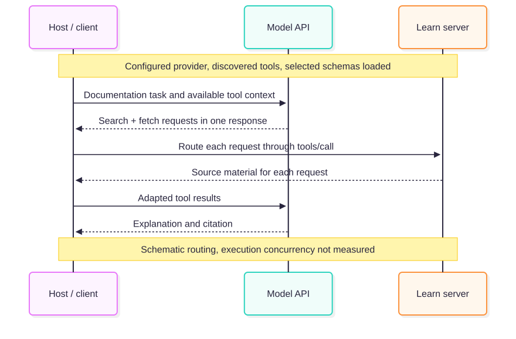

<!-- _class: lead -->

# Connecting an agent to existing MCP servers

Agentic Software Engineering

Configure · discover · use · verify

<!-- 0–8, slides 1–2. Start with a completed documentation task. This lecture precedes the dice provider lecture. -->

---

## First, a documented answer

> Use Microsoft Learn MCP tools to find how Get-ChildItem
> limits recursive directory listing depth. Cite the page.
> Do not execute shell commands.

Expand the **call, arguments, result, and answer**.

<!-- Show an authenticated rehearsed call if available. Use the 2026-11-17 instructor session record as a labeled model-generated account of live use. The independent authoring capture remains LLM-free. Neither is a packet trace. No PowerShell installation needed. -->

---

<!-- _class: code-dense -->

## You hard-wired every tool

```python
TOOLS_SCHEMA = [READ_FILE_SCHEMA, LIST_FILES_SCHEMA]       # sent to the model
TOOLS_DICTIONARY = {"read_file": read_file,
                    "list_files": list_files}              # name -> function

message = call_model(messages, tools=TOOLS_SCHEMA)
for tc in message["tool_calls"]:
    result = TOOLS_DICTIONARY[tc["name"]](**tc["arguments"])
    messages.append({"role": "tool", "tool_call_id": tc["id"],
                     "content": str(result)})
```

Exercise 04, Step 8: register each new tool in **both** places.

<!-- 8–18, slides 3–6. Simplified from exercise 04 Steps 5, 6 and 8: call_zen renamed, error handling and the Step 7 bound omitted. The catalogue is a constant in the harness; adding a tool is a code change; a second harness repeats it. Ask what fails if only one registration is made (schema missing: silent; dictionary missing: unknown-tool error). -->

---

<!-- _class: code-dense -->

## Declare a server, not a tool

Toy agent: one entry **per tool**, in harness code

```python
READ_FILE_SCHEMA = {"name": "read_file", "description": "...", "parameters": {...}}
```

MCP host: one entry **per server**, in configuration

```json
"microsoft-learn": {"type": "http", "url": "https://learn.microsoft.com/api/mcp"}
```

No tool name, description, or schema appears in the file.

<!-- Slide 4. The file names a provider and how to reach it. Fields are explained on slide 7; here only point at what is absent. The server, not the developer, will supply the catalogue. -->

---

## The host discovers, the model selects



Declare · host discovers (`tools/list`) · model requests · host routes (`tools/call`)

<!-- Slide 5. Two connections, two jobs: the model API carries messages, definitions, requests, results; MCP carries discovery and invocation. The model never reads .mcp.json or connects to a server. The dashed box is any further declared server: another config entry, not another host edit. Claude Code's deferred loading via ToolSearch comes on slide 11; do not conflate it with tools/list. -->

---

## Why a shared standard?

**Add a provider by configuration.** No schema, dispatch entry, or branch is added to the host.

**One interface, many hosts × many providers.** A server written once works in every compatible host, for whichever model that host drives.

Not new: adding tools without retraining. Still yours: host support, credentials, permissions, context, and the loop's limits.

<!-- Slide 6. The toy agent already added tools without retraining; the benefit is standard discovery and invocation across the host/provider boundary. Each toy agent is a bespoke host-provider pair. Caveats return on slide 18 (costs, permissions). -->
---

## Declare the provider in this repository

```json
{
  "mcpServers": {
    "microsoft-learn": {
      "type": "http",
      "url": "https://learn.microsoft.com/api/mcp"
    }
  }
}
```

Claude Code project file: **`.mcp.json`**

<!-- 18–28, slides 7–9. Open an empty scratch repo. Explain map, chosen connection name, transport, endpoint, braces and commas. This host convention is not a universal MCP config filename. -->

---

## Configuration is a starting point

Connection name → provider address

Discovery → actual tool definitions

Invocation → particular tool and argument values

**Adding the file does not execute a tool.**

<!-- Compare the launch/connection config with a query argument. The host loads and connects; the server supplies definitions; the model can then request a call and the host routes it. -->

---

## Connect and inspect

- Start the host in the scratch repository
- Review project trust/server approval
- Inspect `/mcp` and tool definitions
- Repeat the task and expand actual calls

Cloning config does not supply accounts or credentials.

<!-- Show a new session as predictable load point. Project scope is shared repo configuration. Claude's local scope has a home-config storage location despite project-limited effect. Normal host access still needed for public Learn MCP. -->

---

## The loop you built, with MCP in it

| Toy agent (exercise 04) | MCP-capable host |
|---|---|
| `TOOLS_SCHEMA` by hand | Discovered definitions, adapted to the model API |
| `TOOLS_DICTIONARY` by hand | Each name associated with its server |
| `TOOLS_DICTIONARY[name](**args)` | Request routed through the MCP client |
| `messages.append({"role": "tool", ...})` | Server result converted to a tool-result message |

The model never reads `.mcp.json` and never connects to a server.

<!-- 28–36, slides 10–12. Close the loop from slides 3–6 now that students have seen the real configuration and /mcp. Name the actual artifacts; "adapt" matters: the model's tool-call format is not the MCP request. Preserve policy, failures and limits as host responsibilities. -->

---

## Discovery, loading, invocation

| Stage | Instructor session record |
|---|---|
| Provider catalogue | Three tool names available |
| ToolSearch | Two definitions selected and loaded |
| Tool requests | Search and fetch requested |

ToolSearch is a **host facility**, not an MCP method.

<!-- Slide 11. Use transcript 1.1: select search and fetch, leave code-sample search deferred. Contrast provider microsoft_docs_fetch with model-facing mcp__microsoft-learn__microsoft_docs_fetch. The host client does tools/list; model requests schema loading via host ToolSearch. This is a model-generated account, not raw host/network capture. The full schema example remains in notes section 6. -->

---

## Follow the task



<!-- Slide 12. Instructor record 1.2 reports search and fetch in one response. Diagram routes each call schematically; neither concurrency nor a JSON-RPC batch is established. Independent SDK negotiation 2025-06-18 belongs to a different run. Refer to the two evidence sources separately. -->

---

## Check each claim against its source

| Claim | Support in the recorded material |
|---|---|
| Depth limits directory levels | Explicit parameter text |
| Depth recurses without Recurse | Example 8 |
| Negative values are rejected | Inference from UInt32 |
| Depth 0 behavior | Not explicit in the cited passage |

A citation does not make every sentence a documented fact.

<!-- Slide 13. Use transcript 2.3 as a real follow-up review. Ask students to classify claims BEFORE showing Claude's self-check. Add LiteralPath/Recurse extension as an optional fifth example in full notes. Inferred does not mean false; checking the passage is separate from verifying behavior by execution. Preserve first answer and qualifications. -->

---

## Your short attempt

> Find official documentation for including hidden items
> with Get-ChildItem. Use the configured MCP tools.
> Cite the source; do not execute commands.

Save one invocation, result evidence, and your reasoning.

<!-- 36–46. Use EVIDENCE.md template. Students need working host access but no PowerShell installation or Microsoft account for the provider. Pair or defer live check on outage; recorded analysis isn't a live pass. -->

---

## Evidence connects four things

Question → actual invocation → returned material → answer

What was requested?
What ran?
What returned?
Which claims does it support?

<!-- Inspect a student example. A copied command in chat is not execution evidence. Use concise excerpts; do not submit account conversation dumps or passwords. -->

---

## Break one connection in a disposable copy

Change the endpoint path → inspect the error → restore it

**Configured ≠ connected ≠ used correctly**

Diagnose the failing boundary before changing prompts.

<!-- 46–54, slides 16–18. Wrong URL is disposable exercise; actual status may vary. Do not predict a response or change a real project's config. Invalid JSON fails earlier. -->

---

## Which layer failed?

| Observation | Inspect |
|---|---|
| Server absent | File, scope, JSON, loading/approval |
| Connection rejected | Endpoint, network, provider requirements |
| Tool unavailable | Discovery and host exposure |
| Wrong operation | Selection and arguments |
| Wrong explanation | Result-to-answer grounding |

<!-- Add wrong local interpreter/PATH and stopped Neo4j cases orally. Provider reachability can be tested without a model. A good answer can exist without the requested integration being used. -->

---

## Three costs and separate permissions

Server work · downstream service · model turns/context

Host approval · provider tools · database authorization

Public endpoint access does not remove host model usage.

<!-- Keep this practical. Inspect actual host deferral rather than assuming every definition always loads. Provider data is evidence, not authority to change host policy. No token prices measured. -->

---

## Remote HTTP or local stdio

| Remote | Local |
|---|---|
| Provider URL | Executable + launch arguments |
| Connect to service | Host starts child process |
| Provider deployment can change | Pin local package/environment |

Tool arguments are separate from process launch arguments.

<!-- 54–62, slides 19–21. CLI can produce JSON and bounded operations too. MCP can adapt a library/CLI/service; use it when discovery/reuse justify lifecycle cost. -->

---

## Local provider, separate database


<!-- Host close does not necessarily stop Desktop DB. MCP readiness and DB readiness are different. Real authoring failures: missing APOC meta, then sandboxed meta.schema. Details in the Neo4j lecture and the setup guide. -->

---

## Two adoption recipes share a method

Task and expected evidence → inspect provider → configure

Discover → bounded call → verify → diagnose

Resources and prompts exist too; this task needs tools.

<!-- Ask which checks survive a model outage: independent client and database reads. Bridge tool metadata to next lecture's provider implementation. -->

---

## Next lecture: a database behind the agent


The Neo4j lecture declares the official Neo4j server as a local process, reads this fictional music graph with reviewed Cypher, writes to it behind the permission dialog, and verifies both outside the conversation. The music homework is assigned there.

<!-- 62–66, slide 22. Teaser only: no database, no installation, no query in this meeting. Point at the diagram's two HAS_TRACK sources as the kind of detail the next lecture's reviews turn on. Students should have Neo4j Desktop installed with one running instance before that meeting (the Neo4j exercise); the notes' Section 12 says so. -->

---

<!-- _class: lead -->

## Next: a database, then a provider

You have configured, discovered, used, and checked a remote server.

Next, the same host starts a local server in front of a database you own. After that, you expose ordinary dice functions with **MCPServer**.

[Detailed notes](../lecture-notes/lecture-mcp-adoption.md) ·
[Neo4j lecture notes](../lecture-notes/lecture-mcp-neo4j.md)

<!-- 66–75, slide 23, with slack. Exit check: explain one config field and identify one observation proving a tool was used. Full notes include setup, failures, examples and explained questions beyond what fits class. -->
