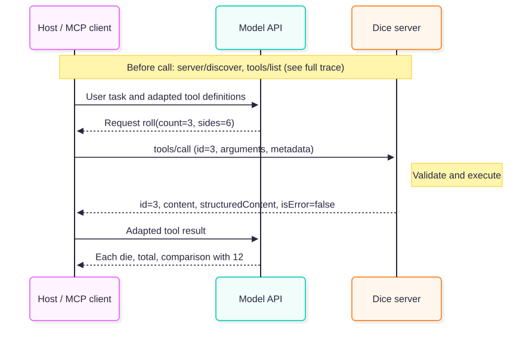

<!-- _class: lead -->

# MCP: from a function to an agent tool

Agentic Software Engineering

A prepared walkthrough with dice · 75 minutes

<!-- Opening 0–5. Run finished behavior before explaining the machinery. No lecture number chosen. -->

---

## First, make it work

> Roll three six-sided dice once. Show each die and total.
> Compare the total with 12. Use the dice MCP tool.

Inspect the **call, arguments, result, and answer**.

Captured fallback: `[2, 4, 5]` → **11** → below 12

<!-- Slide 2. Expand host call. Fallback is actual LLM-free evidence/protocol-E.json; the comparison is our arithmetic, not a captured model answer. Never present a simulated transcript. -->

---

## The CLI already works

```sh
uv run --frozen python dice.py roll --count 3 --sides 6
```

- Ordinary function → JSON result
- Bounds and structured output are possible with a CLI
- MCP adds a shared discovery and invocation interface

<!-- 5–10, slides 3–5. Run Stage A. CLI is a legitimate option; ask what integration work repeats across hosts. MCP can wrap this existing program. -->

---

## You built the loop in the toy agent

| Toy agent | MCP-enabled host |
|---|---|
| `TOOLS_SCHEMA` | Discover and adapt tool definitions |
| `TOOLS_DICTIONARY` | Associate tool with its server |
| Direct dispatch | Route through MCP client |
| Append tool result | Convert result to model API message |

**Add a provider through configuration; discover its tool catalogue.**

<!-- Refer to Steps 5–6 of exercise 04. Name the actual artifacts. Schema goes to the model, routing information stays in the host. -->

---

## The loop stays recognizable

Messages → model → tool request → host dispatch

Result → model → grounded answer (or another call)

**The host still manages policy, failures, and execution limits.**

<!-- Errors and turn limits already existed in the exercise. Do not attribute them to MCP. Ask why the model needs another turn after receiving a result. -->

---

## Two separate connections



<!-- 10–20, slides 6–8. Model API traffic differs from MCP traffic. Model selects, host routes, server executes. Local stdio does not make remote inference offline. Trace all component labels. -->

---

## Trace one call



<!-- Modern path actually captured with SDK 2.3.0: server/discover, tools/list, tools/call. No initialize on this path. Legacy compatibility differs. Model arrows explain the host loop and are not in the LLM-free capture. Use standalone SVG for zooming. -->

---

## Who owns what?

- **Provider:** contract, bounds, execution, useful results
- **SDK:** framing, dispatch, schemas, validation machinery
- **Host:** model adaptation, routing, policy, lifecycle, context

Also in MCP: resources (context), prompts (templates).
Our dice example needs **tools**.

<!-- Ask which layer knows the dice total should equal the sum. The provider and tests must establish semantics. SDK validates shape; it does not prove domain behavior. -->

---

## A → B: add a small adapter

```python
from mcp.server import MCPServer
mcp = MCPServer("dice")

@mcp.tool()
def roll(count: int = 1, sides: int = 6) -> str:
    """Roll bounded dice; report each outcome and total."""
    # Delegate to ordinary dice code; format the result.
```

Official SDK **`mcp==2.3.0`** · see the complete runnable file

<!-- 20–45 slides 9–13. This snippet is abbreviated; open the B branch in dice_server.py. Explain decorator, description, integer hints, defaults. No separate third-party server library. -->

---

## C: inspect the real exchange

```sh
uv run --frozen python protocol_demo.py --stage B
```

1. `server/discover`: versions, capabilities, instructions
2. `tools/list`: names, descriptions, input/output schemas
3. `tools/call`: name, arguments → matching result ID

Protocol **2026-07-28** on this captured stdio path

<!-- Open wire-B.jsonl. Find metadata as well as the application arguments. Do not copy an older handshake into this trace. SDK client automatically handles negotiation. -->

---

## D: make the contract more explicit

```python
Count = Annotated[int, Field(strict=True, ge=1, le=20)]
```

- Count bounds in schema; sides whitelist in function
- Output model → `outputSchema` + `structuredContent`
- Domain failure → `ToolError` → `isError: true`

**Description + schemas + results + failure behavior**

<!-- Show D branch and actual protocol-D.json. Sides is a strict integer; permitted values remain a code check accurately described in docstring. An enum would be another refinement. Description is not the entire interface. -->

---

## An error message can still be success

| Call | B | D |
|---|---|---|
| `count=0` | Error text, `isError=false` | SDK validation, `isError=true` |
| `sides=7` | Error text, `isError=false` | ToolError, `isError=true` |
| `count="many"` | SDK validation error | SDK validation error |

Malformed request: JSON-RPC **`error`**, no `result`

<!-- Use actual files. Function ValueError is a separate direct-call behavior. Missing name in tools/call produces -32602 in the test. A timeout or crash is yet another failure, not a successful string return. -->

---

## E: discover and select two tools

> Roll two d20 and flip five coins using dice MCP tools.
> Show outcomes, dice total, and both coin tallies.

`roll(count=2, sides=20)` · `flip_coins(count=5)`

Inspect both calls; verify the answer against the results.

<!-- Do this in host if rehearsed; otherwise use captured E coins and dice as protocol evidence only. No model transcript was obtained during authoring. Discovery does not guarantee model selection. -->

---

## Test at three layers

| Layer | Evidence |
|---|---|
| Function | Controlled outcomes, sums, bounds, tallies |
| Protocol | Discovery, schemas, calls, real stdio subprocess |
| Agent integration | Selected calls + grounded final answer |

```sh
uv run --frozen pytest -q
```

<!-- 45–58 slides 14–15. Show representative tests, not all code. 34 tests passed at authoring. Host test remains manual. Samples do not prove statistical fairness. -->

---

## Which check would catch it?

- Sum does not match individual dice
- Child process uses the wrong Python environment
- Server prints debug text on stdout
- Host reports a total without calling the tool

<!-- Ask before showing answers: controlled function test; stdio launch test; wire parsing; authenticated host transcript. In-process tests cannot expose every subprocess launch issue. -->

---

## From consumer evidence to provider tests

Adoption lecture: configure → discover → call → verify

Music homework: schema → reviewed query → rows → answer

Dice provider: expose a contract the consumer can inspect

<!-- 58–61. Brief recap of preceding adoption lecture and current fictional music homework. Actual LLM-free music schema/read results are retained; model grounding is separate. Cut if behind. -->

---

## Practical pitfalls

- Description disagrees with code or omits a limit
- Integer schema is mistaken for full domain validation
- Relative launch path or wrong environment
- Debug output corrupts stdio
- Tool output is treated as an instruction source

<!-- 61–68 slides 17–18. Use stderr for logs, explicit launch paths, accurate contracts. Misleading-docstring experiments are optional and outcomes must be observed. Do not promise a model failure. -->

---

## Three costs to keep separate

**Server execution:** local CPU or downstream service

**Model turns:** planning, calls, retries, recovery

**Context:** definitions, arguments, results, history

Host discovery/loading policy matters. Inspect `/context`.

<!-- Claude Code currently supports deferred tool search, with configuration/provider exceptions. Do not say every schema enters every prompt. No token or price measurement performed. Local dice execution itself does not call a model. -->

---

## Choose for the actual task

| CLI fits when… | MCP fits when… |
|---|---|
| Existing command and parsing path work | Reusable discovery across hosts helps |
| Shell workflow is already established | Named structured operations help |
| Another adapter adds little value | Adapter lifecycle cost is justified |

An MCP server can wrap a CLI.

<!-- 68–72 slides 19–20. Compare permissions, deployment, result shape, portability, and maintenance. Neither interface guarantees bounded operations or correct answers. -->

---

## Two practical recipes

**Adopt:** inspect publisher/version/permissions → configure in
scratch host → discover → bounded call → verify answer

**Expose:** ordinary function → contract → MCPServer adapter →
function/protocol/stdio checks → host rehearsal

Ask an agent for **contract + pin + checks + evidence**.

<!-- Open demos/lecture-mcp-dice/agent-prompt.md. If time remains use two-minute target extension from DEMO.md; it is not a substantial lab. Exit question: select CLI or MCP for an existing command and justify. -->

---

<!-- _class: lead -->

## Follow the evidence across the boundaries

Model requests · host routes · server executes

[Student notes](../lecture-notes/lecture-mcp-dice.md) ·
[Runnable example](../demos/lecture-mcp-dice/README.md)

Official references: [SDK](https://github.com/modelcontextprotocol/python-sdk/tree/v2.3.0),
[MCP architecture](https://modelcontextprotocol.io/docs/2026-07-28/learn/architecture),
[Claude Code](https://code.claude.com/docs/en/mcp)

<!-- 72–75 slack. Ask who executes, where results enter context, and what distinguishes Error text from a failed MCP tool result. Primary references and full explanations are in student notes. -->
