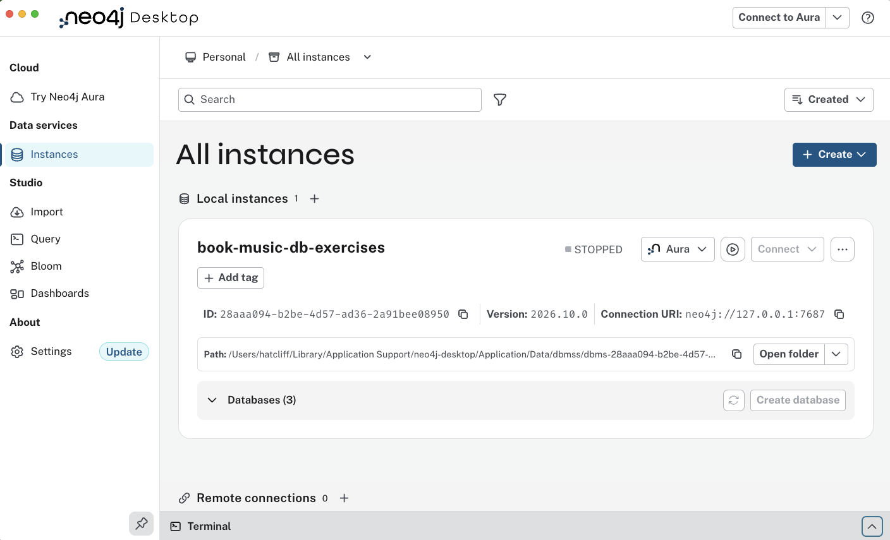
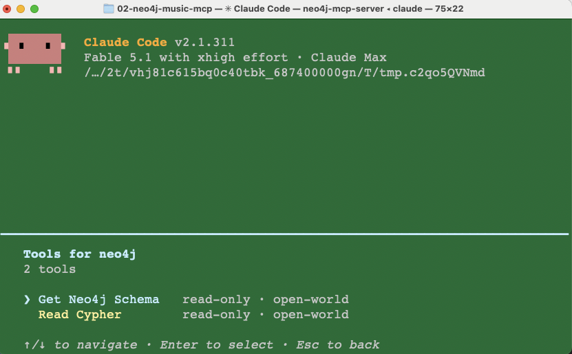
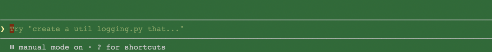
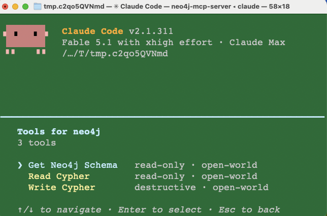
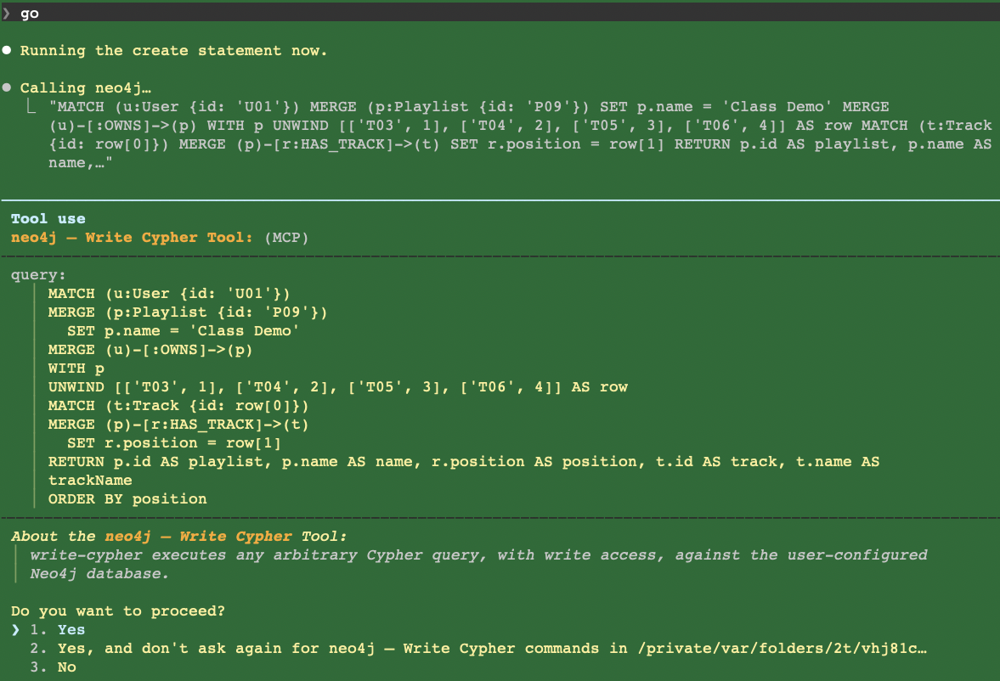

<!-- _class: lead -->

# Connecting an agent to a database through a local MCP server: Neo4j

Agentic Software Engineering

A server the host starts · a database you own · a tool whose argument is a program

<!-- 0–5, slides 1–2. Open on the finished behaviour before any explanation. Scratch repository with .mcp.json (read-only) and .claude/settings.json; session started with claude --permission-mode manual. This lecture follows the adoption lecture and precedes the dice lecture. -->

---

## Demo - Using Claude+MCP for a simple query

> Inspect the music database's schema, then tell me which five artists
> appear in the most distinct playlists.

Expand the **`get-schema`** call, the **`read-cypher`** call, its Cypher
argument, the five rows, and the answer.

<!-- Expect one get-schema and one read-cypher; rows A07 8, A08 8, A01 5, A02 5, A03 4; the answer names fictional-music-v1. Fallback: images/mcp-neo4j-06-read-call.png and reports/live-desktop.json. Say only: same host, same file, same protocol as the adoption lecture; what is new is behind the server. -->

---

<!-- _class: code-dense -->

## Same MCP declaration shape, a different kind of server

Adoption lecture: `"microsoft-learn": {"type": "http", "url": "https://learn.microsoft.com/api/mcp"}`

Today, in `.mcp.json`:

```json
"neo4j": {
  "type": "stdio",
  "command": "uvx",
  "args": ["neo4j-mcp-server@2.1.1"],
  "env": {
    "NEO4J_MCP_URI": "${NEO4J_MCP_URI:-neo4j://127.0.0.1:7687}",
    "NEO4J_MCP_USERNAME": "${NEO4J_MCP_USERNAME:-neo4j}",
    "NEO4J_MCP_PASSWORD": "${NEO4J_MCP_PASSWORD}",
    "NEO4J_MCP_DATABASE": "music",
    "NEO4J_MCP_READ_ONLY": "true",
    "NEO4J_MCP_TELEMETRY": "false"
  }
}
```

<!-- 5–15, slides 3–9. Let students name what is new: a program to start instead of a URL, an env block, a password reference. Still no tool definition in the file. The host starts this program as a child process at session start and talks to it over its standard streams; it ends with the session. The database does not. -->

---

## Three processes, two protocols


<!-- Slide 4. The server is not the capability. It holds one driver connection (the database logs it as Go Driver/6.4.0) and translates MCP on one side into Cypher execution on the other. At startup it runs its own statements against the database: RETURN 1, a check for apoc.meta.schema, a probe for gds.version that fails on purpose. Stopping Claude Code stops the server; Desktop keeps the database running. -->

---

## Who did what, and the evidence of it

| Step | Who | Evidence |
|---|---|---|
| Composes the Cypher | Model | The call's `query` argument |
| Shows the call, applies rules, routes it | Host (Claude Code) | The dialog; the per-server log |
| Checks the statement, sends it, returns rows | Server (`neo4j-mcp-server`) | Its log on standard error |
| Executes and records it | Database (Neo4j) | `query.log`, client `MCP4NEO4J/2.1.1` |

<!-- Slide 5. This table answers "who did what" at every step; the rest of the lecture fills the evidence column. The database sees a Bolt client that logged in as neo4j; it does not know a model composed the statements. Note where env sits: the host reads the keys and expands ${VAR}; the server reads the values; the database sees only a connection. The model can read .mcp.json with ordinary tools (it did in the pilot), which is why the password is a reference. -->

---

<!-- _class: code-dense -->

## The `read-cypher` contract: one required string

From the pilot's `tools/list` capture:

```json
{"name": "read-cypher",
 "inputSchema": {
   "type": "object",
   "properties": {
     "query":  {"type": "string", "description": "The Cypher query to execute"},
     "params": {"type": "object", "description": "Parameters to pass to the Cypher query",
                "additionalProperties": true}},
   "required": ["query"],
   "additionalProperties": false}}
```

Adoption lecture: `{"url": {"type": "string"}}`, a piece of data. Here the required string is a **program**: a Cypher statement with a grammar, a meaning, and an effect on the database. The schema can say *string*. It cannot say whether the string counts playlists or paths, or whether it deletes. Hence a step the adoption lecture did not need: the model proposes the statement, you read it, then it runs.

<!-- Slide 6. The server's own description of the tool, also in the capture: "read-cypher can run only read-only Cypher statements. For write operations (CREATE, MERGE, DELETE, SET, etc...), schema/admin commands, or PROFILE queries, use write-cypher instead." The statement executes with the privileges of the account the server logged in with (neo4j, the administrator). params carries query parameters; the model did not use it in the pilot. The server enforces read-only by classification: it runs EXPLAIN on the statement first and inspects the plan, which is why every read in the database's query log is preceded by an EXPLAIN of the same text (slide 25). -->

---

<!-- _class: code-dense -->

## An instance of the contract: the call behind the opening demo

The `query` slot, filled. Claude Code displayed the call (one terminal line, wrapped here):

```text
⏺ neo4j - Read Cypher (MCP)(query:
    "MATCH (p:Playlist)-[:HAS_TRACK]->(:Track)-[:ARTIST]->(a:Artist)\n
     WITH a, count(DISTINCT p) AS playlistCount\n
     RETURN a.id AS artistId, a.name AS artistName, playlistCount\n
     ORDER BY playlistCount DESC, artistId ASC\nLIMIT 5")
```

The same string, read as the program it is:

```cypher
MATCH (p:Playlist)-[:HAS_TRACK]->(:Track)-[:ARTIST]->(a:Artist)
WITH a, count(DISTINCT p) AS playlistCount
RETURN a.id AS artistId, a.name AS artistName, playlistCount
ORDER BY playlistCount DESC, artistId ASC
LIMIT 5
```

The model composed every character of it. The contract required only that it be a string.

<!-- Slide 7. Model output from the pilot (Part C, prompt 3): the statement the cold open produces when the model's text matches; another session may alias or order differently. In protocol terms this is the arguments object of the tools/call request, {"query": "<that string>"}; the host displays it as the tool's title plus its argument, and the \n escapes are the statement's line breaks. Read it here only as a shape: a pattern, an aggregation, a projection, an order, a limit. The review of what it computes comes on slide 17. -->

---

<!-- _class: code-dense -->

## The return value: rows as JSON inside the MCP envelope

```json
{"content": [{"type": "text",
  "text": "[{\"artistId\": \"A07\", \"artistName\": \"Glass Meadow\",   \"playlistCount\": 8},
           {\"artistId\": \"A08\", \"artistName\": \"Indigo Current\", \"playlistCount\": 8},
           {\"artistId\": \"A01\", \"artistName\": \"Amber Circuit\",  \"playlistCount\": 5},
           {\"artistId\": \"A02\", \"artistName\": \"Blue Orchard\",   \"playlistCount\": 5},
           {\"artistId\": \"A03\", \"artistName\": \"Copper Kite\",    \"playlistCount\": 4}]"}],
 "isError": false}
```

Outside: MCP's `content` envelope, which the host handles. Inside: the server's JSON array of rows, one object per `RETURN` row with the statement's aliases as keys. This is what the model reads before it writes its answer.

The same statement pasted into Desktop's Query tool returns the same five rows with no model involved. That independent route is what the adoption lecture did not have.

<!-- Slide 8. Envelope shape from the SDK capture in reports/live-desktop.json (content, type text, isError). The row text is what the host displayed for this call in the pilot, pretty-printed by the server, compacted here to one row per line. The keys are the aliases the model chose in its RETURN clause, so another session's rows carry other keys. A documentation fetch returned prose; this returns data whose keys the model itself named, one more reason to read the statement before trusting the summary of its rows. get-schema returns the same shape, an array of {key, value} entries (slide 16). -->

---

<!-- _class: table-dense -->

## Side by side

| | Adoption lecture | Today |
|---|---|---|
| Transport | HTTP to a remote endpoint | stdio to a child the host starts |
| Who runs the server | The vendor | Your computer, for the session |
| Configuration | A URL | The server's settings in `env` |
| Credentials | None | A database password, referenced |
| What the server is | The capability | An adapter to a database |
| Tool arguments | A search string, a URL | A Cypher statement |
| Operations | Reads | Reads and writes |
| Checking an answer | Read the cited source | Replay the statement; run a check; read the log |

<!-- Slide 9. If short, read three rows: who runs the server, what the server is, operations. Section 1.7 of the notes has the full table with where failures appear. -->

---

## The database side, in one slide



**Instance**: one Neo4j server, one address, `neo4j://127.0.0.1:7687` ·
**Databases** inside it: `system`, `neo4j`, `chapter01`, `music` ·
**APOC**: a plugin of the instance, installed once; the server requires it ·
One database per activity; the server sees only the one it is given.

<!-- 15–27, slides 10–15. Procedure lives in the setup guide; do not do it in class. Desktop's edition is Enterprise under a developer license, so CREATE DATABASE music works. APOC: the server refuses to initialize without it and get-schema calls apoc.meta.schema; Desktop's installer wrote the procedure permissions itself in the pilot. Warn once: the Query tool's Database selector defaults to neo4j; every replay today has it on music. -->

---

<!-- _class: table-dense -->

## The `.mcp.json` entry, field by field

| Field | Read by | Meaning |
|---|---|---|
| `"neo4j"` | Host | Connection name; prefix of `mcp__neo4j__read-cypher` |
| `"type": "stdio"` | Host | Start a program; MCP over its standard streams |
| `command`, `args` | Host | `uvx neo4j-mcp-server@2.1.1`, pinned |
| `env` | Host, then server | `${NAME}` expanded by the host; values read by the server |
| `NEO4J_MCP_DATABASE` | Server | The one database; the field that changes between activities |
| `NEO4J_MCP_READ_ONLY` | Server | `"true"`: two tools. `"false"`: adds `write-cypher` |
| `NEO4J_MCP_PASSWORD` | Server | Referenced, never written |

<!-- Slide 11. ${NAME:-default} uses the default when NAME is unset; a reference without a default that is unset is caught by the host before launch (slide 15). claude mcp add writes the same shape; we teach the file because the file is what you read and commit. -->

---

<!-- _class: code-dense -->

## What the host does at session start

1. Reads `.mcp.json`; asks once to approve the project server
2. Expands `${...}` from its own environment
3. Starts `uvx neo4j-mcp-server@2.1.1` with that environment
4. `initialize`: the server checks the database (connection, APOC)
5. `tools/list`: the server answers with what its configuration allows

```text
level=INFO msg="Registered server tools" count=2 tools="[get-schema read-cypher]"
level=INFO msg="Handshake request: verifying requirements..." mcp_method=server/discover
level=INFO msg="initialize requirements verified"
level=INFO msg="request started" mcp_method=tools/list
```

<!-- Slide 12. The log lines are the server's own stderr, captured in the pilot. In read-only mode it also logs "Ignoring tool 'write-cypher': not available in read-only mode". The ERROR about gds.version at every tools/list is the probe for Graph Data Science failing on an instance without it; expected. Claude Code may present the tools to the model as deferred names ("I'll load the read tool"): a host facility, not an MCP method. -->

---

## Read `/mcp`



Server detail: command, protocol `2026-07-28`, 2 tools · Tool detail: `Full name: mcp__neo4j__read-cypher`, `query (required): string`

<!-- Slide 13. Live: /mcp, select neo4j, view tools, select Read Cypher. The tags read-only · open-world are the server's annotations (readOnlyHint, openWorldHint) displayed by the host, declared not verified. Fallback: images/mcp-neo4j-01…05. -->

---

<!-- _class: code-dense -->

## Which mode are you in?



**auto**: the host approves tool calls itself; no dialog, writes included.
**manual**: the host asks before every call, reads too (seven read dialogs before the first write in the pilot).

Ship `.claude/settings.json` beside `.mcp.json`:

```json
{"permissions": {"allow": ["mcp__neo4j__get-schema", "mcp__neo4j__read-cypher"]}}
```

<!-- Slide 14. Start with claude --permission-mode manual and read the mode line. The instructor's own default is auto, in which the write dialog of slide 21 never appears. The allow rules make reads silent so only write-cypher prompts; the names are the model-visible names. A shell dialog offers "switch to auto mode": the homework asks students to decline it. -->

---

<!-- _class: code-dense -->

## One failure, and where its cause is written

A second terminal, no variables, `/mcp`:

```text
MCP config diagnostics ⚠
[Warning] [neo4j] mcpServers.neo4j: Missing environment variables: NEO4J_MCP_PASSWORD
```

The host's per-server log, `~/Library/Caches/claude-cli-nodejs/<slug>/mcp-logs-neo4j/`:

```text
Connection failed (0): ... Neo4jError: Neo.ClientError.Security.Unauthorized
```

Stopped instance: `Failed to reconnect to neo4j: 0` → log: `dial tcp 127.0.0.1:7687: connect: connection refused`

<!-- Slide 15. Do the missing-variable failure live; the layer is host configuration, before any process starts. The server was launched with the literal ${NEO4J_MCP_PASSWORD} as password and the database rejected it; that is in the per-server log, not in /mcp. Show the stopped instance from images 08-a/b/c rather than stopping it. Three places to look, in order: /mcp, the per-server log, the instance's logs. -->

---

## Schema first, every session

> Use the neo4j MCP server to inspect the schema of the music database.
> Summarize the node labels, relationship types, and relationship directions
> in a short table. Do not run any other query yet.



<!-- 27–40, slides 16–18. One get-schema call. Compare the model's table with the diagram; in the pilot it noted unprompted that HAS_TRACK comes from both Playlist and Album. The model has not seen the diagram; a model that has not seen the labels guesses them. get-schema is CALL apoc.meta.schema({sample: 100}) in the query log. -->

---

<!-- _class: code-dense -->

## Propose, then read it against the schema

> ... Propose a bounded read-only Cypher query and explain how it avoids
> counting paths instead of playlists. Show the query and do not execute it yet.

**What it is meant to compute.** For each artist, the number of *distinct* playlists that contain at least one of that artist's tracks (an artist on three tracks of one playlist is credited once); then the five artists with the largest such number, ties broken by artist id.

```cypher
MATCH (p:Playlist)-[:HAS_TRACK]->(:Track)-[:ARTIST]->(a:Artist)
WITH a, count(DISTINCT p) AS playlistCount
RETURN a.id AS artistId, a.name AS artistName, playlistCount
ORDER BY playlistCount DESC, artistId ASC
LIMIT 5
```

Anchor is `Playlist`, not `Album` · `count(DISTINCT p)`, not `count(*)` · both sort keys · `LIMIT` · no write clause

<!-- Slide 17. Model output from the pilot; the reference query differs only in a WITH stage and alias case. Different sessions produce different text; the homework assesses the review, not the match. A fluent explanation is a claim to check. The two checks that catch real errors: the anchor label (both Album and Playlist have HAS_TRACK) and DISTINCT. -->

---

## Run, read the call, replay it outside

> Run that query with the neo4j read tool and answer from the returned rows.
> State that the result describes the fictional-music-v1 fixture.

One `read-cypher` call; its `query` argument is the reviewed statement. Its rows:

| artistId | artistName | playlistCount |
|---|---|---:|
| A07 | Glass Meadow | 8 |
| A08 | Indigo Current | 8 |
| A01 | Amber Circuit | 5 |
| A02 | Blue Orchard | 5 |
| A03 | Copper Kite | 4 |

Then in Desktop's Query tool, selector on **`music`**: same statement, same five rows.

<!-- Slide 18. Live: expand the call so the argument and the rows are on screen (fallback: images/mcp-neo4j-06-read-call.png, which also shows the answer naming the fixture and the tie-break). One read-cypher call whose query argument is the reviewed statement, character for character. The replay establishes that this statement returns these rows from this database by a client that is not the model; it does not establish that the statement answers the question (the review) or that the fixture loaded correctly (database.py check). Ask for two meanings of "most popular" before the model picks one. -->

---

## One field, one restart, three tools



The one change: `NEO4J_MCP_READ_ONLY` in the `env` block of `.mcp.json`, read by the server at startup. Set to `"false"`, the server registers `write-cypher` too, the host's `tools/list` returns three tools, and the model's catalogue now holds a tool that changes data.

Nothing in the prompt, the host's rules, or the database changed. Which tools exist here is decided by the **server's** configuration, and whoever can edit the file controls it.

<!-- 40–56, slides 19–24. Exit, copy the write example over .mcp.json, restart, /mcp. Nothing in the repository, the prompt, or the host's rules changed. Server log says count=4 registered; the GDS probe hides the fourth at tools/list. Dependent read first: "Which tracks do playlists P02 and P03 have in common? Return track id and track name, ordered by track id." Expect T03–T06. -->

---

<!-- _class: code-dense -->

## The write, proposed

> Create a new playlist with id P09 named "Class Demo", owned by user U01, containing exactly the tracks T03, T04, T05 and T06 at positions 1 to 4. Use MERGE so that nothing is duplicated. Show me the Cypher and wait for my approval before running it.

```cypher
MATCH (u:User {id: 'U01'})
MERGE (p:Playlist {id: 'P09'})
  SET p.name = 'Class Demo'
MERGE (u)-[:OWNS]->(p)
WITH p
UNWIND [['T03', 1], ['T04', 2], ['T05', 3], ['T06', 4]] AS row
MATCH (t:Track {id: row[0]})
MERGE (p)-[r:HAS_TRACK]->(t)
  SET r.position = row[1]
RETURN p.id AS playlist, p.name AS name, r.position AS position, t.id AS track
ORDER BY position
```

<!-- Slide 20. Model output. Spell the ids out: a fresh session that hears "those four shared tracks" infers. The model ran a precondition read first (user, tracks, no P09), unprompted. Read clause by clause: user and tracks matched, not merged (a typo yields zero rows, not a phantom node); only the playlist and its relationships merged, on an id a uniqueness constraint protects; a position on each; a RETURN. The earlier session's version used ON CREATE SET and a list of maps: both correct, neither canonical. -->

---

## Two approvals that are not the same thing



The model's "say approved" is a courtesy (the model typically will
interpret it correctly, but not always). The permission dialog is the
host's control (the real control), and it
appears only in a prompting mode.

<!-- Slide 21. Read the dialog aloud: tool title, the full statement, the tool's own description, three options. Option 1 runs this call once. Option 2 writes a standing allow rule into .claude/settings.local.json; never for a write tool. The records show the dialog open from 17:38:32 (request) to 17:41:05 (call) in the pilot. In the auto-mode session (image 12) the statement ran the moment the model received "approved". -->

---

<!-- _class: code-dense -->

## Verify from outside: check the database against the fixture

The **fixture** is the database's intended state, saved outside the database: `fixture/tracks.csv` (48 rows), `fixture/playlists.csv` (92 rows), and `manifest.json` with the counts the loaded graph must have: 8 playlists, 8 `OWNS`, 89 playlist tracks, …

`database.py load` built the graph from those files. `database.py check` counts nodes by label and relationships by type and compares them with the manifest. Run it from inside the session (a line starting with `!` runs in the session's shell):

```text
! cd "$NEO4J_HW_DIR" && uv run --frozen python database.py check
Readiness mismatch: ... "observed": {... "Playlist": 9, ... "OWNS": 9, "PLAYLIST_HAS_TRACK": 93 ...}
```

It fails because the database no longer matches the saved baseline: one more playlist, one more ownership, four more track memberships, nothing else moved. The mismatch is the check working: it found the change without being told what the change was.

<!-- Slide 22. Before the check, read the write back in Desktop's Query tool on music: four rows, owner U01, positions 1 to 4, T03 to T06 (Desktop image 10). The manifest also carries the CSV hashes, so the fixture itself is checked before it is trusted. Expected 8/8/89, observed 9/9/93 for Playlist, OWNS, PLAYLIST_HAS_TRACK; the other six counts are unchanged. A project database has no such file; slide 26 says what replaces it (a count snapshot, a copy). Fallbacks: images 13 and 14. -->

---

<!-- _class: code-dense -->

## Revert: a second write, through the same dialog

> Delete playlist P09 and only its own relationships. Do not touch any other node. Show the Cypher first.

```cypher
MATCH (p:Playlist {id: 'P09'}) DETACH DELETE p
```

`DETACH DELETE` removes the node and every relationship attached to it: the `OWNS` from `U01` and the four `HAS_TRACK` to T03–T06. The user and the tracks remain. A second permission dialog, option 1; then `database.py check` passes and prints the nine counts.

This is a revert, not a rollback. The first write was committed when the call returned. The revert is another committed write, and it is exact only because we know what the first one did.

<!-- Slide 23. Model output from the pilot. Create, verify, revert, check is the homework's Task 5 and the shape of any responsible write. The passing check prints the fixture version, the database name, and the counts. Had the model's revert been broader (a DETACH DELETE on a pattern without the id), the check would have shown it. Slide 26 picks the thread up for a database that has no fixture. Fallbacks: images 15 and 16. -->

---

<!-- _class: table-dense -->

## Three controls, and what each does not prevent

| Control | Decides | Does not prevent |
|---|---|---|
| 1 The server's flag `NEO4J_MCP_READ_ONLY` | whether `write-cypher` is visible to the host/model | editing `.mcp.json` and restarting; any route other than this server |
| 2 The host's rules: the dialog in manual mode, allow and deny rules | whether the model may call the tool | the model seeking another route; auto mode removes the dialog; `/mcp` still lists a denied tool |
| 3 The database account: the privileges of the user the server logs in as | what any client may do with that password | **holds on every route**; built-in `reader` role; not exercised in the pilot |

<!-- Slide 24. The notes' Section 6.7 draws this as diagrams/neo4j-write-controls.svg. Server flag: whether the tool exists; not editing the file, not other routes. Host rules: dialog, allow, deny; a deny rule withheld the tool from the model while /mcp still listed three; no refusal message; the model blamed the server's configuration and proposed a direct connection; the instructor declined the shell dialog. Database account: the only control that holds on every route; described from documentation, not exercised in the pilot. -->

---

<!-- _class: code-dense -->

## The database's own record of what ran

```text
$ uv run --frozen python query_log.py --last 3
2026-11-18 17:58:47 -0600  success  music  neo4j  MCP4NEO4J/2.1.1  3 ms  tx 225
    MATCH (p2:Playlist {id: 'P02'})-[:HAS_TRACK]->(t:Track)<-[:HAS_TRACK]-(p3:Playlist {id: 'P03'})
    RETURN DISTINCT t.id AS track_id, t.name AS track_name
    ORDER BY t.id
2026-11-18 18:18:52 -0600  fail     <none>  neo4j  MCP4NEO4J/2.1.1  10 ms  tx -1
    RETURN gds.version() as gdsVersion
    error: Unknown function 'gds.version' (line 1, column 8 (offset: 7))
```

Three records: the host's transcript · the server's log · the instance's `query.log`. Only the third is beyond the model's side.

<!-- 56–64, slides 25–26. Run it live in the second terminal after the write session: the write as one multi-line statement in one transaction, an EXPLAIN before each read (--explain), the client MCP4NEO4J/2.1.1, the Query tool as app nx, the startup probes. Enterprise logs queries by default (VERBOSE), parameters included. Prompt recipe: ask the model to list what it ran, then compare with the log. -->

---

## On a database that matters

**No undo through the tool.** One statement, one transaction, committed on return.

- **Contain**: one database per activity; read-only by default; dialog or deny rule; a `reader` account
- **Snapshot**: counts by label and by relationship type, before and after
- **Copy** before a write session: Desktop export, or `neo4j-admin database dump` around `STOP DATABASE`
- **Dry-run** writes: read first, anchor on ids, `RETURN` what changed, `EXPLAIN`
- **After a mistake**: stop writing · list what ran (`query_log.py`) · measure · inverse statement or restore

<!-- Slide 26. Two minutes. The fixture has a loader; a project database does not. The copy routes are documented by Neo4j and were not exercised in the pilot (PILOT.md D7); say so. The reader role is the control that holds on every route. Section 10 of the notes has the procedure. -->

---

<!-- _class: table-dense -->

## The recipe, for any Neo4j database

| Set up | Every session |
|---|---|
| 1 One database per activity | 6 `/mcp` before the first prompt |
| 2 APOC once per instance | 7 Schema first, every session |
| 3 Password in the shell, `${…}` in the file | 8 Propose, review, run |
| 4 One stdio entry; change `NEO4J_MCP_DATABASE` | 9 Verify in Query, with a check, in the log |
| 5 Manual mode; allow reads; prompt writes | 10 Constraints first, then `MERGE`; count against the source |

<!-- 64–70, slides 27–28. Each step has a reason and a failure it prevents in Section 9 of the notes. Between activities one field changes; between reading and writing another. The OpenFlights follow-on applies this without a script, on real data. -->

---

## Homework: the lecture on your own instance

1. Instance ready: APOC, `CREATE DATABASE music` (guide §1–3)
2. Load and check the fixture (SETUP.md)
3. Connect; record `/mcp`, the tool names, the mode line — **finish 1–3 in the first two days**
4. Question A: schema, propose, review, run, replay in Query
5. The write cycle: a playlist of your naming, the dialog, read-back, `check` mismatch, revert
6. Reflection: what you changed; what you could only know from outside

Work and submit in `exercise-neo4j-mcp/` of your course repo: `.mcp.json` (password referenced) and `EVIDENCE.md`. 15 points. About an hour.

<!-- Slide 28. Optional: Question B, the ambiguity question, a diagnosis. Decline the "switch to auto mode" offer; never choose the dialog's second option. query_log.py is in the package. No interim submission: ask them to finish setup in the first two days and to write to you with the exact error text if stuck. Due date per the module README. -->

---

<!-- _class: lead -->

## Next: build the provider

You declared a local server, read its catalogue, reviewed its Cypher, and verified a write from outside.

The dice lecture exposes an ordinary function through **MCPServer** and tests it at these boundaries.

[Detailed notes](../lecture-notes/lecture-mcp-neo4j.md) ·
[Setup guide](../../neo4j/neo4j-desktop-mcp-setup.md) ·
[Music homework](../../neo4j/02-neo4j-music-mcp/README.md)

<!-- 70–72, slide 29; 72–75 slack. Exit question: name one field of the stdio entry and which process reads it; name one observation that proves a write happened that did not come from the model. -->
