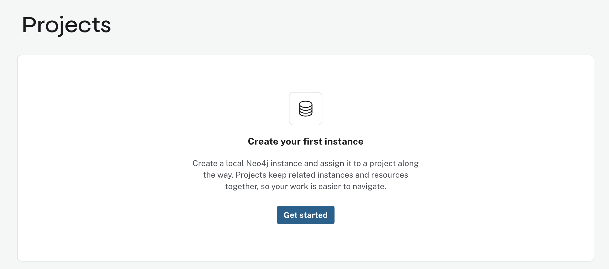
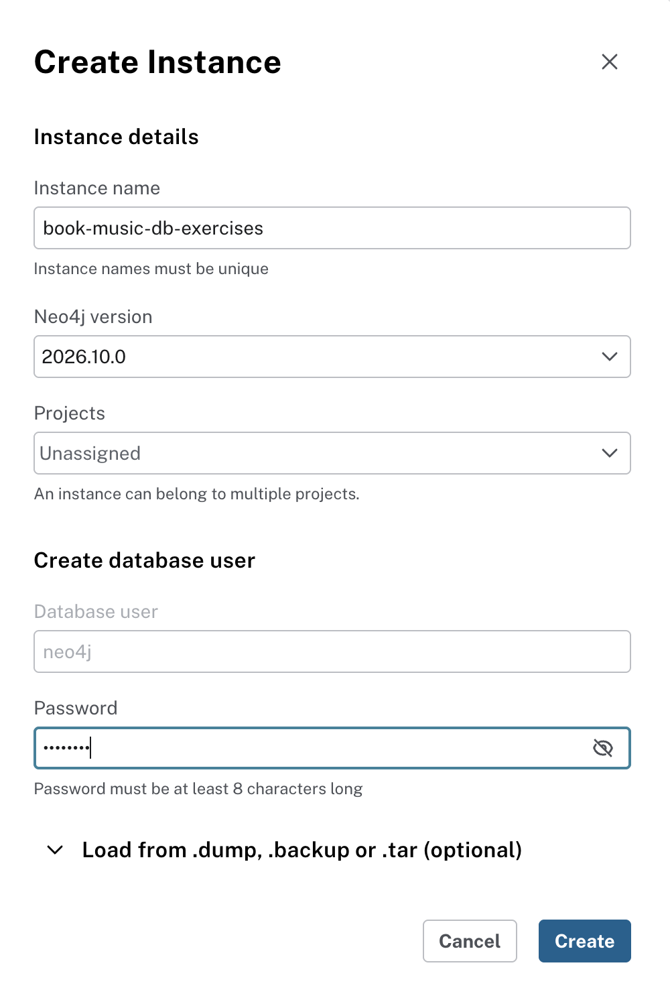
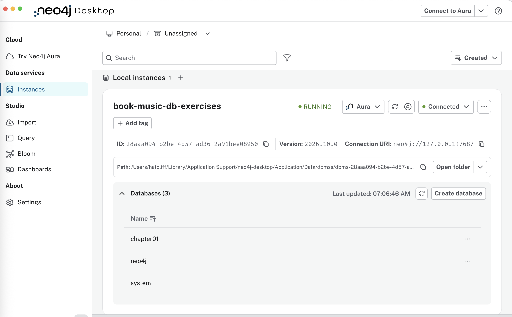
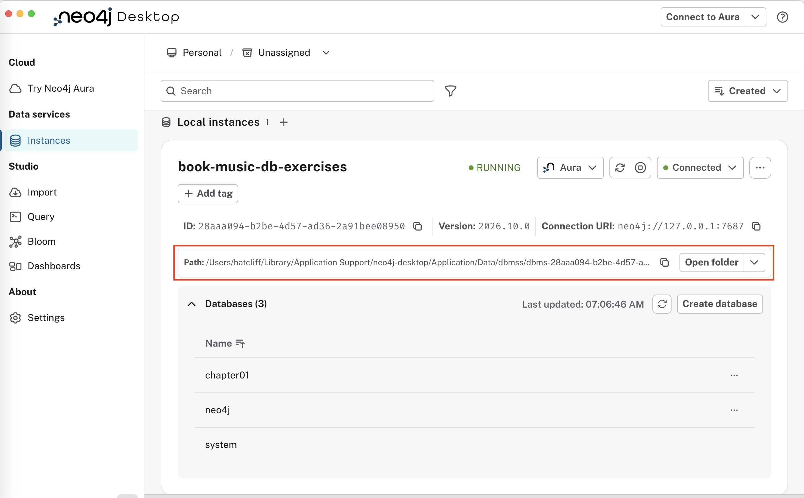
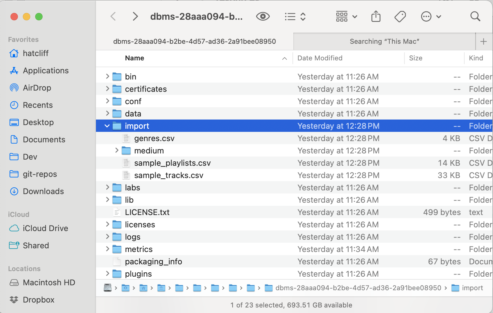
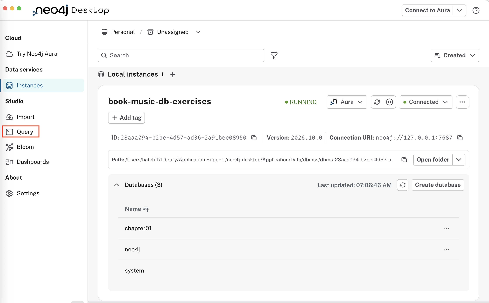
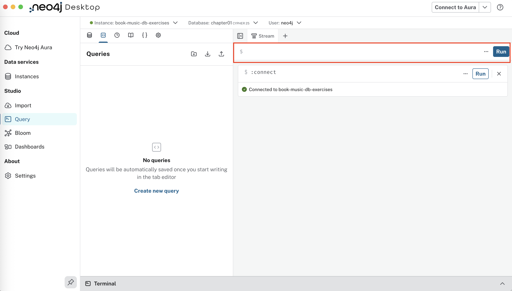

# 01 An Introduction to Cypher

The purpose of this exercise is to learn the basic concepts of Neo4J
and the Cypher query language.

You are asked to follow the interactions with Neo4J described in
Chapter 1 of the book "Neo4J: The Definitive Guide".  This book is
freely available to KSU students and faculty (see below).

You will turn in some screen shots and a short description of your
impressions of using Neo4J.

## Instructions

### Installing Neo4J 

Install the [Neo4J Desktop
Edition](https://neo4j.com/deployment-center/?gdb-selfmanaged&community)
(note: if you really want to use another method, such as the
Docker-based installation because you already have it installed, that
is OK, but the instructors will not be able to provide any support for
that).

Launch the application to confirm the installation worked correctly.

Access [Chapter
1](https://learning.oreilly.com/library/view/neo4j-the-definitive/9781098165642/ch01.html)
of Neo4J the book.  

**Important**: to access the book above, DO NOT create your own
account.  KSU has a OReilly subscription, so you do not need to the
pay for the book, and you sign in using KSU Single Sign On (SSO)
facility.  After clicking the Sign-in button, instead of entering your
email address, choose the "Affiliated with a school or institution" option.


Note that the book assumes that you have installed Neo4J using the
Docker option.  You will need to disregard those instructions and
instead work with the desktop version.


### Guided activities

#### Setting Up the Instance and Creating a Database

When working with the Desktop app, you will first need to create an
instance (and create a password for the neo4j user).  Select the
Create Instance option (you can pick any name you want for your instance).





After reading through a lot of Neo4J background info, you will arrive
at Section "Ingesting your first datasets" -- this is where the guided
activities begin.  Skip past the instructions on installing and
starting the Docker-based Neo4j.  In those instructions, you may note
that one of the steps is to create a database named `chapter01`.

With the desktop app, you will do that via the UI.  The screen shot
below shows a "Create database" button -- use that to create a
database named `chapter01`.  The screen shot shows the result of that
step (it seems like two other administrative databases `neo4j` and
`system` are also created).



The following step is "clunky" (perhaps you can figure out another way
to make it work).   During your interactions in the Cypher query
window, you will import data from files using the `file:/// ...`
expression.  This will import files from the `import` folder of your
database.  You need to copy the contents of this exercise's [`import`
folder](import) into the `import` folder of your database.  The UI
panel shows the location of the database on your computer and you can
use the copy icon to the right of it to copy the path to the folder to
your cut buffer.  The is path is the *root* of the datbase, so you
will need to add `import` to the end of that path to get the
destination folder.   



On my machine, I used `cp` from this exercise
folder of my cloned course material repo to copy the files over (note
my path had a space in it -- which required me to edit the path from
the UI to make sure the path worked appropriately in the shell).

```bash
cp -r import/* /Users/hatcliff/Library/Application\ Support/neo4j-desktop/Application/Data/dbmss/dbms-28aaa094-b2be-4d57-ad36-2a91bee08950/import
```

After the copy, if you use the UI's "Open Folder" button next to the database path,
you should be able to see the copied files sitting in the database's
`import` folder.



Now use the UI navigation panel on the left to switch to the "Query"
view.



The screenshot below shows the query view.  



To enter the Cypher commands and queries in the activities, you will enter the text in the
dialog on the top right indicated with the red box in the image above,
then press `Run` to run the command/query.  It seems like copy and paste from the book itself
works pretty well, but you can also find all of the queries in the
activity listed in the [online resources for the book](https://github.com/neo4j-the-definitive-guide/book/tree/main/chapter01/cypher)

Now you should be able to follow through the activities in the book.

As you work, try to internalize as many of the illustrated concepts as
possible.

- Save a screen shot of the results of Query 13 in Day 4 in the
  section "Materializing similarities" and save it in your assignment
  submission labelled `q13-similarities` (.jpg, .png, .pdf formats are
  all fine).

- Take a screen shot of the results of the Query 16 (2nd version)
  `016-shortest-2.cypher` and save it in your assignment submission
  labelled `q16-shortest-path`

- Create a file called `neo4j-chapter01-assessment.md` and provide
  text for the following...
  - Describe one capability of Neo4J that you think might be useful for
    you in your class or research and explain why.
  - Describe what you think were the most powerful aspects of the
    Cypher query language and one the that you found to be most
    confusing.  

## What to Submit

Commit the three files above in the folder `exercise-neo4j` in your
student repo.

