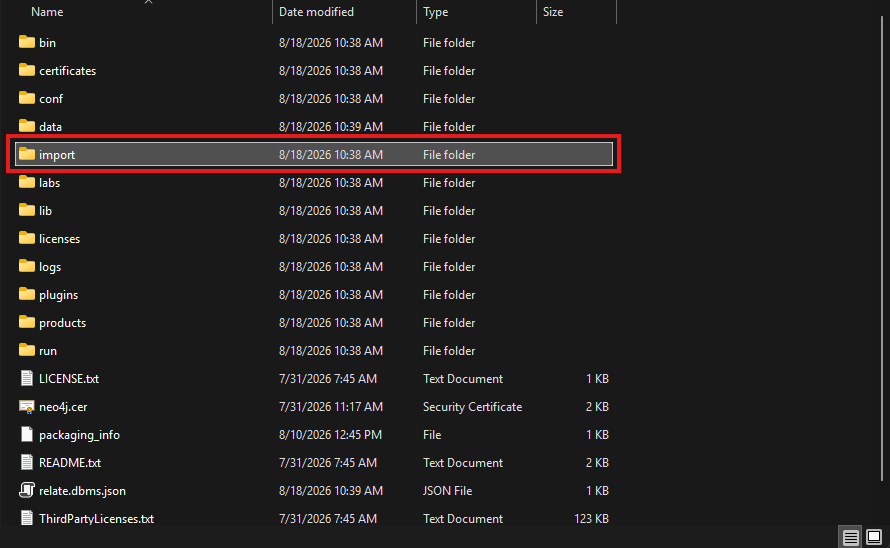

# 01 An Introduction to Cypher

## Instructions

### Installing Neo4J 

Install the [Neo4J Desktop Edition](https://neo4j.com/deployment-center/?gdb-selfmanaged&community)

Launch the application to confirm the installation worked correctly.

Access [Chapter
1](https://learning.oreilly.com/library/view/neo4j-the-definitive/9781098165642/ch01.html)
of Neo4J the book.  

**Important**: to access the book above, DO NOT create your own
account.  KSU has a OReilly subscription, so you do not need to the
pay for the book, and you sign in using KSU Single Sign On (SSO)
facility.  After clicking the Sign-in button, instead of entering your
email address, choose the "Affiliated with a school or institution" option.

Note that the book assumes that you have installed Neo4J using the
Docker option.  You will need to disregard those instructions and
instead work with the desktop version.

### Guided activities

Read through and follow along with the Cypher activities in the book.

When working with the Desktop app, you will first need to create an
instance (and create a password for the neo4j user).

## Troubleshooting Tips

### Importing Data

In order to ingest CSV data, the .csv files must first be imported. As
you use the Desktop version, you may need to add the files manually to a
local directory to make them accessible via Cypher queries as
illustrated in the book.

Find the `import` folder. Open it and copy any .csv files you need to import. 

> [!TIP] 
> The `import` folder **in this repository** holds the same .csv files required for the 
> exercises in the book. 