# Reading a music graph and its Cypher queries

A graph database stores entities and the relationships between them. For this
assignment, imagine placing cards on a table: a playlist card, track cards, and
artist cards. Arrows show which tracks are in a playlist and which artists are
credited on a track. A query follows those arrows and produces a table. It does
not play music or consult a streaming service.

## Nodes, labels, properties, and identity

A **node** represents one entity. A **label** classifies it, such as `Track` or
`Playlist`. **Properties** store values, such as `id: 'T01'` and `name: 'Signal 01'`.
A **relationship** is a directed connection with a type, such as `ARTIST`.
Relationships can also have properties. A playlist's `HAS_TRACK` relationship
stores a `position` because an occurrence belongs at a place in that playlist.

The fixture graph is:



Read the arrows literally. A User OWNS a Playlist. A Playlist HAS_TRACK to a
Track. An Album also HAS_TRACK to a Track. A Track ARTIST to an Artist records
a credit. The same relationship type can connect different labeled entities,
so a query asking about playlists must not inadvertently count albums.

IDs distinguish entities. The fixture deliberately has two playlists named
Evening. Asking for the playlist named Evening is ambiguous; asking for P03
is not. Track and artist names can also be nonunique in real catalogues. Group
and compare using IDs, then present names for readability.

The files include complete information for this fictional dataset. They are
not samples of a real service whose omitted listening histories can be guessed.
A count in the graph means a count of this fixture.

## Start with a tiny query

Open the instance's Query interface and run:

```cypher
MATCH (p:Playlist)
RETURN p.id AS playlist_id, p.name AS playlist_name
ORDER BY playlist_id
LIMIT 5
```

`MATCH` asks the database to find bindings that fit a pattern. Parentheses denote
a node. `p` is a query variable referring to a matched node; it is not a property
or a special server name. `:Playlist` restricts the label. `RETURN` chooses the
columns, `AS` names them, `ORDER BY` makes their order predictable, and `LIMIT`
bounds the number of returned rows.

Without ORDER BY, do not assume the first five rows are a meaningful top five.
Without an ordering criterion based on a count, LIMIT alone does not rank entities.
A small result limit also does not guarantee that every arbitrary query is cheap;
the matching and aggregation can still require work. This fixture is small and
our patterns are deliberately simple.

## Follow relationships

```cypher
MATCH (p:Playlist {id:'P01'})-[occurrence:HAS_TRACK]->(t:Track)
RETURN occurrence.position AS position, t.id AS track_id, t.name AS title
ORDER BY position
```

The map `{id:'P01'}` selects the source by identity. Square brackets describe a
relationship. `occurrence` lets us read its position. The arrow specifies the
direction. This query returns occurrences, not a distinct set of tracks.
P01 contains T01 twice, at two positions; that is intentional. Sorting by
position describes the playlist sequence.

To find artist credits, extend the pattern:

```cypher
MATCH (:Playlist {id:'P01'})-[:HAS_TRACK]->(t:Track)-[:ARTIST]->(a:Artist)
RETURN t.id AS track_id, a.id AS artist_id, a.name AS artist_name
ORDER BY track_id, artist_id
```

The unnamed first node still has a label and ID restriction; we simply do not
need to refer to it later. A collaboration generates more than one matched
credit path. Repeated occurrences generate more paths too. Do not assume one
matched row corresponds to one distinct artist or playlist.

## Counts depend on what you count

Consider a constructed example separate from the fixture: P1 contains T1 and
T2; P2 contains T1; T1 and T2 both credit artist A. There are three
playlist-to-track-to-A paths, but only two playlists containing A. Now duplicate
the P1/T1 input record. A correct loader collapses the exact duplicate rather
than introducing another occurrence. If T1 appears at another position in P1,
that is a separate occurrence, but A still appears in only two distinct playlists.

Compare:

```cypher
MATCH (p:Playlist)-[:HAS_TRACK]->(:Track)-[:ARTIST]->(a:Artist)
RETURN a.id AS artist_id, count(*) AS matched_paths,
       count(DISTINCT p) AS distinct_playlists
ORDER BY artist_id
```

`count(*)` counts matched rows in each group. `count(DISTINCT p)` first removes
repeated bindings of the same Playlist node and then counts. Because `a.id` is
a nonaggregated expression, rows are grouped by artist ID. Adding `a.name` is
useful for presentation when the ID/name relationship is consistent.

Question A asks for distinct playlists, not path count. It credits both artists
on a collaboration; do not select only a primary artist. It also asks for a
stable tie rule. If counts tie, sort ascending by artist ID. Sorting by name
instead changes the specification even when the counts are correct.

## Shared tracks between playlists

A pattern can follow one incoming relationship after an outgoing one:

```cypher
MATCH (source:Playlist {id:'P01'})-[:HAS_TRACK]->(t:Track)<-[:HAS_TRACK]-(other:Playlist)
WHERE other <> source
RETURN other.id AS playlist_id, count(DISTINCT t) AS shared_tracks
ORDER BY shared_tracks DESC, playlist_id ASC
LIMIT 5
```

Both playlists reach the same bound Track node `t`. That expresses shared track
identity. `WHERE other <> source` excludes the source itself. Without it, P01
can match its own tracks. `DISTINCT t` prevents multiple occurrence combinations
from inflating the overlap. The pattern requires at least one shared track,
so playlists with zero overlap do not appear.

Question B is overlap, not recommendation. Two playlists may share tracks but
serve different purposes. Artist overlap is another possible metric, but it is
not the one requested. The database cannot infer an unstated definition of
musical similarity merely because the question sounds natural.

## Review an agent's query

Read a proposed query with the question beside it. Check:

- Are the labels and directions supported by the discovered schema?
- Does it select P01 by ID, exclude P01 from results, and count track identities?
- Does it count distinct playlists for A and distinct tracks for B?
- Does it preserve collaboration credits and the requested tie rule?
- Does it bound the returned table and avoid write clauses?
- For a write: does it touch only the named IDs, merge new nodes on a
  constrained `id`, match existing ones, and delete nothing wider than one
  bound node? (See "Writing data" below.)

You do not have to learn every Cypher clause to check these queries. Ask the
agent to explain unfamiliar syntax, then verify that explanation against the
supplied references or Cypher documentation. A fluent explanation is a claim
to inspect, not proof by itself. If a proposed pattern uses a label absent from
the fixture, stop and inspect the actual schema rather than imagining the label
must exist.

## Writing data

Task 5 of the homework asks the agent for one write, and you must read it
before it runs. Four clauses carry the whole story.

**Constraints.** `queries/load.cypher` begins with one uniqueness constraint
per label on `id`:

```cypher
CREATE CONSTRAINT music_playlist_id IF NOT EXISTS FOR (n:Playlist) REQUIRE n.id IS UNIQUE;
```

A second node with `id: 'P09'` can never exist in this database. That is
what makes `id` safe to merge on.

**`MERGE`** means "find this pattern, or create it if it is missing": a
`MATCH` with a fallback. On a node pattern with a unique `id`,
`MERGE (p:Playlist {id:'P09'})` finds the playlist on a second run instead
of creating a twin; `CREATE` would make a twin, or fail against the
constraint. What counts as "the same" is exactly the pattern you write:
`MERGE (p)-[r:HAS_TRACK]->(t)` treats any existing `HAS_TRACK` between those
two nodes as a match, whatever its `position`.

**`SET`** assigns properties. `SET p.name = 'Class Demo'` runs whether the
node was found or created; `ON CREATE SET` would run only for a new node.

**`DETACH DELETE`** removes a node together with its relationships. A plain
`DELETE` of a node that still has relationships is refused by the database.
`DETACH DELETE p` on one bound node removes that node and only the
relationships attached to it; the tracks and the user at the other ends stay.

The statement the model proposed in the instructor's rehearsal (2026-11-18;
model output, not a reference query) does all of this:

```cypher
MATCH (u:User {id: 'U01'})
MERGE (p:Playlist {id: 'P09'})
  SET p.name = 'Class Demo'
MERGE (u)-[:OWNS]->(p)
WITH p
UNWIND [['T03', 1], ['T04', 2], ['T05', 3], ['T06', 4]] AS row
MATCH (t:Track {id: row[0]})
MERGE (p)-[r:HAS_TRACK]->(t)
  SET r.position = row[1]
RETURN p.id AS playlist, p.name AS name, r.position AS position, t.id AS track, t.name AS trackName
ORDER BY position
```

Read it the way you will read yours. The user and the tracks are matched,
not merged, so a typo in an id produces zero rows rather than a phantom user
or track. Only the playlist, its `OWNS`, and its `HAS_TRACK` relationships
are merged. `UNWIND` turns a list of pairs into one row per track, which is
how a single statement attaches four tracks with four positions. The
`RETURN` reads the result back in the same statement; it is a convenience,
not a verification, because it reports what the statement believes it did.
The verification is the read you run yourself in Query afterwards, and
`database.py check`, which counts nodes and relationships against the
fixture and reports exactly what moved (here one Playlist, one OWNS, four
HAS_TRACK).

The revert from the same rehearsal:

```cypher
MATCH (p:Playlist {id: 'P09'})
DETACH DELETE p
RETURN count(*) AS deleted
```

**Reviewing a write.** Add these to the checklist above: the statement
touches only the ids the question named; new nodes are merged on an id with
a uniqueness constraint; existing nodes are matched, not merged; each
`HAS_TRACK` gets a `position`; a delete is `DETACH DELETE` of one bound node
and nothing wider (`MATCH (p:Playlist) DETACH DELETE p` would remove every
playlist). The host's permission dialog shows you the full statement one
last time before it runs; that is the moment to say no.

## Separate the stages of evidence

The agent may produce a query that is syntactically valid but answers the wrong
question. The database may return correct rows that the final prose misstates.
The model may answer without querying at all. Record each stage so you can
identify where the problem occurred.

A complete record connects the user question to the query, the actual MCP
invocation, the returned table, and the final explanation. Directly rerunning
a reference query bypasses the model's narration and gives another observation
of database results. It does not independently establish that the fixture was
loaded correctly. The instructor's CSV oracle checks the counting rules through
a different implementation without Neo4j.

## Interpreting popularity carefully

“Most popular” might mean most streams, most distinct listeners, most playlist
appearances, or highest preference score. This graph supports a count of playlist
appearances, but contains no streams or listening durations. A student answer
should name the operational definition and population: “greatest number of
distinct playlists in fictional-music-v1,” not “most popular artist worldwide.”

## Checks with explanations

**Two playlists share one track that occurs twice in each. Is the overlap four?**
No. Four occurrence combinations may match the pattern, but the requested
count is one distinct Track node.

**Two artists share a track credit. Does one lose credit?** No. The fixture
represents both credit edges, and question A counts each artist's playlists.

**Two playlists have the same display name. Can we combine them?** No. Their IDs
represent different playlists. Collapsing names would change the population.

**Would LIMIT 5 without ORDER BY find the five greatest counts?** No. The query
must compute the requested counts and sort them before taking five rows.

**Does a successful query prove the agent used the MCP integration?** No. The
submission needs an actual tool call. A query written in chat may never have run.

See [Cypher patterns](https://neo4j.com/docs/cypher-manual/current/patterns/)
and [aggregation](https://neo4j.com/docs/cypher-manual/current/functions/aggregating/)
for additional examples. The homework uses only the patterns explained here.
