# Connecting Claude Code to a Neo4j Desktop database through MCP

This guide takes a Neo4j Desktop instance you already have and connects Claude
Code to one of its databases through the official Neo4j MCP server. It is
written for the music homework in [`02-neo4j-music-mcp/`](02-neo4j-music-mcp/README.md)
and is reused unchanged for every later Neo4j activity in the course: only the
database name changes. The concepts (hosts, servers, `tools/list`, the
permission layers) are taught in the MCP lectures of
`module-software-engineering/`; this document is the procedure.

Everything here was observed on 2026-11-18 with Neo4j Desktop 2.3.0, Neo4j
2026.10.0 Enterprise (the edition Desktop installs, with its Developer
license), APOC 2026.10.0-core, `neo4j-mcp-server` 2.1.1, and Claude Code
2.1.311 on macOS. Where your screen differs, the labels will be close; the
order of steps will not change.

**You need:** Neo4j Desktop with an instance from exercise 01 (any instance
will do); Claude Code; and `uv` (`uv --version` prints a version; otherwise
install it from <https://docs.astral.sh/uv/>). Budget 20 to 30 minutes the
first time, including one download of about 10 MB.

## How the pieces fit

Three processes take part, and each failure in this guide belongs to one of
them:

- **Neo4j**, the database, started and stopped from Desktop, listening on
  `127.0.0.1:7687`.
- **`neo4j-mcp-server`**, a small program that speaks MCP on one side and the
  Neo4j driver protocol on the other. Claude Code starts it for you as a child
  process, from the entry you write in `.mcp.json`, and talks to it over
  standard input and output (the `stdio` transport). It is not a service you
  install or keep running.
- **Claude Code**, the host. It launches the server, asks it for its tool list,
  shows those tools to the model, and runs each call the model requests,
  subject to your permission settings.

The server needs the APOC plugin inside Neo4j (its schema tool calls
`apoc.meta.schema`), and it needs the database password, which you give it
through your shell's environment rather than through any file.

## 1 Your instance

Open Neo4j Desktop. The **Instances** view lists your instances as cards.

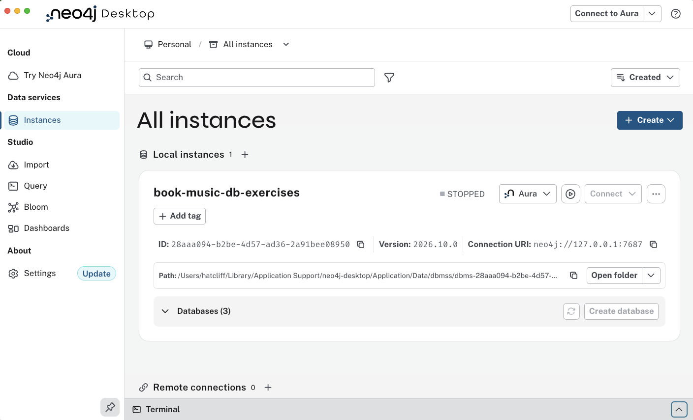

Read two things off the card of the instance you will use:

- the **version** (here 2026.10.0), and
- the **Connection URI**, `neo4j://127.0.0.1:7687`. Desktop does not say "Bolt"
  anywhere; the `neo4j://` scheme is what the MCP server will be given, and
  it works as written for a local instance.

Start the instance with its **Play** button if it shows STOPPED. Run one
instance at a time: two running instances compete for port 7687 and the second
one fails to start or moves to another port.

## 2 APOC, once per instance

**Why.** Since version 2.0.0 the Neo4j MCP server refuses to start against a
database that lacks APOC, and its `get-schema` tool is a call to
`apoc.meta.schema`. APOC is installed per instance, so you do this once and it
serves every database the instance holds.

Open the instance's menu (the three dots on the card) and choose **Plugins**.

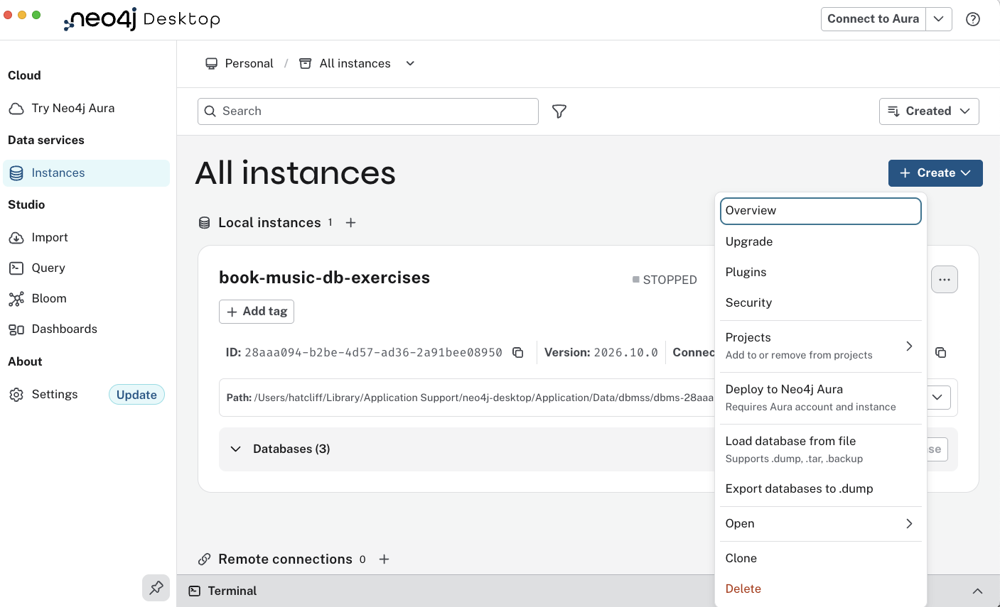

APOC is the first entry. Press **Install**.

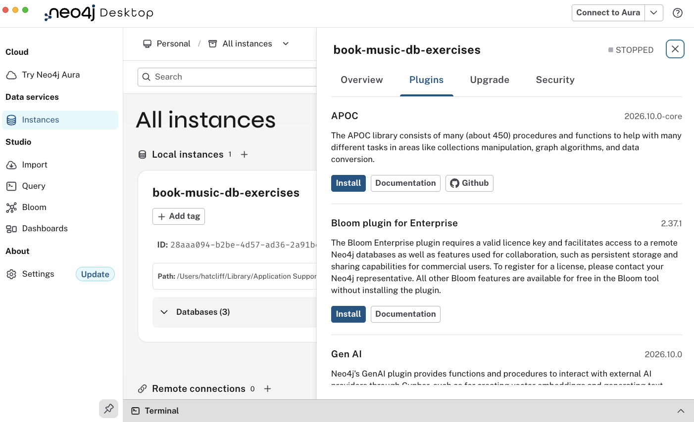

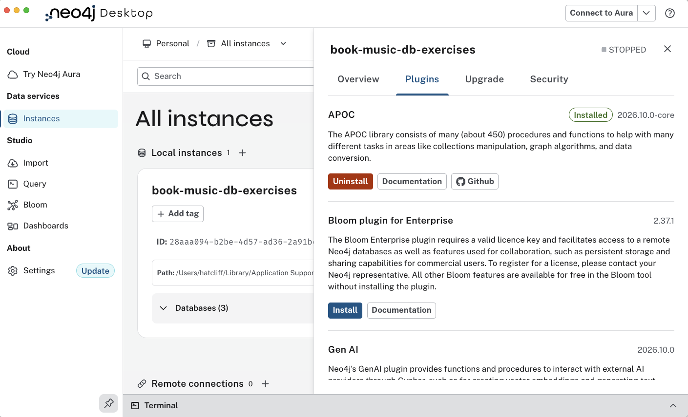

In the pilot the install completed in a second with the instance stopped, and
the plugin was active after the instance was started. If your instance was
running, stop it and start it again so the plugin loads. Desktop writes the
procedure permissions APOC needs into the instance configuration itself; you
do not edit any file.

Do **not** install Graph Data Science, even though the same tab offers it.
With it the server exposes a fourth tool, and your tool counts will differ
from the lecture's and from the checks in the homework.

### Verify APOC from the Query tool

Open **Query** from the left sidebar. The first time, press **Connect** on the
instance. The header then shows three selectors: Instance, Database, User.
Leave Database on `neo4j` for now. Run:

```cypher
SHOW PROCEDURES YIELD name WHERE name STARTS WITH 'apoc.meta.' RETURN name ORDER BY name;
```

Expect a list of names (`apoc.meta.data` … `apoc.meta.stats`).

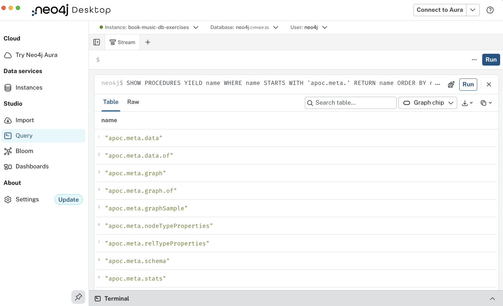

Then run:

```cypher
CALL apoc.meta.schema() YIELD value RETURN value;
```

On an empty database this returns one row holding an empty map, `{}`. That is
a pass.

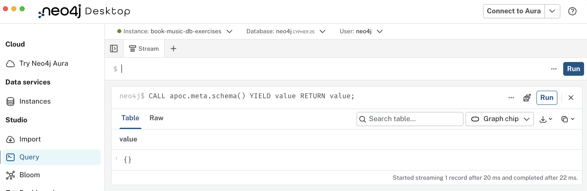

If instead you see an error mentioning *sandboxed* or *unrestricted*, the
instance did not get APOC's permissions. This did not happen in the pilot
with Desktop's installer. If it happens to you, stop the instance, add the
line `dbms.security.procedures.unrestricted=apoc.*` to the instance's
`conf/neo4j.conf`, start it, and rerun both queries.

## 3 One database per activity

**Why.** The edition Desktop installs supports several databases in one
instance. Each activity gets its own database, so loading or deleting one
activity's data never touches another's, and the MCP server is pointed at
exactly one of them.

In Query, run (any database selected):

```cypher
CREATE DATABASE music IF NOT EXISTS;
SHOW DATABASES YIELD name, currentStatus RETURN name, currentStatus;
```

When you paste two statements, Query runs both and shows a collapsed list of
results; open the second with **View results**.

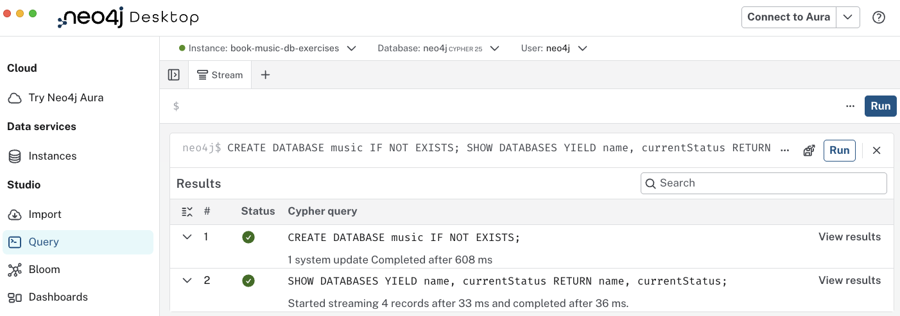

Expect `music` listed, first as `starting`, then `online` a moment later.

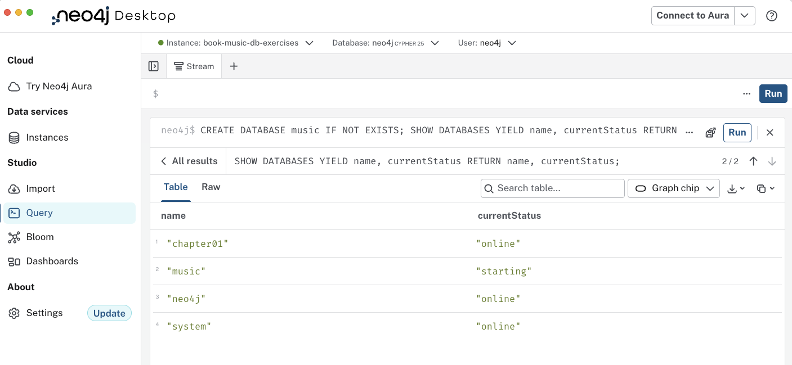

From now on, **whenever you run a query in Query, check the Database selector
in the header**. It defaults to `neo4j`. A query that returns nothing is very
often a query run against the wrong database.

For a later activity, replace `music` with that activity's name; everything
else in this guide stays the same.

## 4 The password stays in your shell

**Why.** The MCP server reads its connection details from environment
variables named `NEO4J_MCP_*`. Claude Code can copy variables from its own
environment into the server's when it starts it. So you set the variables in
a terminal, start Claude Code from that same terminal, and the password never
appears in a file, in the repository, or on screen.

Open a terminal and change to the directory of the activity (for the music
homework, the `exercise-neo4j-mcp/` folder of your course repository, which
the homework's README has you create). Then, in **zsh** (the macOS
default):

```sh
export NEO4J_MCP_URI='neo4j://127.0.0.1:7687'
export NEO4J_MCP_USERNAME='neo4j'
read -r -s 'NEO4J_MCP_PASSWORD?Password for neo4j: '; export NEO4J_MCP_PASSWORD; echo
```

In **bash**:

```sh
export NEO4J_MCP_URI='neo4j://127.0.0.1:7687'
export NEO4J_MCP_USERNAME='neo4j'
read -r -s -p 'Password for neo4j: ' NEO4J_MCP_PASSWORD; export NEO4J_MCP_PASSWORD; echo
```

In **PowerShell 7**:

```powershell
$env:NEO4J_MCP_URI = 'neo4j://127.0.0.1:7687'
$env:NEO4J_MCP_USERNAME = 'neo4j'
$env:NEO4J_MCP_PASSWORD = Read-Host -MaskInput 'Password for neo4j'
```

The `read` line waits for you to type the password and shows nothing while
you type. Desktop stores this password for its own connection, so you may not
have typed it since you created the instance. If you no longer know it, set a
new one in Query with the `system` database selected:

```cypher
ALTER USER neo4j SET PASSWORD 'your-new-password';
```

The variables last as long as this terminal window. If you open a new window
later, set them again. A wrong password shows up in step 6 as a server that
fails to connect; the fix is to retype it here.

## 5 The project entry

**Why.** Claude Code learns about MCP servers from a file named `.mcp.json`
in the project directory. One entry describes how to start the server and
what environment to give it. The entry below is the one general form used
throughout the course; between activities only `NEO4J_MCP_DATABASE` changes,
and between reading and writing only `NEO4J_MCP_READ_ONLY`.

Create `.mcp.json` in the activity directory with this content (the music
homework ships it as `.mcp.json.example`; copy it to `.mcp.json`):

```json
{
  "mcpServers": {
    "neo4j": {
      "type": "stdio",
      "command": "uvx",
      "args": ["neo4j-mcp-server@2.1.1"],
      "env": {
        "NEO4J_MCP_URI": "${NEO4J_MCP_URI:-neo4j://127.0.0.1:7687}",
        "NEO4J_MCP_USERNAME": "${NEO4J_MCP_USERNAME:-neo4j}",
        "NEO4J_MCP_PASSWORD": "${NEO4J_MCP_PASSWORD}",
        "NEO4J_MCP_DATABASE": "music",
        "NEO4J_MCP_READ_ONLY": "true",
        "NEO4J_MCP_TELEMETRY": "false"
      }
    }
  }
}
```

Field by field:

| Field | Meaning |
|---|---|
| `"neo4j"` | The name you give this server. It becomes the prefix of the tool names the model sees (`mcp__neo4j__read-cypher`) and the name `/mcp` shows. |
| `"type": "stdio"` | Claude Code starts a program and talks to it over its standard input and output. The adoption lecture's example used `"type": "http"` and a `url` instead; that is the only structural difference. |
| `"command"`, `"args"` | The program to start. `uvx` downloads the pinned server version once (about 10 MB, 1 to 2 seconds) and runs it; later starts take a fraction of a second. |
| `"env"` | The environment the server process receives. `${NAME}` is replaced by Claude Code with the value of `NAME` from the shell you started it in; `${NAME:-default}` uses the default when `NAME` is unset. This is Claude Code's syntax, not shell syntax, and not part of JSON. |
| `NEO4J_MCP_DATABASE` | The one database this server will query. The activity's name goes here. |
| `NEO4J_MCP_READ_ONLY` | `"true"` makes the server offer only `get-schema` and `read-cypher`. `"false"` adds `write-cypher`. The difference is visible in `/mcp` as a different tool count. |
| `NEO4J_MCP_TELEMETRY` | `"false"` stops the server from reporting usage to its vendor. |

The password is referenced, never written. `.mcp.json` is meant to be shared
in a repository; the shell variable is not.

### A companion file: `.claude/settings.json`

**Why.** In its prompting mode, Claude Code asks you before *every* tool call,
reads included, and a single question to the database can produce three or
four dialogs. The two read tools cannot change anything, so the course
pre-approves them and keeps the write tool behind a dialog. The music
homework package ships this file; for any other activity, create
`.claude/settings.json` in the activity directory:

```json
{
  "permissions": {
    "allow": ["mcp__neo4j__get-schema", "mcp__neo4j__read-cypher"]
  }
}
```

The tool names here are the model-visible names: `mcp__`, the server name,
two underscores, the tool name.

## 6 Start Claude Code and check the connection

From the terminal of step 4, in the activity directory:

```sh
claude --permission-mode manual
```

**Why the flag.** Claude Code has several permission modes. In *auto* mode,
which may be your default, it approves tool calls itself and you never see a
dialog, including for writes to the database. In *manual* mode it asks. The
line under the input box tells you which mode you are in; with the flag it
reads `manual mode on`. (Shift+Tab cycles modes inside a session.)

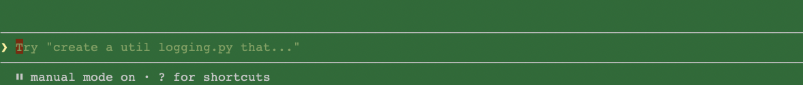

The first time Claude Code sees a project's `.mcp.json` it asks whether to use
the servers in it. Say yes for `neo4j`; the answer is recorded in
`.claude/settings.local.json`, which Claude Code creates for you.

Now type `/mcp`. You should see the `neo4j` server listed as connected. Select
it to see its detail, then its tools. In the read-only configuration there are
two:

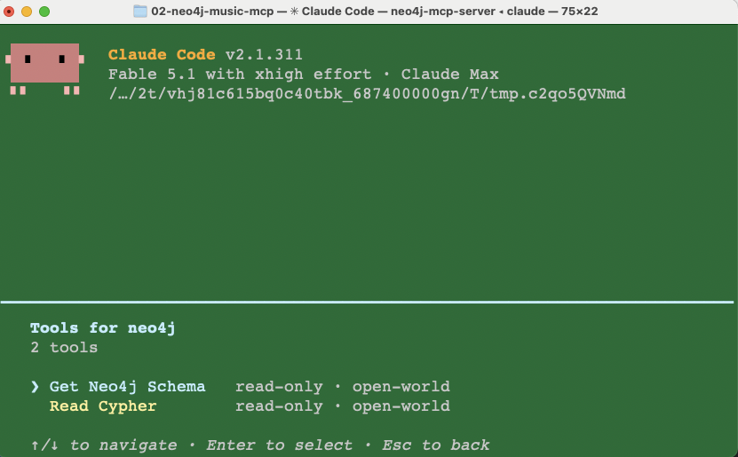

Select a tool to see its description and parameters; this is the contract the
model receives, taken from the server's `tools/list` answer.

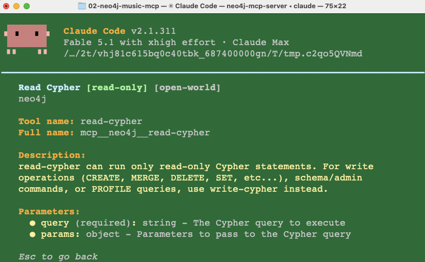

Press Esc to leave `/mcp`. Then ask for the schema before anything else:

> Use the neo4j server to get the schema of the database and summarize the
> node labels, relationship types, and their properties.

On an empty database the summary is short; that is correct. Once the activity's
data is loaded, this is also the first prompt of every session, because the
model writes better queries when it has seen the labels and properties rather
than guessed them.

The server logs one `ERROR` line about `gds.version` each time its tools are
listed when Graph Data Science is absent. It is noise, and it is why GDS is
not installed: the line is the server probing for the optional plugin.

## 7 When an activity asks for writes

Set `NEO4J_MCP_READ_ONLY` to `"false"`, exit Claude Code, and start it again
(the server is started when the session starts). `/mcp` now shows three tools.

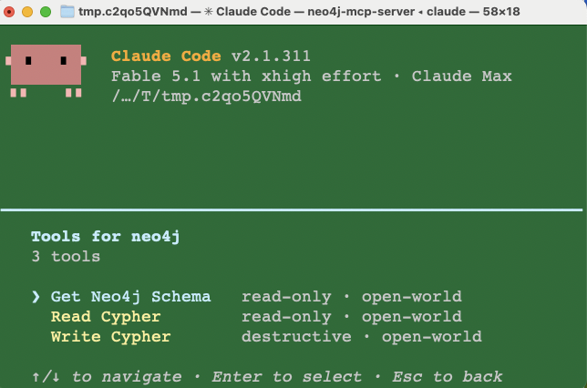

When the model requests `write-cypher` in manual mode, Claude Code stops and
shows the call, the full Cypher text, the tool's own description, and three
options:

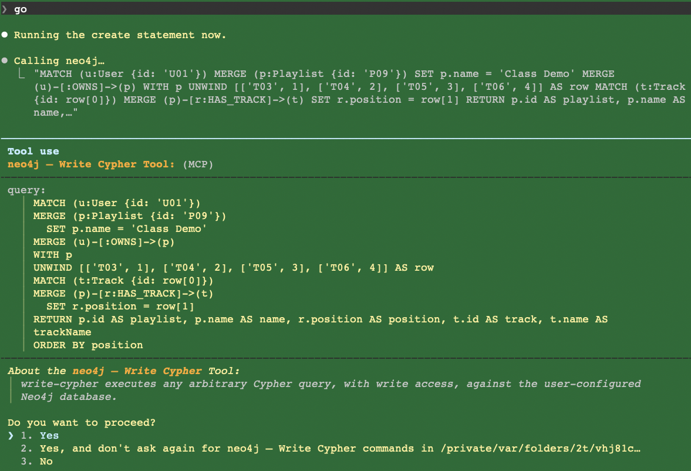

Read the Cypher. Choose **1. Yes** to run it this once. Do not choose the
"don't ask again" option for a write tool: it writes a permanent allow rule
into `.claude/settings.local.json`, and every later write runs without you
seeing it.

Two habits that the homework asks for and that serve any database:

- **Propose, review, run.** Ask for the Cypher first ("show me the Cypher and
  wait for my approval"). The model's question to you is a courtesy, not a
  control; the dialog is the control. Both are useful.
- **Verify outside the conversation.** After a write, read the result back in
  Desktop's Query tool (with the right database selected), or run the
  activity's check script. A model's report that a write succeeded is a claim
  to check, not a verification.

Three controls stand between the model and a change to your data, and each
one does something the others do not: the server flag (`NEO4J_MCP_READ_ONLY`)
decides whether a write tool exists at all; Claude Code's permission settings
decide whether the model may call it (a `permissions.deny` rule for
`mcp__neo4j__write-cypher` removes the tool from the model's catalogue,
although `/mcp` still lists it); and the database account's own privileges
decide what any client may do with that password. The last one is the only one
that holds whatever route a program takes to the database. Desktop's edition
has roles for it (a user granted the built-in `reader` role cannot write);
the course does not require you to set one up.

## 8 When it fails: which layer, and where to look

| What you see | Layer | What to do |
|---|---|---|
| `/mcp` opens with **MCP config diagnostics** and `Missing environment variables: NEO4J_MCP_PASSWORD`; the server shows as failed | Host configuration | You started Claude Code from a shell without the variable. Exit, run the step 4 lines, start again from that shell. |
| The server shows as failed and, after `/mcp` reconnect, `Failed to reconnect to neo4j: 0` | Database not reachable | The instance is stopped (Desktop card shows STOPPED, or another instance holds the port). Start it, then `/mcp` and reconnect. |
| Server fails right after start although the variable is set | Credentials | Wrong password. The database's `logs/security.log` says `failed to log in: invalid principal or credentials`. Retype it in step 4. |
| Server fails and the log mentions APOC | Instance plugins | APOC not installed or the instance not restarted after installing it. Step 2. |
| `/mcp` shows 2 tools, you expected 3 | Server configuration | `NEO4J_MCP_READ_ONLY` is `"true"`. Change it and restart Claude Code. |
| Model says it has no write tool although `/mcp` shows three | Host permission rules | A `permissions.deny` entry in a `settings.json` (project or user level) withholds the tool from the model. |
| Queries return nothing in Query | Query tool | The Database selector is on `neo4j`. Select the activity's database. |
| Rows are right, the explanation is wrong | Model | Not a setup failure. Keep the rows, correct the explanation, and note it in your evidence record. |
| Claude answers without calling the tool | Model selection | Name the server in the prompt ("use the neo4j server to…"). |

`/mcp` names the failing server but rarely the cause. Claude Code writes each
server's output and its own connection events to a per-project log; on macOS:

```text
~/Library/Caches/claude-cli-nodejs/<project-path-slug>/mcp-logs-neo4j/<timestamp>.jsonl
```

That is where the real message lives: for a stopped instance, `dial tcp
127.0.0.1:7687: connect: connection refused`; for a bad password,
`Neo.ClientError.Security.Unauthorized`. The instance's own `logs/` folder
(`security.log`, `query.log`) is the third place to look: `query.log` records
every statement the server ran, with the client identified as `Go Driver` and
the application as `MCP4NEO4J/2.1.1`, so it also answers the question "did a
tool call really reach the database?".

## 9 Stopping

Exit Claude Code with `/exit`. The MCP server process ends with the session.
The Neo4j instance keeps running until you stop it in Desktop: the **Stop**
button sits where Play was on the instance card. The password disappears when
you close the terminal. `.mcp.json` and `.claude/settings.json` stay in the
activity directory for next time; `.claude/settings.local.json` holds your
own choices and is not meant to be shared.

## 10 The same guide for another database

1. Start the one instance; APOC is already there.
2. `CREATE DATABASE <name> IF NOT EXISTS;` in Query, and select it in the
   Database selector before running anything against it.
3. Set the variables (step 4) in a terminal and start Claude Code from it.
4. Copy the `.mcp.json` entry with `NEO4J_MCP_DATABASE` set to `<name>`, and
   the `.claude/settings.json` with the two allow rules.
5. `claude --permission-mode manual`, approve the project server, `/mcp`,
   schema first.
6. Writes behind the dialog, proposed and reviewed before they run, checked
   afterwards in Query.
